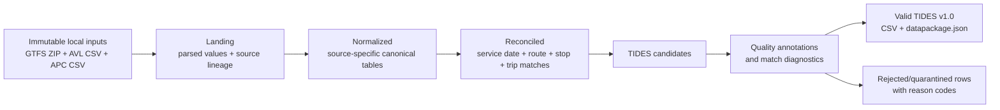

# TTC Offline TIDES Prototype

This directory is a documentation-first prototype for converting Toronto Transit Commission (TTC) GTFS, Automatic Vehicle Location (AVL), and Automatic Passenger Counter (APC) data into a [TIDES](https://tides-transit.org/) data package.

The project borrows the layered transformation and data-quality ideas from the [WMATA SMART Data Hub reference implementation](../wmata/sdh-open-source/), but it is intentionally much smaller. It is designed to prove data-matching and TIDES-conversion concepts on one machine using local files and Python. It is not a production TTC data platform, and it is not presented as an official TTC system.

> **Current status:** Experiment 05 provides a versioned, reproducible raw-to-TIDES batch pipeline for a selected date and route 29. CLI and browser use the same ten-stage implementation. Its scheduled assignments remain experimental model outputs, not independently validated ground truth or an official TTC publication. The earlier `ttc-tides` preprocessing CLI remains available separately.

Primary contact: to be assigned.

## Experiment 05: current batch pipeline

```sh
uv sync --frozen
./experiment05.sh availability
./experiment05.sh run --service-date 2023-11-06 --route-id 29 --match-mode all
./experiment05.sh web --port 8767
```

Open `http://127.0.0.1:8767`. Select an available date and `global`, `early`,
`middle`, `late`, or all four modes. Successful results are reused by their
input/code/config/feed fingerprint; `--force-rerun` requests a fresh run.
Supply the local raw inputs and GTFS archives described by
`config/experiment05-v1.toml`; they are not distributed in Git.

See the [design and stage/CLI/output contracts](docs/experiment05-design.md),
[plateau state definitions](docs/experiment05-platform.md), and
[TIDES export contract](docs/tides05-contract.md). Each run stores its summary,
validation, exact provenance and independent per-mode packages under
`outputs/experiment_05/runs/<run_id>/`.

## Frozen merge workbench (04c, based on 04)

Rebuild the 2023-11-06 / route 29 experiment directly from raw CSVs and open the
result viewer with `./workbench.sh run --serve --port 8780`. Use
`./workbench.sh serve` to inspect the retained 03d/04/04b/04c results on port 8767,
or `./workbench.sh verify` to check the frozen code and data identities.
These historical full-result commands require their original large outputs.
Experiment 05's allowlisted cleanup retires regenerable historical case,
overview and episode files; after retirement they must be rebuilt before full
historical browsing/verification. The pre-05 tag and minimal reproducibility
snapshot preserve the baseline, configs, tests, manifests and sample cases.
See [reproducible execution and retention](docs/frozen-workbench.md).
The [04c occurrence experiment](docs/experiment04c-occurrence-plausibility.md)
separates operational delay, local occurrence displacement and high-recall retrieval.
Its default prior is explicitly uncalibrated; independent held-out labels are absent.

## APC–AVL diagnostic study (2026-09-08)

The separately authorized [coverage study](experiments/apc_avl_coverage_study/README.md)
inspects the complete raw AVL/APC fixture and compares 21 segmentation, merge,
and threshold combinations without GTFS schedule matching. See its
[edge-case inventory](docs/apc-avl-raw-edge-cases-20260908.md),
[TIDES-based evaluation standard](docs/apc-avl-coverage-evaluation-standard.md),
and [method comparison](docs/apc-avl-method-comparison-20260908.md).
These are diagnostic source associations and experimental segments, not verified
performed trips or a production TIDES export. The existing production freeze
and prior human-label artifacts remain unchanged.

The subsequent [direct-evidence optimization](experiments/apc_avl_direct_evidence/README.md)
keeps those segmentation maps fixed and replaces only the observation merge
layer. It distinguishes endpoint-pair support, partial support and conflicting
evidence; see the [optimization report](docs/apc-avl-direct-evidence-optimization-20260908.md)
and [fixed-window robustness results](docs/apc-avl-direct-evidence-probes-20260908.md).

The [local merge-review website](tools/merge_review/README.md) provides a
vehicle-by-vehicle candidate-trip queue, linked map/timeline/time-distance
inspection, and separately persisted human notes for those frozen results.
Run `uv run --offline --no-sync python -m tools.merge_review.server` from this
directory, then open `http://127.0.0.1:8765`. This is inspection, not trip
certification or production reconciliation.

## Python environment

This project uses [uv](https://docs.astral.sh/uv/) as the only Python
environment and dependency manager. Python 3.12 is selected by
`.python-version`, dependencies are declared in `pyproject.toml`, and the
resolved environment is recorded in `uv.lock`. Do not maintain a parallel
`requirements.txt` or install project dependencies directly with `pip`.

From this directory, create or update the local `.venv` with:

```shell
uv sync
```

Run Python and development tools through uv so they always use the locked
environment:

```shell
uv run python --version
uv run ruff check .
uv run pytest
uv run ttc-tides --help
```

Use `uv add <package>` for a runtime dependency and `uv add --dev <package>`
for a development-only dependency. Commit both `pyproject.toml` and the updated
`uv.lock`. In automation, use `uv sync --frozen` to fail rather than changing a
stale lockfile.

## GTFS preprocessing

The implemented commands operate only on local files:

```shell
# Inspect local archives and immutable identities.
uv run ttc-tides gtfs inventory --gtfs-dir database_offline/gtfs

# Generate a manifest draft for human review; this does not approve it.
uv run ttc-tides gtfs manifest \
  --gtfs-dir database_offline/gtfs \
  --out artifacts/feed_manifest.draft.csv

# After reviewing a manifest and promoting intended rows to status=approved:
uv run ttc-tides gtfs select \
  --gtfs-dir database_offline/gtfs \
  --manifest config/feed_manifest.csv \
  --date 2023-11-05

uv run ttc-tides gtfs process \
  --gtfs-dir database_offline/gtfs \
  --manifest config/feed_manifest.csv \
  --date 2023-11-05 \
  --out artifacts/gtfs-2023-11-05

uv run ttc-tides gtfs evaluate \
  --gtfs-dir database_offline/gtfs \
  --all \
  --out artifacts/gtfs-quality
```

`candidate` rows from a generated draft are excluded by default. During
investigation only, `select` and `process` accept `--allow-candidate`; this is
an explicit override, not a substitute for reviewing feed provenance and
precedence. Generated outputs are rejected if they resolve inside the GTFS
source directory.

`process` writes typed, lineaged Parquet tables under `normalized/gtfs`, daily
services, scheduled trips/stop events, and versioned `p2` patterns under
`matched/gtfs`, plus quarantines and a JSON report under `quality`. See the
[GTFS implementation review](docs/gtfs-implementation-review.md) for algorithm
decisions, acceptance results, and known limits.

## Project intent

The prototype has three deliberate constraints:

1. **Offline first.** All source data comes from [`database_offline/`](database_offline/README.md). A run must not require a cloud service, commercial data platform, external database, or live API.
2. **Python transformations.** Source parsing, matching, transformation, validation, and export will be implemented in Python rather than dbt or SQL models.
3. **Proof before production.** The immediate goal is a reproducible, inspectable end-to-end conversion of the available TTC sample, not scheduling, incremental ingestion, operational monitoring, or production deployment.

## Scope

The first useful package should contain these TIDES v1.0 tables:

| TIDES table | Primary source | Prototype purpose |
| --- | --- | --- |
| `vehicle_locations` | AVL | Preserve timestamped GPS observations and enrich them with inferred service and trip context. |
| `passenger_events` | APC | Express positive boarding and alighting counts as stop-level passenger events. |
| `stop_visits` | APC, enriched by AVL and GTFS | Represent observed arrivals, departures, dwell, loads, boardings, and alightings by performed trip and stop. |
| `trips_performed` | Derived from AVL/APC and GTFS | Summarize each observed trip and its best scheduled-trip match. |
| `vehicles` | Distinct AVL/APC vehicle identifiers | Provide the supporting identifiers referenced by the event and summary tables. |

The output will also include `datapackage.json` and will be validated against the stable [TIDES v1.0](https://github.com/TIDES-transit/TIDES/releases/tag/v1.0) schemas. The implementation should pin that version rather than silently following the changing `main` branch.

Not in the initial scope:

- live ingestion or real-time outputs;
- a SQL warehouse, dbt project, DuckDB database, or cloud lakehouse;
- Dagster or another production orchestrator;
- dashboards, ridership metrics, or a serving API;
- rail, fare-payment, operator, or device enrichment not present in the local sources;
- claiming that every observation can be matched to a scheduled trip.

## Source snapshot

The current offline fixture is relatively large even though its operational scope is narrow:

| Source | Current content | Observed coverage | Approximate size |
| --- | --- | --- | ---: |
| AVL | 6,202,996 GPS rows; routes `29`, `929`, `PI`, and `PO`; 156 vehicles | 2023-11-01 through 2023-11-30 | 840 MB |
| APC | 573,596 stop observations; routes `29` and `929`; 148 vehicles; 103 source stop codes | Event timestamps from 2023-11-01 through 2023-12-01 | 97 MB |
| GTFS | 14 versioned ZIP archives, each containing eight core GTFS files | Calendar ranges from 2023-01-08 through 2024-01-06 | 441 MB compressed |

These figures describe the files currently in the working directory; they are not guarantees about future inputs. See [Source data audit](docs/source-data-audit.md) for field-level findings and known risks.

## Important findings before implementation

The source audit changes how the merge must be designed:

- AVL `tatripId` must **not** be renamed to TIDES `trip_id_scheduled`. None of the 3,133 distinct values in the AVL fixture match a trip in the GTFS feeds valid for November 2023. Sample values can collide with trip IDs in older feeds while describing unrelated routes, so equality would create false matches.
- APC `StopID` is functionally a GTFS `stop_code`, not a GTFS `stop_id`. Mapping it as `stop_id` directly would be wrong. Across the November feeds, 559,715 of 573,596 APC rows map by `stop_code`; one source code (`1652`) accounts for the remaining 13,881 rows and needs investigation or a controlled spatial fallback.
- GTFS `route_id` values change between feed versions, while AVL/APC contain public route labels such as `29` and `929`. Route matching must therefore use `route_short_name` plus the feed selected for the service date.
- GTFS archives overlap and do not contain `feed_info.txt`. The pipeline needs an explicit feed manifest and deterministic precedence rule; it cannot infer the active feed from the filename alone.
- APC contains 1,150 timestamps on 2023-12-01 even though the operational sample is described as November. Service date must be inferred using TTC-local time and candidate GTFS service days, including post-midnight service, rather than always using the timestamp's calendar date.
- AVL codes `PI` and `PO` appear to represent non-revenue activity, but their exact meaning must be confirmed before mapping them to TIDES `Pullin`, `Pullout`, or another `trip_type`.

## Architecture



The stages correspond to the useful parts of the WMATA staging/intermediate/quality/mart pattern, but each stage is a Python transformation over files:

1. **Landing:** read source files without changing their meaning; add source filename, archive hash, and row identity.
2. **Normalize:** parse types and names independently for GTFS, AVL, and APC. Preserve original values beside any interpreted value when meaning is uncertain.
3. **Reconcile:** select the correct GTFS feed, determine the service date, map public route and stop codes to version-specific GTFS IDs, segment performed trips, attach APC stops to AVL activity, and score candidate scheduled trips.
4. **Build TIDES candidates:** create only fields supported by the source or a documented derivation.
5. **Quality:** annotate every candidate with validity and match diagnostics. Invalid or low-confidence data is quarantined rather than silently discarded.
6. **Publish:** export valid TIDES CSV resources, a TIDES v1.0 `datapackage.json`, and a run report.

Intermediate data should use Parquet, partitioned by source and service date. Final TIDES resources should use the CSV/data-package representation expected by the specification. The GTFS stage uses Python 3.12, Polars transformations, PyArrow/Parquet intermediates, and pytest. Frictionless is reserved for future TIDES package validation. SQL is not a transformation layer.

See [Architecture and data contracts](docs/architecture.md) for matching rules, identifiers, lineage, quality behavior, and artifact boundaries.

## Merge strategy

Schedule matching is the central investigation, not a simple join. A detailed, reviewable implementation plan for the full GTFS/AVL/APC-to-TIDES merge — stage specifications, WMATA logic transplant map, identifiers, configuration, tests, and milestones — is drafted in [Merge implementation plan](docs/merge-implementation-plan.md).

### 1. Select GTFS by service date

Build a manifest for every archive containing its SHA-256, observed calendar range, acquisition or publication timestamp when known, and precedence. Expand `calendar.txt` plus `calendar_dates.txt` to determine active services. If more than one feed covers a date, select the highest-priority known revision and record the decision on every downstream row.

For the current November fixture, the archives beginning `cdab5829...` and `7ecc0186...` appear to be the relevant revisions for November 1–18 and November 19 onward, respectively. This is an initial hypothesis based on calendar ranges and archive member dates; it must be recorded and confirmed in the manifest rather than embedded in code.

### 2. Normalize source identity

- Map AVL/APC route labels to the selected feed's `routes.route_short_name`, then carry the corresponding version-specific `route_id`.
- Map APC `StopID` to `stops.stop_code`, then output the associated `stops.stop_id`.
- Retain AVL `tatripId` as source evidence only, for example `source_tatrip_id`; never treat it as a GTFS foreign key without an independently verified mapping.
- Preserve source row identifiers so any TIDES row can be traced back to its AVL or APC record.

### 3. Infer service date and performed trips

AVL `Date_Key` is the primary service-date candidate and must be checked against its timestamp. APC has no explicit service date, so compare the timestamp against both the local calendar date and the prior date's GTFS service, including GTFS times after `24:00:00`.

Performed-trip segmentation should use a documented combination of vehicle, source route/run context, direction or destination changes, time gaps, terminal behavior, and the ordered APC stop sequence. `trip_id_performed` must be deterministic for the same input and configuration.

### 4. Match scheduled trips with evidence

Candidate GTFS trips should be restricted by selected feed, active service, route, direction, time window, and compatible stop order. Score the remaining candidates using scheduled-time difference and observed stop-sequence agreement. A match should carry internal fields such as `match_method`, `match_score`, and `match_status`.

Only a unique, sufficiently confident result becomes `trip_id_scheduled`. Ambiguous and unmatched cases retain a valid performed-trip identity while leaving scheduled fields null where the TIDES schema permits it.

### 5. Merge APC with AVL

Attach an APC observation to the performed AVL trip for the same vehicle when their time intervals overlap and the AVL path is spatially compatible with the APC stop. This supplies trip context to stop-level APC data without pretending that timestamp equality exists. Conflicts and many-to-many candidates go to the quality layer.

## Quality and observability

Every stage must produce machine-readable counts and reason codes. At minimum, a run report should show:

- input rows, parsed rows, duplicates, and rejected rows by source;
- selected GTFS feed by service date;
- APC stop-code mapping rate and fallback rate;
- performed trips detected;
- scheduled-trip matches by `matched`, `ambiguous`, and `unmatched` status;
- APC-to-AVL attachment rate;
- TIDES rows written by resource;
- schema-validation results and referential-integrity failures.

Structural failures such as a missing required source column should stop the run. Record-level problems should normally be quarantined with their source lineage so the prototype can continue and expose the size of the issue.

## Repository structure

```text
agencies/ttc/
├── .python-version            # Python version selected by uv
├── pyproject.toml             # Project dependencies and tool configuration
├── uv.lock                    # Reproducible resolved dependency set
├── README.md                 # Scope, architecture, and roadmap
├── database_offline/         # Immutable local GTFS/AVL/APC inputs
│   ├── gtfs/
│   ├── avl/
│   └── apc/
├── config/                   # Future feed manifest and explicit mappings
├── docs/                     # Architecture, source audit, and decisions
│   └── decisions/
├── src/ttc_tides/            # Implemented GTFS package; future source stages join here
├── tests/unit/               # Fast synthetic GTFS tests
└── artifacts/                # Generated local intermediates, TIDES output, and reports
```

The local source data and generated artifacts are intentionally excluded from Git. Only documentation, configuration, code, and small synthetic test fixtures should be committed.

## Roadmap

1. **Document and profile:** agree on source semantics, GTFS precedence, TIDES v1.0 pin, and success metrics.
2. **Ingest and normalize:** GTFS is implemented with streamed ZIP reads, source contracts, lineage, quarantine, and normalized Parquet; AVL/APC and a persisted landing layer remain.
3. **Prepare GTFS:** implemented for feed metadata, daily service, scheduled trips, scheduled stop times, stop patterns, and quality reporting; manifest approval remains a data-governance gate.
4. **Build AVL trips:** emit base vehicle locations and deterministic performed-trip segments.
5. **Reconcile APC:** map stop codes, infer service dates, attach APC observations to performed trips, and match scheduled trips.
6. **Build TIDES:** generate `vehicles`, `vehicle_locations`, `passenger_events`, `stop_visits`, and `trips_performed`.
7. **Validate and report:** produce the v1.0 data package, quarantine tables, quality metrics, and reproducible end-to-end tests.

The full proof of concept is successful when one offline command can rebuild the November GTFS+AVL+APC sample deterministically, validate the resulting TIDES v1.0 package, report all unmatched or rejected data, and avoid any unrecorded row loss. The GTFS-only command exists; the multi-source TIDES command does not yet.

## Open decisions

- Who owns and confirms the GTFS feed manifest and TTC source-field semantics?
- What are the exact operational meanings of `Run`, `tatripId`, `Branch`, `PI`, `PO`, `NoTrips`, `AvgOTP`, and `AvgSample`?
- Is APC `Boarding`/`Alighting` a total across doors? If so, should it be represented only as aggregate `passenger_events`, or also mapped by convention to `stop_visits.boarding_1` and `alighting_1`?
- What service-day cutoff or TTC scheduling rule should be used when schedule matching cannot resolve a post-midnight event?
- Is stop code `1652` absent because of a temporary stop/feed mismatch, and is its APC coordinate reliable enough for a versioned spatial crosswalk?
- What confidence threshold is acceptable for publishing `trip_id_scheduled`?
- May the offline source files be redistributed, or must they remain strictly local?

These questions are deliberately visible. The prototype should encode a decision only after it is documented in `docs/decisions/`.

## References

- [TIDES v1.0 release](https://github.com/TIDES-transit/TIDES/releases/tag/v1.0)
- [TIDES architecture](https://tides-transit.org/v1.0/architecture/)
- [TIDES table schemas](https://tides-transit.org/v1.0/tables/)
- [TIDES data-package format](https://tides-transit.org/v1.0/datapackage/)
- [GTFS Schedule reference](https://gtfs.org/documentation/schedule/reference/)
- [WMATA SMART Data Hub reference implementation](../wmata/sdh-open-source/)
