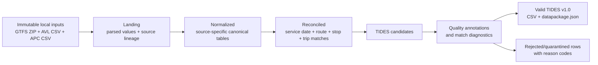

# TTC Offline TIDES Prototype

This directory is a local research prototype for converting Toronto Transit
Commission (TTC) GTFS, Automatic Vehicle Location (AVL), and Automatic Passenger
Counter (APC) data into a [TIDES](https://tides-transit.org/) data package. It
borrows the layered transformation and data-quality ideas of the
[WMATA SMART Data Hub reference implementation](../wmata/sdh-open-source/) at a
much smaller scale, testing data-matching and TIDES-conversion approaches on one
machine from local files in Python. It is not a production TTC data platform,
and it is not presented as an official TTC system.

> **Current status:** Experiment 05 provides a versioned, reproducible
> raw-to-TIDES batch pipeline for a selected service date and route 29, and has
> been run end to end for 2023-11-06 and 2023-11-20. CLI and browser use the
> same ten-stage implementation. Its scheduled assignments remain experimental
> model outputs, not independently validated ground truth or an official TTC
> publication. The earlier `ttc-tides` preprocessing CLI remains available
> separately.

Primary contact: Jiahao (GitHub [@codedai](https://github.com/codedai)).

**Status, timeline, open decisions, plan, risks and the documentation map live
in [PROJECT_STATUS.md](PROJECT_STATUS.md).** This README covers what the
directory is and how to run it.

## Experiment 05: current batch pipeline

```sh
uv sync --frozen
./experiment05.sh availability
./experiment05.sh run --service-date 2023-11-06 --route-id 29 --match-mode all
./experiment05.sh web --port 8767
```

Open `http://127.0.0.1:8767`. Select an available date and `global`, `early`,
`middle`, `late`, or all four modes. Successful results are reused by their
input/code/config/feed fingerprint; `--force-rerun` requests a fresh run.
Supply the local raw inputs and GTFS archives described by
`config/experiment05-v1.toml`; they are not distributed in Git.

After a run, open its read-only trip inspector: vehicle/direction filters,
previous/next trip, geographic AVL/canonical-stop map, AVL/APC interval timeline,
and per-reference time–distance panels with up to three saved GTFS candidates.
Schedules use their original unshifted times. Trip windows offer full extent or
5/15/30/60/120 minutes with horizontal pan; the day overview offers full extent
or 30/60/120/240 minutes. The overview is separated by direction and reference,
showing the assigned schedule or a labeled diagnostic rank-1 fallback. Reference
metre axes are not interchangeable; multi-panel appearances are not extra trips.
Opening or changing a view does not rerun matching or modify published outputs.
The local map has no external street basemap. Unattached APC has counts and audit
downloads, not a dedicated orphan-row explorer.

The ten stages are `load_raw` → `normalize` → `event_timeline` → `project_avl` →
`segment_trips` → `attach_apc` → `generate_candidates` → `assign_scheduled` →
`map_tides` → `validate_publish`. The partial modes use chronological thirds of
valid projected travel distance, not equal elapsed-time thirds or new trip boundaries.
Input selection is a Toronto local calendar day; previous-service-day hypotheses
remain diagnostics, not a complete cross-midnight operating-day reconstruction.
Three-round one-to-one assignment is an Experiment 05 operating assumption, not
a TIDES requirement: TIDES permits multiple performed trips per scheduled trip.
`ASSIGNED` is not a calibrated `MATCHED` claim; unassigned scheduled fields are null.

Each run stores its summary, validation, exact provenance and independent
per-mode packages under `outputs/experiment_05/runs/<run_id>/`. That directory
is gitignored: run evidence exists only on the machine that produced it.

The [APC stop-visit and passenger-event policy](docs/experiment05-apc-events.md)
documents the current `apc_stop_interval_departure_proxy_v1` export convention:
one uniquely attached APC row is one observed stop-visit hypothesis; positive
integer visit totals become aggregate passenger events timestamped at departure,
not individually measured passenger times. Vehicle arrival/departure events use
their respective source timestamps, and door-specific counts remain null. Current
2023-11-06 policy packages contain 38,211 event rows per mode, not 38,211
passengers; historical 2023-11-20 packages retain their original export policy.

Further reading: the [design and stage/CLI/output contracts](docs/experiment05-design.md),
[plateau state definitions](docs/experiment05-platform.md),
[TIDES export contract](docs/tides05-contract.md),
[diagnostic output schema](docs/experiment05-output-schema.md),
[read-only visualization guide](docs/experiment05-visualization.md),
[TIDES compliance and evidence-boundary audit](docs/experiment05-tides-compliance.md),
and the [pipeline overview and cross-agency comparison](docs/ttc-tides-pipeline-and-comparison.md),
which explains the algorithms end to end and reports the measured results for
2023-11-06 and 2023-11-20.

## Frozen merge workbench (04c, based on 04)

Rebuild the 2023-11-06 / route 29 experiment directly from raw CSVs and open the
result viewer with `./workbench.sh run --serve --port 8780` when the frozen
release inputs are available; `./workbench.sh verify` checks code, configuration,
dependency and raw-input identities before anything runs.
`config/workbench-release.json` selects the SHA-256-locked release under
`releases/` — currently `workbench-04c-20261021T013832-cddd406e`, re-cut on
2026-10-20 from the English-only sources and recorded there with `release.json`
SHA-256 `1e922fa9…`. `releases/` holds exactly that release plus the hash-locked
`pre-experiment-05-20260910` minimal reproducibility snapshot; the six
superseded 2026-09-10 releases were removed on 2026-10-20 and remain in git
history at commit `878089a`. A release cut from the current sources has new
provenance and is not claimed to be byte-identical to any 2026-09-10 release;
see [PROJECT_STATUS.md section 5.3](PROJECT_STATUS.md#53-frozen-release-pointer).

Historical 03d/04/04b/04c full-result browsing is no longer available from the
retired outputs: the approved cleanup removed 1,252 regenerable case, overview
and episode files (14,127,707,246 logical bytes). Do not treat the preserved
historical output hashes as a currently passing full output inventory. Full
browsing or verification requires regeneration first, which has new provenance
and is not claimed to be byte-identical. `./workbench.sh serve` and
`./experiment05.sh web` both default to port 8767, so only one of them can hold
it; pass `--port` (for example `./workbench.sh serve --port 8781`) to run both.

See [reproducible execution and retention](docs/frozen-workbench.md). The
[04c occurrence experiment](docs/experiment04c-occurrence-plausibility.md)
separates operational delay, local occurrence displacement and high-recall
retrieval; its default prior is explicitly uncalibrated, independent held-out
labels are absent, and [what calibration would require](docs/experiment04c-calibration-inputs.md)
is specified separately. The preceding steps are
[04 continuous matching](docs/experiment04-continuous-matching.md) and
[04b delay weights](docs/experiment04b-delay-weights.md).

## APC–AVL diagnostic study (2026-09-08)

The [coverage study](experiments/apc_avl_coverage_study/README.md) inspects the
complete raw AVL/APC fixture and compares 21 segmentation, merge, and threshold
combinations without GTFS schedule matching. Its authorization is a chat
instruction recorded in its own README and in no decision record; the gap is
tracked in [PROJECT_STATUS.md section 7](PROJECT_STATUS.md#7-open-decisions). See its
[edge-case inventory](docs/apc-avl-raw-edge-cases-20260908.md),
[TIDES-based evaluation standard](docs/apc-avl-coverage-evaluation-standard.md),
and [method comparison](docs/apc-avl-method-comparison-20260908.md).
These are diagnostic source associations and experimental segments, not verified
performed trips or a production TIDES export. The existing production freeze
and prior human-label artifacts remain unchanged.

The subsequent [direct-evidence optimization](experiments/apc_avl_direct_evidence/README.md)
keeps those segmentation maps fixed and replaces only the observation merge
layer. It distinguishes endpoint-pair support, partial support and conflicting
evidence; see the [optimization report](docs/apc-avl-direct-evidence-optimization-20260908.md)
and [fixed-window robustness results](docs/apc-avl-direct-evidence-probes-20260908.md).
Direct-support coverage collapses under a ±60-second APC clock shift, so clock
consistency between the two sources remains a separate, unconfirmed gate.

The [local merge-review website](tools/merge_review/README.md) provides a
vehicle-by-vehicle candidate-trip queue, linked map/timeline/time-distance
inspection, and separately persisted human notes for those frozen results.
Run `uv run --offline --no-sync python -m tools.merge_review.server` from this
directory, then open `http://127.0.0.1:8765`. This is inspection, not trip
certification or production reconciliation; the stored notes are unblinded and
must not be used as labels.

## Python environment

This project uses [uv](https://docs.astral.sh/uv/) as the only Python
environment and dependency manager. Python 3.12 is selected by
`.python-version`, dependencies are declared in `pyproject.toml`, and the
resolved environment is recorded in `uv.lock`. Do not maintain a parallel
`requirements.txt` or install project dependencies directly with `pip`.

From this directory, create or update the local `.venv` with:

```shell
uv sync
```

Run Python and development tools through uv so they always use the locked
environment:

```shell
uv run python --version
uv run ruff check .
uv run pytest
uv run ttc-tides --help
```

Use `uv add <package>` for a runtime dependency and `uv add --dev <package>`
for a development-only dependency. Commit both `pyproject.toml` and the updated
`uv.lock`. In automation, use `uv sync --frozen` to fail rather than changing a
stale lockfile. Test-suite commands and their current counts are listed in
[PROJECT_STATUS.md](PROJECT_STATUS.md#49-test-suites).

## GTFS preprocessing

The implemented commands operate only on local files:

```shell
# Inspect local archives and immutable identities.
uv run ttc-tides gtfs inventory --gtfs-dir database_offline/gtfs

# Generate a manifest draft for human review; this does not approve it.
uv run ttc-tides gtfs manifest \
  --gtfs-dir database_offline/gtfs \
  --out artifacts/feed_manifest.draft.csv

# After reviewing a manifest and promoting intended rows to status=approved:
uv run ttc-tides gtfs select \
  --gtfs-dir database_offline/gtfs \
  --manifest config/feed_manifest.csv \
  --date 2023-11-05

uv run ttc-tides gtfs process \
  --gtfs-dir database_offline/gtfs \
  --manifest config/feed_manifest.csv \
  --date 2023-11-05 \
  --out artifacts/gtfs-2023-11-05

uv run ttc-tides gtfs evaluate \
  --gtfs-dir database_offline/gtfs \
  --all \
  --out artifacts/gtfs-quality
```

`candidate` rows from a generated draft are excluded by default. During
investigation only, `select` and `process` accept `--allow-candidate`; this is
an explicit override, not a substitute for reviewing feed provenance and
precedence. No approved `config/feed_manifest.csv` exists yet. Generated outputs
are rejected if they resolve inside the GTFS source directory.

`process` writes typed, lineaged Parquet tables under `normalized/gtfs`, daily
services, scheduled trips/stop events, and versioned `p2` patterns under
`matched/gtfs`, plus quarantines and a JSON report under `quality`. See the
[GTFS implementation review](docs/gtfs-implementation-review.md) for algorithm
decisions, acceptance results, and known limits. `ttc-tides diagnostic run`
additionally executes the provisional S0–S2 AVL/APC landing and normalization
stages authorized by [ADR 0002](docs/decisions/0002-merge-plan-review-disposition.md);
no later stage of the governed merge plan exists in `src/ttc_tides`.

## Project intent

The prototype has three deliberate constraints, fixed by
[ADR 0001](docs/decisions/0001-offline-python-prototype.md) (2026-08-05) and
restated authoritatively in
[PROJECT_STATUS.md section 1](PROJECT_STATUS.md#1-purpose-and-scope):

1. **Offline first.** All source data comes from [`database_offline/`](database_offline/README.md). A run must not require a cloud service, external database, or live API.
2. **Python transformations.** Source parsing, matching, transformation, validation, and export are implemented in Python rather than dbt or SQL models.
3. **Proof before production.** The immediate goal is a reproducible, inspectable end-to-end conversion of the available TTC sample, not scheduling, incremental ingestion, operational monitoring, or production deployment.

## Scope

The current Experiment 05 package supports these TIDES v1.0 tables:

| TIDES table | Primary source | Prototype purpose |
| --- | --- | --- |
| `vehicle_locations` | AVL | Preserve timestamped GPS observations and enrich them with inferred service and trip context. |
| `passenger_events` | APC | Record vehicle arrival/departure and positive integer visit-level boarding/alighting totals under the explicit departure-proxy policy. |
| `stop_visits` | APC attached to AVL segments | Represent source arrivals, departures and dwell; no AVL-only stop reconstruction, door-count invention or automatic scheduled-stop mapping. |
| `trips_performed` | Derived from AVL/APC and GTFS | Summarize each observed segment and its mode-specific scheduled assignment, if any. |
| `vehicles` | Distinct AVL/APC vehicle identifiers | Provide the supporting identifiers referenced by the event and summary tables. |

The `passenger_events` convention is specified in the
[APC stop-visit and passenger-event policy](docs/experiment05-apc-events.md) and
measured in the [compliance audit](docs/experiment05-tides-compliance.md); the
resource list in the [TIDES export contract](docs/tides05-contract.md) predates
that policy and does not yet name the table.

The output includes `datapackage.json` and is validated against pinned [TIDES v1.0](https://github.com/TIDES-transit/TIDES/releases/tag/v1.0) schemas with additional cross-table checks. Formal validation does not validate source semantics, inferred boundaries or scheduled assignments. `devices` is vendored but never populated, and device identifiers are left empty.

Not in the initial scope:

- live ingestion or real-time outputs;
- a SQL warehouse, dbt project, DuckDB database, or cloud lakehouse;
- Dagster or another production orchestrator;
- production dashboards, ridership metrics, or a public serving API (a local diagnostic web UI is provided);
- rail, fare-payment, operator, or device enrichment not present in the local sources;
- claiming that every observation can be matched to a scheduled trip.

## Source snapshot

The current offline fixture is relatively large even though its operational scope is narrow:

| Source | Current content | Observed coverage | Approximate size |
| --- | --- | --- | ---: |
| AVL | 6,202,996 GPS rows; routes `29`, `929`, `PI`, and `PO`; 156 vehicles | 2023-11-01 through 2023-11-30 | 840 MB |
| APC | 573,596 stop observations; routes `29` and `929`; 148 vehicles; 103 source stop codes | Event timestamps from 2023-11-01 through 2023-12-01 | 97 MB |
| GTFS | 14 versioned ZIP archives, each containing eight core GTFS files | Calendar ranges from 2023-01-08 through 2024-01-06 | 441 MB compressed |

These figures describe the files currently in the working directory; they are not guarantees about future inputs. See [Source data audit](docs/source-data-audit.md) for field-level findings and known risks, and [PROJECT_STATUS.md section 4.1](PROJECT_STATUS.md#41-source-audit-and-gtfs-preprocessing) for the same figures in their project context.

## Important findings before implementation

The source audit changes how the merge must be designed:

- AVL `tatripId` must **not** be renamed to TIDES `trip_id_scheduled`. None of the 3,133 distinct values in the AVL fixture match a trip in the GTFS feeds valid for November 2023. Sample values can collide with trip IDs in older feeds while describing unrelated routes, so equality would create false matches.
- APC `StopID` is functionally a GTFS `stop_code`, not a GTFS `stop_id`. Mapping it as `stop_id` directly would be wrong. Across the November feeds, 559,715 of 573,596 APC rows map by `stop_code`; one source code (`1652`) accounts for the remaining 13,881 rows and needs investigation or a controlled spatial fallback.
- GTFS `route_id` values change between feed versions, while AVL/APC contain public route labels such as `29` and `929`. Route matching must therefore use `route_short_name` plus the feed selected for the service date.
- GTFS archives overlap and do not contain `feed_info.txt`. The pipeline needs an explicit feed manifest and deterministic precedence rule; it cannot infer the active feed from the filename alone.
- APC contains 1,150 timestamps on 2023-12-01 even though the operational sample is described as November. Experiment 05 currently selects a Toronto local calendar day and only its active GTFS service; previous-day hypotheses are diagnostic. A complete cross-midnight operating-day policy remains an open decision.
- AVL codes `PI` and `PO` appear to represent non-revenue activity, but their exact meaning must be confirmed before mapping them to TIDES `Pullin`, `Pullout`, or another `trip_type`.

## Architecture

The layered design below is the contract of the governed
[merge implementation plan](docs/merge-implementation-plan.md), not a
description of what runs today. `src/ttc_tides` implements only GTFS
preprocessing and the S0–S2 landing and normalization stages; the end-to-end
path is implemented separately by Experiment 05 under `tools/experiment05/`.
[`docs/architecture.md`](docs/architecture.md) predates Experiment 05, still
describes reconciliation, TIDES construction and publication as planned, and
contains a DST statement the independent review marked factually false — see
[PROJECT_STATUS.md section 6](PROJECT_STATUS.md#6-work-in-progress-and-unfinished-items).



The stages correspond to the layers of the WMATA staging/intermediate/quality/mart pattern that apply at this scale, but each stage is a Python transformation over files:

1. **Landing:** read source files without changing their meaning; add source filename, archive hash, and row identity.
2. **Normalize:** parse types and names independently per source, preserving original values beside any interpreted value when meaning is uncertain.
3. **Reconcile:** select the GTFS feed, determine the service date, map public route and stop codes to version-specific GTFS IDs, segment performed trips, attach APC stops to AVL activity, and score candidate scheduled trips.
4. **Build TIDES candidates:** create only fields supported by the source or a documented derivation.
5. **Quality:** annotate every candidate with validity and match diagnostics; quarantine invalid or low-confidence data instead of discarding it silently.
6. **Publish:** export valid TIDES CSV resources, a TIDES v1.0 `datapackage.json`, and a run report.

Intermediates use Parquet under immutable run/stage directories; final TIDES resources are CSV data packages. The implementation uses Python 3.12, Polars, PyArrow, pytest and Frictionless validation of both in-memory resources and written CSVs. SQL is not a transformation layer.

See [Architecture and data contracts](docs/architecture.md) for matching rules, identifiers, lineage, quality behavior, and artifact boundaries.

## Merge strategy

Schedule matching is the central investigation, not a simple join. The full
GTFS/AVL/APC-to-TIDES merge — stage specifications, WMATA logic transplant map,
identifiers, configuration, tests and milestones — is specified in the
[merge implementation plan](docs/merge-implementation-plan.md), whose stages from
S3 onward are frozen pending re-review. Experiment 05 and that governed plan are
two distinct tracks; where they differ, both positions are stated below.

**1. Select GTFS by service date.** Manifest every archive with its SHA-256,
observed calendar range, acquisition or publication timestamp when known, and
precedence; expand `calendar.txt` plus `calendar_dates.txt` for active services;
when feeds overlap a date, take the highest-priority known revision and record
the decision on every downstream row. Each run manifest pins the selected feed
identity and hash; archive-name heuristics are not used. The manifest is still a
draft, and Experiment 05 enables candidate feeds in configuration — a research
override, not agency approval of feed precedence.

**2. Normalize source identity.** Map AVL/APC route labels through the selected
feed's `routes.route_short_name` to its version-specific `route_id`, and APC
`StopID` through `stops.stop_code` to `stops.stop_id`. Keep AVL `tatripId` as
source evidence only; it is never a GTFS foreign key without an independently
verified mapping. Preserve source row identifiers so any TIDES row traces back
to its AVL or APC record.

**3. Infer service date and performed trips.** Experiment 05 selects AVL by
`Message_DateTime` (`Date_Key` as a missing-time fallback) and APC by arrival
time (departure fallback) inside the requested local calendar day. Resolved times
use UTC seconds; ambiguous or nonexistent local times are flagged, not guessed;
previous-day hypotheses are retained but never retrieved as scheduled candidates;
GTFS times beyond `24:00:00` are not wrapped. Segmentation combines vehicle,
source route/run context, direction or destination changes, time gaps, terminal
behavior and the ordered APC stop sequence; `trip_id_performed` is deterministic
for the same input and configuration.

**4. Match scheduled trips with evidence.** Candidates are restricted by
selected feed, active service, route, direction, time window and compatible stop
order, then scored on scheduled-time difference and observed stop-sequence
agreement, carrying internal `match_method`, `match_score` and `match_status`
fields. Experiment 05 freezes those rankings, then runs three locked, monotone
one-to-one assignment rounds over the top three candidates with no calibrated
score threshold; the scorer's diagnostic confidence status stays separate, and
unassigned cases keep their performed-trip identity with null scheduled fields.
Assignment alone is not proof of correctness.

**5. Merge APC with AVL.** An APC observation attaches to the performed AVL trip
of the same vehicle when their time intervals overlap and the AVL path is
spatially compatible with the APC stop; this supplies trip context without
pretending timestamp equality exists, and conflicts or many-to-many candidates go
to the quality layer. In the ten-stage pipeline this attachment precedes
scheduled matching. Current defaults allow a 120-second interval-to-trip gap and
at most 1,800 seconds of APC service interval; where comparable nearby AVL
exists, its minimum canonical progress error must be within 200 metres, and the
absence of nearby AVL is a weaker-evidence ranking fallback, not observed spatial
agreement. One unique attached source row and stop ID yields one visit;
`visit_merge_gap_s` is unused and merges nothing. `trip_stop_sequence` is observed
arrival/departure/source-row order, not GTFS `stop_sequence`, and without an
explicit scheduled-stop occurrence mapping the scheduled stop sequence and
planned stop times stay null.

## Quality and observability

This is the governed merge plan's run-report contract, not the Experiment 05
output schema. Every stage must produce machine-readable counts and reason codes.
At minimum, a run report should show:

- input rows, parsed rows, duplicates, and rejected rows by source;
- selected GTFS feed by service date;
- APC stop-code mapping rate and fallback rate;
- performed trips detected;
- scheduled-trip assignment outcomes (`ASSIGNED` / `UNMATCHED` in Experiment 05;
  `matched`, `ambiguous`, `unmatched` in the governed plan's diagnostics);
- APC-to-AVL attachment rate;
- TIDES rows written by resource;
- schema-validation results and referential-integrity failures.

Structural failures such as a missing required source column should stop the run. Record-level problems should normally be quarantined with their source lineage so the prototype can continue and expose the size of the issue.

## Repository structure

The dated and sized directory layout is maintained in one place,
[PROJECT_STATUS.md section 10.1](PROJECT_STATUS.md#101-directory-layout-working-tree-2026-10-20).
This is the short orientation:

- `README.md`, `PROJECT_STATUS.md` — this entry point; status, timeline, open
  decisions, plan and risks.
- `experiment05.sh`, `workbench.sh` — launchers for the Experiment 05 pipeline
  and the frozen merge workbench.
- `.python-version`, `pyproject.toml`, `uv.lock` — the locked Python 3.12
  environment.
- `config/` — Experiment 05 configuration, the feed-manifest boundary and the
  frozen-release pointer.
- `src/ttc_tides/` — GTFS preprocessing CLI and the S0–S2 diagnostic runner.
- `tools/` — Experiment 05 pipeline, merge-review workbench, labeling UI v1 and
  the exported label summaries.
- `experiments/` — R1 design spikes, labeling UI v2, APC–AVL studies.
- `docs/`, `docs/decisions/` — architecture, source audit, experiment reports,
  ADR 0001 to 0003.
- `schemas/` — vendored, hash-pinned TIDES v1.0 schemas.
- `tests/` — synthetic, regression and browser checks.
- `releases/` — the selected frozen workbench release and the
  pre-experiment-05 reproducibility snapshot.
- `database_offline/`, `artifacts/`, `outputs/` — local raw inputs, generated
  artifacts and Experiment 05 runs. Their contents are gitignored: raw CSV and
  ZIP under `database_offline/`, all of `artifacts/` except its README, and all
  of `outputs/`. Only the `database_offline/README.md` and
  `artifacts/README.md` placeholders are tracked.

The local source data and generated artifacts are intentionally excluded from
Git. Only documentation, configuration, code, and small synthetic test fixtures
should be committed.

## Status, roadmap and open decisions

Maintained in [PROJECT_STATUS.md](PROJECT_STATUS.md); a decision is encoded in
the code only after it is recorded in [`docs/decisions/`](docs/decisions/).

## References

- [TIDES v1.0 release](https://github.com/TIDES-transit/TIDES/releases/tag/v1.0)
- [TIDES architecture](https://tides-transit.org/v1.0/architecture/)
- [TIDES table schemas](https://tides-transit.org/v1.0/tables/)
- [TIDES data-package format](https://tides-transit.org/v1.0/datapackage/)
- [GTFS Schedule reference](https://gtfs.org/documentation/schedule/reference/)
- [WMATA SMART Data Hub reference implementation](../wmata/sdh-open-source/)
