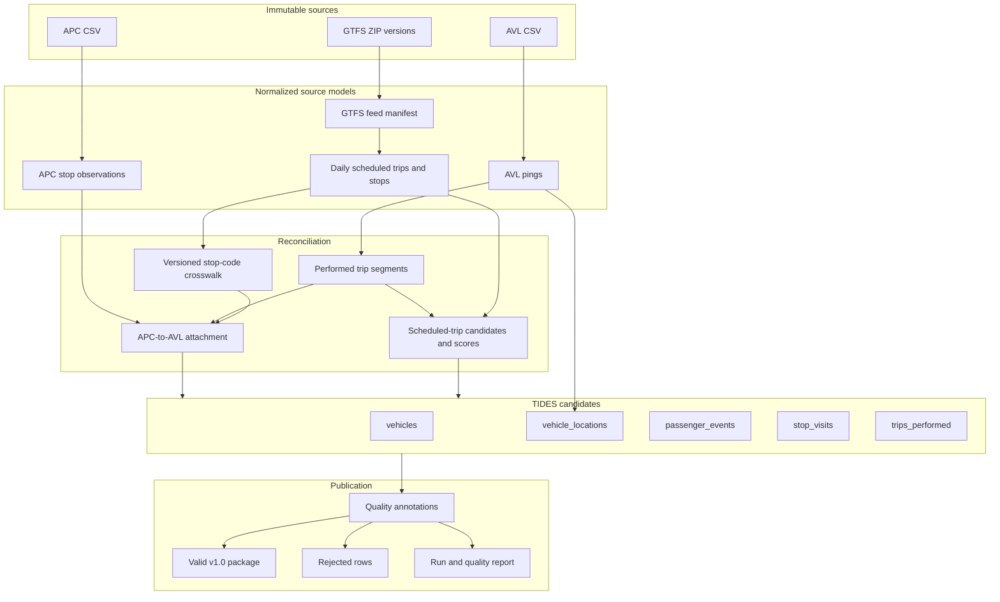

# Architecture and data contracts

## Status

This document is the design contract for the prototype. The GTFS preprocessing
subset is implemented; AVL/APC ingestion, cross-source reconciliation, TIDES
construction, and publication remain planned. See the
[GTFS implementation review](gtfs-implementation-review.md) for the verified
behavior and current limitations of that subset.

## Design principles

1. **Offline and reproducible:** the same inputs, configuration, and code must produce the same identifiers and outputs without network access.
2. **Python owns transformations:** SQL may be used later for ad hoc inspection, but it is not an implementation or dependency layer.
3. **Immutable raw inputs:** source files are never modified in place.
4. **Lineage before convenience:** every normalized, matched, rejected, and published row is traceable to source file hashes and source row numbers.
5. **No guessed foreign keys:** source values become GTFS or TIDES identifiers only through an explicit, tested mapping.
6. **Version-aware GTFS:** every GTFS-derived identifier is interpreted within a selected feed and service date.
7. **Uncertainty is data:** ambiguous matching is retained as a diagnostic state, not hidden behind an arbitrary choice.
8. **Valid output, inspectable loss:** the published package contains valid rows; quarantined rows and reason counts explain everything excluded.

## Adaptation of the WMATA design

| WMATA reference concept | TTC prototype adaptation |
| --- | --- |
| Source ingestion assets | Python readers over local immutable files |
| Iceberg/object storage | Partitioned local Parquet artifacts |
| dbt staging models | Source-specific Python normalization |
| dbt intermediate models | Small, named Python transformations with explicit input/output contracts |
| dbt quality models | Annotated quality datasets plus valid and rejected outputs |
| dbt marts | TIDES CSV resources and `datapackage.json` |
| Dagster orchestration | A future single-process Python CLI with ordered stages |
| OpenMetadata/warehouse lineage | File hashes, row lineage, run manifest, and quality report |
| Production schedules and sensors | Out of scope |

The conceptual layers are reused; the production platform is not.

## Logical data flow

## Artifact layers

Artifacts are generated locally and are not committed.

| Layer | Format | Contract |
| --- | --- | --- |
| `landing/` | Parquet | Parsed source columns plus lineage; minimal semantic transformation. |
| `normalized/` | Parquet | Stable snake-case fields and physical types; one source domain per dataset. |
| `matched/` | Parquet | Service, stop, performed-trip, and scheduled-trip candidates with evidence and scores. |
| `quality/` | Parquet/JSON | Candidate TIDES rows with validity flags, reason codes, and aggregate metrics. |
| `tides/` | CSV/JSON | Only canonical TIDES v1.0 resources and `datapackage.json`. |
| `reports/` | JSON/Markdown | Run manifest, counts, timing, hashes, configuration, and validation summary. |

Parquet intermediates should be partitioned by source and `service_date` when available. The 840 MB AVL CSV must be scanned lazily or in batches; the implementation must not depend on loading the complete expanded dataset into memory.

## Common lineage contract

Every landing row should have internal metadata equivalent to:

| Field | Meaning |
| --- | --- |
| `_source_type` | `gtfs`, `avl`, or `apc` |
| `_source_file` | Path relative to `database_offline/` |
| `_source_file_sha256` | Hash of the exact source archive/file |
| `_source_member` | Member name for a GTFS ZIP; null for standalone CSV |
| `_source_row_number` | One-based data-row number within the member/file |
| `_ingest_run_id` | Identifier for the local pipeline run |
| `_record_id` | Deterministic hash of source hash, member, and row number |

Downstream aggregations should retain a source-record count and either the contributing `_record_id` values or a deterministic link table. TIDES exports omit these internal columns, but the quality artifacts keep the association.

## Source normalization contracts

### GTFS

- Hash the original ZIP and inventory its members.
- Preserve all source identifiers as strings even when they look numeric.
- Parse GTFS dates and times according to GTFS rules, including times at or beyond 24 hours.
- Expand `calendar.txt` and apply `calendar_dates.txt` exceptions.
- Derive a daily view of scheduled trips and stop times for only the feed selected for each service date.
- Derive `pattern_id` deterministically from the ordered stop path and route/direction context; do not use `shape_id` as an assumed synonym.
- Record all overlapping-feed candidates and the rule that chose one.

### AVL

- Strip the UTF-8 byte-order mark from the first header without altering data values.
- Parse `Message_DateTime` as a naive TTC-local timestamp, then attach the `America/Toronto` timezone for comparison and export.
- Treat `Date_Key` as the source service-date candidate and report inconsistencies with timestamp-derived candidates.
- Convert `KPH` to TIDES meters per second only at the TIDES candidate stage; retain the original value in normalized data.
- Keep `tatripId` as `source_tatrip_id`. It is neither `trip_id_performed` nor `trip_id_scheduled`.
- Preserve `Route`, `Run`, `Destination`, `OffRoute`, and `Delayed` as matching evidence.
- Treat `PI`/`PO` as unconfirmed categorical values until a documented mapping is approved.

### APC

- Drop or rename the unnamed first CSV column only after preserving it as the source export row identifier.
- Parse arrival and departure as TTC-local timestamps and require departure not to precede arrival unless a documented midnight repair applies.
- Treat `StopID` as `source_stop_code`; map it through the selected GTFS feed's `stops.stop_code` to obtain TIDES `stop_id`.
- Preserve APC latitude/longitude for verification and controlled fallback, not as automatic proof of a GTFS stop.
- Treat `Boarding`, `Alighting`, `Arrload`, and `Depload` as observed counts. Their door-level semantics remain an open decision.
- Treat `AvgDwell`, `AvgOTP`, `AvgSample`, and `NoTrips` as source fields whose aggregation semantics need confirmation before TIDES mapping.

## GTFS feed selection

The future `config/feed_manifest.csv` is the authority for archive precedence. It should include at least:

- relative path and SHA-256;
- a stable `feed_id`;
- calendar minimum and maximum;
- acquisition timestamp and publication timestamp, if known;
- explicit priority or supersedes relationship;
- notes and approval status.

Selection algorithm:

1. Find manifests whose expanded services include the service date.
2. Exclude revisions marked invalid or superseded for that date.
3. Choose the highest explicit priority; do not use lexical filename order.
4. Fail on an unresolved tie.
5. Record `feed_id` and selection reason on every GTFS-derived matched row.

This avoids using changing GTFS IDs without their version context.

## Time and service-date contract

- The canonical local timezone is IANA `America/Toronto`; exports use timezone-aware ISO 8601 datetimes.
- A timestamp's calendar date is not automatically its service date.
- AVL first uses `Date_Key`, validated against the selected GTFS service.
- APC evaluates at least two candidates: local calendar date and previous local date.
- Candidate service dates are scored with active GTFS service, scheduled trip times (including values beyond 24:00), stop order, and vehicle-trip context.
- A configurable fallback cutoff may be introduced only after TTC operational semantics are confirmed.
- DST gaps and folds must be explicit test cases even though the current November fixture does not span the fall transition date.

## Identifier contract

Source and derived identifiers remain strings in all layers.

- `location_ping_id`: deterministic hash of AVL source lineage; unique across the package.
- `passenger_event_id`: deterministic hash of APC source lineage plus event type.
- `trip_id_performed`: deterministic hash of service date, vehicle, and stable segment evidence. It must not depend on processing order or a random UUID.
- `trip_id_scheduled`: exact GTFS `trips.trip_id` from the selected feed, populated only for a sufficiently confident unique match.
- `route_id`: exact GTFS `routes.route_id` from the selected feed, reached through `route_short_name` or the scheduled-trip match.
- `stop_id`: exact GTFS `stops.stop_id` from the selected feed, normally reached through APC `StopID` to GTFS `stop_code`.
- `pattern_id`: deterministic derived identifier for an ordered stop path; its algorithm and namespace must be versioned.
- `vehicle_id`: normalized string form of the source vehicle identifier.

## Performed-trip segmentation

Segmentation is expected to evolve through experiments. Its contract is more important than its first algorithm:

1. Order observations by service-date candidate, vehicle, timestamp, and stable source-row tie-breaker.
2. Form candidate runs using route, `Run`, direction/destination evidence, time gaps, terminal behavior, and source state changes.
3. Use APC ordered stops to refine start/end boundaries when attached to AVL.
4. Never merge observations across incompatible route or service-date evidence.
5. Emit a reason for each boundary and a segmentation version.
6. Re-running the same version on the same inputs must create identical `trip_id_performed` values.

The initial implementation should compare several simple boundary rules on a small day before selecting one for the full month.

## Scheduled-trip matching

For each performed trip, generate candidates from the selected GTFS feed and active service date. Filter, then score:

1. exact public route match;
2. compatible direction, branch/headsign, or destination evidence;
3. temporal overlap with scheduled start/end;
4. ordered stop overlap and sequence consistency;
5. aggregate absolute arrival/departure-time difference;
6. spatial compatibility when stop identity is missing.

Internal output fields should include:

- `match_status`: `matched`, `ambiguous`, or `unmatched`;
- `match_method` and algorithm version;
- best and second-best scores;
- score margin;
- candidate count;
- evidence counts such as matched stops and time residuals;
- rejection or ambiguity reasons.

A threshold and minimum margin must be configuration, tested against reviewed examples. Low confidence must result in a null `trip_id_scheduled`, not a forced selection.

## APC-to-AVL attachment

An APC stop observation can be attached to an AVL performed trip when:

- vehicle identifiers agree;
- service-date candidates are compatible;
- the APC arrival/departure interval overlaps the trip interval within a configured tolerance;
- route evidence agrees; and
- nearby AVL pings are spatially compatible with the mapped GTFS stop or APC coordinates.

The attachment is one APC record to at most one performed trip. Ties are ambiguous. The attachment score and candidate count remain in matched/quality artifacts.

## TIDES construction notes

- `vehicle_locations` is generated at AVL ping grain. Stop and scheduled-trip fields may be null when not supported confidently.
- `passenger_events` is generated only after the APC record has a valid performed trip and positive boarding/alighting activity. One APC record may create a boarding event, an alighting event, both, or neither.
- `stop_visits` is generated at one performed-trip/visited-stop grain. Duplicate APC observations for the same visit require an explicit aggregation rule.
- `trips_performed` is derived from the final performed-trip segments and their best GTFS match.
- `vehicles` contains the union of valid vehicle identifiers referenced by published tables. Unknown descriptive attributes remain null.
- Canonical TIDES CSV files contain only TIDES fields. TTC/source extensions stay in diagnostic artifacts.

Whether aggregate APC boardings map into the door-specific `boarding_1`/`alighting_1` fields is intentionally unresolved. The implementation must not imply door-level precision without confirmation.

## Quality contract

Quality checks fall into three classes:

### Fatal run checks

- source file missing or unreadable;
- required source columns absent or duplicated;
- unresolved GTFS feed-precedence tie;
- incompatible configured TIDES schema version;
- output path would overwrite immutable input.

### Record quarantine checks

- invalid timestamp, coordinates, count, or identifier;
- duplicate source record;
- APC stop code cannot be mapped safely;
- impossible arrival/departure ordering;
- performed-trip assignment is ambiguous;
- required TIDES relationship cannot be constructed.

### Warnings and metrics

- scheduled trip unmatched or low confidence where TIDES allows null;
- AVL marked off-route;
- source service date differs from inferred date;
- load arithmetic is inconsistent with boarding/alighting;
- large temporal or spatial residuals;
- unusual ping gaps or stop-sequence discontinuities.

Each reason has a stable code, human description, severity, stage, and count. The valid output should be derived only from the annotated candidate dataset so no separate filter logic can drift from quality reporting.

## Reproducibility and run manifest

Each run report should record:

- code version and dirty-worktree state when available;
- TIDES schema reference (`v1.0` for the initial prototype);
- Python and dependency versions;
- configuration hashes;
- input paths, sizes, and SHA-256 hashes;
- selected GTFS feed per service date;
- stage row counts and artifact hashes;
- matching/segmentation algorithm versions;
- start/end timestamps and outcome;
- Frictionless validation results.

No timestamp or random value should participate in a published record identifier.

## Test strategy

The implementation should start with small synthetic fixtures that exercise:

- overlapping and superseded GTFS feeds;
- `calendar_dates.txt` additions/removals;
- GTFS times beyond 24 hours;
- changing `route_id` with stable `route_short_name`;
- repeated `stop_code` or missing code mappings;
- loop routes and repeated stops;
- ambiguous scheduled trips;
- trips spanning midnight;
- duplicate AVL pings and APC records;
- missing/invalid coordinates and counts;
- DST gap and fold behavior;
- deterministic IDs across repeated runs;
- TIDES v1.0 schema and cross-resource integrity.

A reduced, redistributable TTC-like integration fixture should be created from synthetic values rather than committed source extracts unless redistribution permission is confirmed.
