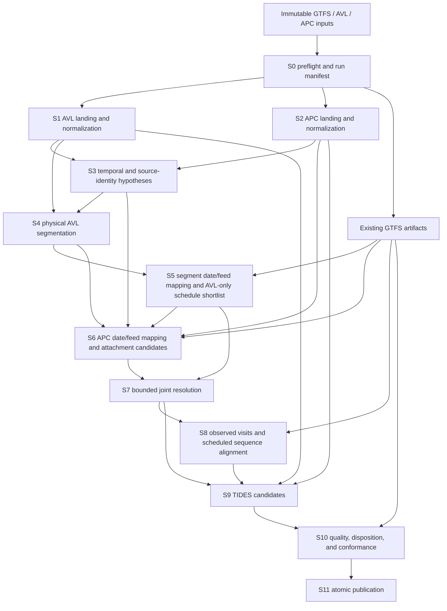

# Implementation plan: merging TTC GTFS, AVL, and APC into TIDES v1.0

- Status: **architecture approved; revised per review blockers R1–R6, awaiting
  section-scoped re-review of the changed sections** (see
  [merge-plan-review.md](merge-plan-review.md) and
  [ADR 0002](decisions/0002-merge-plan-review-disposition.md)). Provisional,
  non-publishable S0–S2 diagnostic work is authorized; S3 and all downstream
  publication-bound work are frozen until the re-review passes.
- Last revised: 2026-08-06 (R1–R6 revision)
- Last reviewed: 2026-08-06
- Scope: the unimplemented AVL/APC reconciliation and TIDES publication work;
  the GTFS preprocessing stage already exists
- Governing documents: [Architecture and data contracts](architecture.md),
  [Source data audit](source-data-audit.md), and
  [ADR 0001](decisions/0001-offline-python-prototype.md)
- Reference implementation: the local
  [WMATA SMART Data Hub](../../wmata/sdh-open-source/warehouse/models/)
- Normative schema: TIDES tag `v1.0`, peeled commit
  [`b2cb23178e00cb58dbdb1b9a5a8626818278ecbb`](https://github.com/TIDES-transit/TIDES/tree/b2cb23178e00cb58dbdb1b9a5a8626818278ecbb/spec)

This is a documentation-only implementation plan. It defines what must be
learned, decided, built, measured, and reviewed before the prototype can claim
to publish TIDES. It does not approve unconfirmed TTC source interpretations,
and it does not treat a technically valid CSV as semantically correct data.

The plan deliberately optimizes for an offline, inspectable proof of concept.
It does not reproduce WMATA's warehouse, dbt, orchestration, or production
platform.

---

## 1. Executive design decision

The merge will be implemented as an **acyclic evidence pipeline**:

1. preserve source records and normalize only known syntax;
2. generate explicit timestamp and source-identity hypotheses;
3. form physical AVL segments without assuming a scheduled trip or service
   date;
4. generate service-date/feed/mapping hypotheses at the latest useful grain
   (segment for AVL, observation for APC) and an AVL-only scheduled-trip
   shortlist;
5. generate APC-to-segment candidates;
6. resolve a bounded combination of service date, attachment, and scheduled
   trip once, retaining every candidate and score;
7. construct only the TIDES resources permitted by confirmed source semantics;
8. publish only after schema, lineage, referential-integrity, and decision
   gates pass.

This structure replaces the former S4→S5→S7 cycle, in which service-date
resolution required a feed-specific stop mapping, stop mapping required a
resolved service date, and service-date scoring also depended on APC
attachment. It also avoids forcing APC attachment before schedule matching or
schedule matching before attachment. A schedule-independent shortlist is
created first; a finite joint resolution follows. There is no open-ended
iteration.

Five principles are non-negotiable:

- **Evidence is not identity.** `Date_Key`, `tatripId`, `Run`, `Branch`, route
  labels, and destination text remain evidence until their meanings are
  validated.
- **Uncertainty is an output.** Low-margin and conflicting candidates remain
  unresolved; the pipeline never chooses merely to maximize coverage.
- **Source grain controls publication.** APC-derived TIDES resources are
  blocked until the meaning of `AvgSample`, `NoTrips`, and the count fields is
  established.
- **GTFS identifiers are feed-scoped.** A `route_id`, `stop_id`, `trip_id`, or
  `pattern_id` is never interpreted without `feed_id` and service date in the
  internal model.
- **WMATA supplies patterns, not TTC truth.** Its deterministic ordering,
  layering, and quality annotations are useful. Its CAD trip context, service
  cutoff, duplicate aggregation, and operational enums are not transferable
  without TTC evidence.

## 2. Review evidence and corrections to the earlier draft

The following measurements are fixture-specific observations, not universal
input guarantees. They are recorded because they materially change the plan.

| Finding from the current offline fixture | Design consequence |
| --- | --- |
| All 6,202,996 AVL `Date_Key` values equal the calendar date of `Message_DateTime`. Exactly 1,105 `(vehicle, tatripId)` groups span two `Date_Key` values; of these, at least 266 continue contiguously across midnight (consecutive pings ≤ 60 minutes apart — the count is identical at 5/15/30/60-minute thresholds), while the remaining 839 are cross-day reuse of the same `(vehicle, tatripId)`. | Rename the normalized field to `source_date_key`; do not use it as an authoritative service date or split a trip at its boundary. The 266 genuine crossings alone prove `Date_Key` changes mid-trip. |
| The 14,591 observed `(vehicle, tatripId)` groups include 1,930 that contain more than one route label, and some IDs recur across many days. | `tatripId` is a noisy boundary feature, never a partition key, identifier, or GTFS key. Changes must be debounced and calibrated. |
| AVL and APC contain 156 and 148 vehicles respectively; 147 normalized strings overlap, with 9 AVL-only and 1 APC-only. | Exact string equality is the first vehicle-identity hypothesis, not proof that every identifier is globally equivalent. Preserve source-specific IDs and report unmatched sets. |
| APC has 573,596 rows: `AvgSample=1` for 528,370, `2` for 45,020, and `4` for 206. | APC cannot be declared one-row-per-stop-visit until the export contract is confirmed. APC-derived passenger events and stop visits have a blocking source-grain gate. |
| Ignoring the export index, there are no exact full-payload APC duplicates, but 450 pairs share `(vehicle, route, stop, arrival, departure)` while differing elsewhere. | A visit-key collision is not a duplicate and must not be summed automatically. Preserve both records and resolve their semantics. |
| `Depload = Arrload + Boarding - Alighting` is exact for 567,627 rows and differs for 5,969; the largest absolute difference is 47. | Load conservation is a quality signal with reviewed tolerances, not a destructive normalization rule. |
| The fixture includes the 2023-11-05 fall-back hour: 3,831 AVL rows and 425 APC rows occur during local 01:00–01:59. AVL has 653 same-vehicle/local-timestamp collision groups in that hour. | A default `fold=0` would invent instants. Ambiguous local times retain both UTC candidates until sequence or cross-source evidence resolves them; unresolved records cannot publish a timestamped TIDES event. |
| APC runs through 2023-12-01 02:14:41, while AVL ends at 2023-11-30 23:59:59. | Month processing needs boundary-aware input windows and must report right-censored AVL/APC reconciliation; it must not require every December 1 APC row to belong to November 30 service. |

The standards review also corrects two earlier assumptions:

- TIDES v1.0 explicitly permits multiple performed trips to reference one
  `trip_id_scheduled`. Global one-to-one scheduled-trip assignment is
  therefore invalid as a default.
- TIDES resources are individually optional. A valid AVL-core package can be
  published without APC-derived resources if the chosen package profile and
  all references are valid. Semantic incompleteness must be disclosed in the
  run report.

Before implementation of S3 and later stages starts, the README, architecture
document, and source audit must be aligned with the approved decisions in this
plan. This alignment is an **M0 deliverable** (§15), and the complete list of
passages that must change is enumerated in **Appendix C** — including the
architecture document's factually incorrect claim that the fixture does not
span the DST fall-back date. The documents must not continue to describe
`Date_Key` as the primary resolved service date after the fixture evidence
above is accepted.

## 3. Scope and publication profiles

### 3.1 In scope

- offline inventory, landing, and normalization of the supplied AVL and APC
  CSV files;
- deterministic source lineage and record disposition;
- local-time/DST and service-date hypothesis handling;
- version-aware vehicle, route, and stop reconciliation;
- AVL performed-segment detection;
- scheduled-trip candidate generation and calibrated matching;
- APC-to-AVL attachment when APC grain permits it;
- TIDES v1.0 candidate construction, validation, and local publication;
- machine-readable quality, candidate, lineage, and run reports;
- synthetic, fixture-level, calibration, determinism, and performance tests.

### 3.2 Publication profiles

Publication is capability-based rather than all-or-nothing.

| Profile | Outputs | Minimum semantic gates (explicit IDs) |
| --- | --- | --- |
| `diagnostic` | Normalized Parquet, hypotheses, candidates, dispositions, and reports; no TIDES conformance claim | Structural source contracts only |
| `avl-core-v1` | `vehicles`, `vehicle_locations`, eligible `trips_performed`, and `datapackage.json` | G0.1 (TIDES pin), G0.2 / D-15 (GTFS manifest), G0.3 / D-16 (time contract incl. D-05 DST), D-04 (no unapproved cutoff), D-14 (segmentation and matching thresholds via §11). Vehicle identity within the AVL namespace only — the cross-namespace decision D-12 does **not** block this profile. |
| `apc-enriched-v1` | AVL core plus eligible `passenger_events` and `stop_visits` | All `avl-core-v1` gates plus G0.4 / D-06 (APC grain), D-07 (collision additivity), G0.7 / D-08 (count semantics and event-time proxy), D-09 (load/door fields), D-10 (stop-mapping exceptions), G0.5 / D-12 (vehicle namespace equivalence), and attachment thresholds under D-14 |

Gate names in this table are exhaustive ID lists, not prose categories, so M0
review of a profile is mechanical: every listed ID must be closed or
explicitly waived with recorded residual risk.

Rows that cannot support a trip may still be eligible for `vehicle_locations`
because its trip and service-date fields are optional in TIDES v1.0. Project
policy requires `service_date` whenever `trip_id_performed` is populated, and
every populated performed-trip reference must resolve to a published
`trips_performed` composite key.

### 3.3 Out of scope

- production scheduling, incremental ingestion, cloud services, SQL/dbt, or
  a persistent database;
- GTFS-realtime and live APIs;
- fare transactions, faregate data, rail, dashboards, and NTD metrics;
- per-ping stop imputation as a default feature;
- inventing source semantics to increase match or publication rates;
- redistributing raw TTC data or generated vehicle traces without approval.

## 4. Gate 0: contracts and decisions required before implementation

Diagnostic normalization may begin with open semantic questions. Publication
work may not begin until its blocking gates have an owner, evidence, decision,
and review date recorded in the decision register.

Each gate carries a **closure class**: class **I** (internally closable —
evidence from the fixture, the spec, or the codebase plus project-owner
approval, with residual risk recorded) or class **E** (requires external TTC
or data-owner authority; remains open-blocking until such an owner exists).

| Gate | Class | Required artifact | Blocks | Register |
| --- | --- | --- | --- | --- |
| G0.1 TIDES pin | I | Vendored v1.0 schemas from commit `b2cb…`, upstream URL, license/attribution, file SHA-256 values, and a field-level conformance matrix | Every publish profile | D-01 |
| G0.2 GTFS manifest | I | Approved feed precedence and coverage for every candidate service date, including boundary dates; approver defaults to the project owner with residual risk recorded | GTFS mapping, matching, and publication | D-15 |
| G0.3 Time contract | I | Documented basis for each timestamp (fixture evidence: `Date_Key` equals the local calendar date on all rows, supporting naive local wall time), DST behavior, precision, and clock source; residual risk of the local-time interpretation recorded | Timestamped publication and cross-source attachment | D-05, D-16 |
| G0.4 APC grain | E | Define one source row, `NoTrips`, `AvgSample`, averages, rounding, and whether counts are totals or estimates | `passenger_events` and `stop_visits` | D-06 |
| G0.5 Vehicle identity | I (AVL namespace) / E (cross-namespace) | AVL-namespace normalization is internal; any AVL↔APC equivalence claim beyond exact-string identity requires reviewed evidence | Cross-namespace: APC attachment and the `apc-enriched-v1` profile only. Single-namespace `vehicles` for `avl-core-v1` is **not** blocked. | D-12 |
| G0.6 Operational fields | E | Confirm or reject meanings of `Run`, `tatripId`, `Branch`, `RouteDirection`, `PI`, and `PO` | Only features or TIDES fields that use them | D-11 |
| G0.7 APC event policy | E | Decide event timestamp proxy, aggregate-count representation, load use, and door-field policy | APC-derived TIDES resources | D-08, D-09 |
| G0.8 Data governance | E (redistribution) / I (local handling) | Redistribution, retention, access, logging, vehicle-ID handling, and the provenance/terms of the current fixture | Publication outside the local workspace | D-13 |

**Ownership fallback.** Decision ownership defaults to the project owner (the
maintainer of `agencies/ttc`) for every class-I gate. Class-E gates remain
open-blocking until a TTC data owner exists; this single point of failure is
carried in the §17 risk register. A class-I closure records the internal
evidence and the residual risk accepted.

An unconfirmed setting may be used in `diagnostic` mode to compare hypotheses.
It must be labeled experimental and cannot silently become a publish default.
There is no fixed service-day cutoff fallback for publishable rows unless TTC
provides and approves such a rule.

## 5. Pipeline and dependency graph

(S4 consumes both the normalized AVL payload — its soft boundary evidence
lives there — and the S3 hypotheses; S8 needs the GTFS scheduled sequences
and times; S10's referential checks read the selected feeds directly.)

**Segmentation is global, windows are batching only.** S4 runs per vehicle
over the entire run extent, so no segment can be split by a batching
boundary and no partition-overlap arithmetic is load-bearing. The
**resolution window** (a bounded source-calendar span) batches only the
downstream S5–S7 work:

- a *segment* is owned by the window containing its first ping's resolved
  instant; a segment whose time is unresolved is owned by the window
  containing its first ping's **earliest candidate** instant (deterministic);
- an *APC record* is owned by exactly one window: the window that owns its
  earliest-starting candidate segment (tie: the earlier window). Its
  candidates may reference segments owned by an adjacent window; the
  resolving window loads those as read-only context. Because every APC
  record has exactly one owning window, the "at most one attachment"
  constraint is enforceable globally, not merely per window;
- S7 stages 1–2 (§S7) run per (vehicle, window) with context visibility;
  S7 stage 3 (sequence validation) runs as a single global pass per segment
  after all windows complete, in deterministic window order.

Month-edge censoring is explicit.

The raw 840 MB AVL CSV is scanned once into typed, column-pruned Parquet.
Per-day work reads those intermediates; it must not rescan the CSV for every
candidate date.

## 6. Cross-stage artifact contracts

Every artifact has a declared grain, key, schema version, producer, consumers,
partition policy, and lineage rule. Schemas are checked at both write and read
boundaries. The names below are logical contracts; exact module filenames may
be settled in the implementation PR without changing their meaning.

| Artifact | Grain and logical key | Partition / ordering | Required lineage |
| --- | --- | --- | --- |
| `landing_avl`, `landing_apc` | One parsed CSV data record; `source_record_id` | Source file, data-record ordinal | File URI, SHA-256, CSV dialect, ordinal, raw export ID |
| `normalized_avl`, `normalized_apc` | One accepted landing row; same key | Parsed source calendar date, vehicle bucket; deterministic timestamp/record ordering | `source_record_id`, preserved raw values, parse methods |
| `record_rejections` | One failed source record plus one or more reason edges | Source and reason | Source record and failed contract |
| `temporal_identity_hypotheses` | One source record × time-fold/identity candidate; `hypothesis_id` | Source calendar date and vehicle | Source record, evidence, method, config version |
| `avl_segments` | One physical sequence candidate of AVL pings; `segment_id` | First source calendar date and vehicle | Ordered ping-to-segment edge table, boundary evidence |
| `schedule_candidates_baseline` | One segment × service-date × feed × route × scheduled-trip hypothesis | Candidate date and route | Segment, mapping evidence, feed, trip, feature vector, score version |
| `apc_attachment_candidates` | One APC time/date/feed/route/stop hypothesis × segment/date candidate | Candidate date and vehicle | APC record, segment, mapping hypotheses, feature vector |
| `time_resolutions` | One source record time decision; produced by S4 for AVL and by S7 for APC | Source calendar date and vehicle | Selected fold/instant, method, score, margin, and the disposition of every rejected fold candidate |
| `segment_resolutions` | One physical segment decision | Resolved service date when available | All considered date/schedule candidates, selected candidate, status, threshold, margin |
| `apc_resolutions` | One accepted APC source record decision | Resolved service date when available | All attachment candidates, selected segment/visit when any, status, threshold, margin |
| `observed_visits` | One resolved performed segment × actual visit sequence | Service date and performed-trip ID | APC-to-visit and visit-to-scheduled-stop edge tables |
| `tides_candidates` | One row at the grain of each TIDES resource | TIDES composite keys | One-to-many lineage edges to source and reconciliation records |
| `record_dispositions` | One landing record with exactly one terminal pipeline state | Source | Terminal state, reasons, zero-or-more published lineage edges |
| `quality_report`, `conformance_report` | One run × resource/stage; produced by S10 | Not partitioned | Check results, invariant outcomes, warning counts |
| `run_summary` | One run public-safe summary; produced by S11 | Not partitioned | Profile, counts, gate outcomes, validator result |
| `run_manifest` | One run | Not partitioned | Inputs, schemas, config, code, artifacts, counts, timings |

`trip_id_performed` is minted at **S7** when a segment reaches a resolved
status, from the §8 recipe; S4's `segment_id` is never published. The logical
key `source_record_id` corresponds to the implemented `_record_id`
lineage-column convention of the GTFS stage (`_source_file_sha256`,
`_source_row_number`, …); implementations keep that column naming rather than
introducing a parallel scheme. Candidate-level invalidity (for example an
S5 hypothesis whose feed is missing) is recorded *in the candidate artifacts*
with an explicit invalidity status, not in `record_rejections`, which is
reserved for source records.

Large lineage relationships use normalized edge tables, not lists embedded in
every Parquet row. A source row may produce zero, one, or several TIDES rows;
therefore source-row conservation and published-row counts are reported as
separate invariants.

## 7. Stage specifications

### S0 — Preflight and immutable run manifest

Preflight resolves no domain data. It:

- inventories exact input paths, sizes, row counts where cheaply available,
  and SHA-256 hashes;
- verifies required columns and rejects duplicate headers or unsafe paths;
- records the GTFS feed-manifest hash and the pinned TIDES schema checksums;
- validates typed configuration, allowed ranges, units, and unknown keys;
- verifies the requested profile's decision gates;
- creates a run manifest containing code revision, dependency lock hash,
  configuration hash, algorithm versions, timezone database version, and
  requested source/calendar boundaries;
- refuses publication into `database_offline/` and refuses accidental
  replacement of an existing run.

There is **no stage resume in the prototype**: every run recomputes from the
landing layer, which is cheap at this scale once the raw CSVs are normalized
to Parquet. Content-addressed stage reuse is a post-proof optimization and is
out of scope for M0–M6. A run ID never participates in a domain identifier.

### S1 — AVL landing and normalization

Landing reads all source columns as strings, preserves the BOM-normalized
header and raw values, and assigns a file-hash/record-ordinal identity. The
ordinal is the 1-based CSV data-record position after the header under the
pinned CSV dialect, not an APC export-index value or a physical text-line
number. Typed normalization is a second contract.

| Source field | Canonical treatment |
| --- | --- |
| `Date_Key` | `source_date_key`; strict `YYYYMMDD` parse. It is evidence about the export/calendar date, not `service_date`. |
| `Message_DateTime` | Preserve naive local text and precision; generate timezone candidates in S3. Do not attach a fold during normalization. |
| `Vehicle` | Trimmed source vehicle string; retain raw token and namespace. Empty is structurally invalid. |
| `Latitude`, `Longitude` | WGS-84 numeric values. Global range failure is structural; a TTC-area envelope is a non-destructive plausibility flag. Null coordinates may still support temporal work. |
| `Heading` | Numeric 0–360 as permitted by TIDES v1.0; preserve 360 rather than silently rewriting unless a canonicalization policy is approved. |
| `Route`, `Run`, `Destination`, `tatripId` | Trimmed source evidence. `Route` may be public or operational; none is a foreign key. |
| `OffRoute`, `Delayed` | Parse only observed, case-normalized source tokens; an unknown token is reported, not coerced by generic truthiness. |
| `KPH` | Nonnegative numeric source speed in km/h. Convert to m/s only in the TIDES builder. A calibrated plausibility limit is a warning unless the source contract proves an invalid domain. |

Exact payload duplicates are annotated using a hash that excludes lineage
columns. The pipeline does not keep an arbitrary “first” as truth unless the
source contract proves duplicate delivery. If canonical suppression is later
approved, selection is deterministic and every suppressed record receives a
disposition edge to the retained record.

Output is typed Parquet partitioned after the single source scan by parsed
source calendar date and a stable vehicle bucket. Invalid timestamps remain in
the rejection artifact; valid records are never repartitioned in place after a
later service-date decision.

### S2 — APC landing and normalization

S2 follows the same landing contract and preserves the unnamed export index as
lineage, not domain identity.

| Source field | Canonical treatment |
| --- | --- |
| `StopArrivalTime`, `StopDepartureTime` | Preserve naive local strings and parse wall times. Departure before arrival is not repaired until time hypotheses can distinguish DST, midnight, source error, and aggregation. |
| `VehicleID` | Trimmed source vehicle string in the APC namespace. |
| `Route`, `RouteName`, `Branch`, `RouteDirection` | Preserved evidence; no direct GTFS ID or direction assignment. |
| `StopID` | `source_stop_code`, because the audit supports a GTFS `stop_code` interpretation; never rename directly to `stop_id`. |
| `Lat`, `Lon`, `ONSTREET`, `ATSTREET` | Independent stop-mapping evidence; disagreement with a mapped GTFS stop is recorded. |
| `Boarding`, `Alighting`, `Arrload`, `Depload` | Parsed without rounding. Negative, fractional, and null domains are measured before a publish rule is chosen. |
| `NoTrips`, `AvgDwell`, `AvgOTP`, `AvgSample` | Preserved and profiled as possible aggregation metadata. No TIDES mapping until G0.4 is closed. |
| `DAYTYPE`, `PeriodID` | Diagnostic evidence only. |

S2 distinguishes three concepts:

- an **exact payload duplicate**;
- a **source-key collision**, such as two differing rows with the same vehicle,
  stop, and interval;
- several records later assigned to one inferred visit.

None is automatically additive. Summing is permitted only when the approved
source contract proves that the records describe disjoint counts. Otherwise
the records remain separate and the inferred visit is ambiguous.

### S3 — Temporal and source-identity hypotheses

S3 creates candidates and does not choose winners.

#### Time and DST

For each local wall timestamp:

- a normal time produces one UTC instant;
- a fall-back time produces both fold candidates;
- a nonexistent spring-forward time is structurally invalid unless a source
  timezone contract defines another interpretation;
- AVL fold candidates are scored at vehicle-sequence level using monotonicity,
  elapsed time, spatial speed, and source-context continuity;
- APC fold candidates can use interval validity, attached AVL candidates, and
  scheduled evidence later;
- no independent APC record defaults to the first or second fold.

**Fold ownership is fixed and one-way:** AVL folds are *finalized in S4*
during sequence ordering and are never revisited by S7. APC folds are
*finalized in S7*: selecting an attachment selects the fold of the winning
time hypothesis; an APC record with no selected attachment keeps its folds
unresolved and its timestamp is not publishable (D-05). Each finalization
writes a `time_resolutions` row (§6) recording the selected candidate, the
method, score, margin, and the disposition of every rejected candidate — this
is what makes Appendix B's "which time folds were considered" answerable.

Internally, retain resolved UTC instants, the original local wall time,
timezone, UTC offset, fold method, and confidence. The output serialization
policy must preserve an unambiguous offset.

#### Hypothesis grain

- Do not materialize AVL service-date/feed hypotheses per ping. Those values
  are shared by a physical segment and are generated in S5, reducing redundant
  rows and preventing a premature date decision.
- APC service-date/feed/route/stop hypotheses are generated in S6, where the
  segment candidates needed to evaluate them already exist.

#### Vehicle identity

- Start with exact normalized vehicle strings and retain source namespaces.
  Any non-identity crosswalk must be explicit, versioned, one-to-one, and
  reviewed.

### S4 — Physical AVL segmentation

S4 detects contiguous vehicle activity without a scheduled trip ID and
without first assigning service date. Its output key is an internal
`segment_id`, not yet `trip_id_performed`.

Within each vehicle, S4 evaluates the finite UTC/fold sequence candidates from
S3 and chooses one only when continuity evidence produces a unique, calibrated
winner; the choice is recorded in `time_resolutions` and is final (§S3). It
does not assume that physical CSV row order is event order. Pings with a
unique instant are ordered by instant and source record ID. An ambiguous
region does **not** branch into alternative segment hypotheses: S4 emits
exactly one conservative segmentation in which the affected pings carry
`fold_status = unresolved` and the containing segment is marked
time-uncertain. Time-uncertain segments are eligible only for the
`unresolved_time` status in S7, and their unresolved pings are never
publishable with a timestamp. This keeps the S7 candidate graph free of
segment-decomposition alternatives. Segmentation then uses two types of
boundary evidence:

- **hard evidence:** vehicle partition, an unrecoverable time-order break, or
  a time gap beyond a calibrated maximum continuity gap;
- **soft evidence:** sustained changes in public route, `tatripId`, `Run`, or
  destination; terminal dwell; direction reversal; route geometry; and
  source flags.

No single soft feature creates an immediate boundary. Route, destination, and
trip-like ID changes require a documented debounce/stability rule. `PI` and
`PO` are retained as activity labels but do not imply `Pullin` or `Pullout`
until G0.6 is resolved.

Before one segmentation policy is accepted, compare at least:

1. time-gap-only baseline;
2. time gap plus debounced public-route/context changes;
3. the second variant plus terminal/direction evidence.

Calibration reports split/merge rates, duration and ping-count distributions,
cross-midnight continuity, route purity, and sensitivity to each threshold.
Thresholds in early experiments are hypotheses, not defaults.

Tiny fragments and boundary-censored sequences remain first-class diagnostic
segments. A ping may later publish without a trip reference. A published ping
must never reference a performed trip that was excluded from
`trips_performed`.

### S5 — Segment service-date/feed mapping and AVL-only schedule shortlist

S5 expands hypotheses at **segment grain**, not ping grain. Candidate service
dates are derived from the segment's local interval and the maximum service-
day time present in the applicable GTFS feeds. This includes `d` and `d-1`
for ordinary post-midnight service and extends farther back only when an
actual feed contains a larger offset; no universal cutoff is assumed.

Each candidate date selects exactly one feed through the approved manifest.
A missing or ambiguous feed invalidates that hypothesis; it does not silently
fall through to another archive. Within `(candidate_service_date, feed_id)`,
map observed public route labels to `routes.route_short_name`. Zero or
multiple mappings remain explicit. `source_date_key`, cross-midnight
continuity, active service, and route availability are evidence—not hard
answers.

For every valid segment/date/feed/route hypothesis, generate a bounded
shortlist of active scheduled trips. This stage creates candidates, not a
scheduled-trip assignment.

Candidate pruning uses:

- exact feed and active service;
- feed-scoped route mapping;
- overlap between the observed segment interval and scheduled trip interval,
  expanded by a calibrated window rather than comparing only first times;
- optional direction/headsign evidence only where mappings are reviewed;
- spatial path/shape compatibility when reliable geometry is available. The
  existing matched GTFS artifacts expose no coordinates; S5/S6 spatial
  features require a **new geometry artifact** derived from the normalized
  `stops`/`shapes` layer, and "reliable geometry" means the shapes member is
  present and its coordinates pass the existing GTFS quality checks.

Baseline features include robust start/end residuals, interval overlap,
duration ratio, path-to-shape residuals, and explicit missingness indicators.
Pullout, layover, and early/late segmentation can make segment starts differ
from first scheduled departures, so a single start-time threshold is
insufficient.

The full bounded candidate set and feature vector are persisted. A top-k cap
is allowed only after measuring candidate recall on labels; ties at the cap
must be retained. An empty shortlist is a valid result.

### S6 — APC date/feed mapping and segment candidate generation

For each APC wall-time hypothesis, derive service-date candidates using the
same feed-observed maximum service-day offset rule as S5. Select the manifest
feed, map source route to `routes.route_short_name`, and map
`source_stop_code` to `stops.stop_code` within that exact date/feed scope.
Zero or multiple candidates remain unmapped or ambiguous. Preserve stop
coordinate/text residuals. A spatial fallback must be a reviewed mapping
artifact with effective feed dates and evidence; it is never an anonymous
nearest-neighbor result.

For each resulting APC time/date/feed/vehicle/route/stop hypothesis, retrieve
physical segments with compatible identity, date hypothesis, and overlapping
intervals. Use indexed interval/as-of joins and bounding boxes before exact
distance; never form a month-scale Cartesian product.

Candidate evidence includes:

- overlap or distance between the APC stop interval and segment interval;
- distance from the mapped stop to an observed AVL point or to interpolation
  between bracketing pings;
- source-route compatibility;
- consistency between APC date/feed hypotheses and the segment's baseline
  scheduled shortlist;
- stop-code mapping confidence and source-coordinate residual;
- clock-offset diagnostics by vehicle/day.

Interpolation is permitted only between bracketing pings within a calibrated
maximum gap; no long-gap extrapolation. Hard distance and time limits are
safety bounds justified by measured sampling and clock behavior. Within those
bounds, candidates receive a score and missingness vector.

Attachment is not “accept only when one candidate survives.” Multiple
candidates may have a clear scored winner; one candidate may still have weak
evidence. Selection therefore requires both an absolute threshold and a
runner-up margin. All candidates remain queryable.

### S7 — Bounded joint resolution

S7 evaluates the finite candidate graph produced by S3, S5, and S6. It does
not feed its result back into earlier stages. Resolution is scoped to a
vehicle and bounded calendar window so conflicts across adjacent segments are
visible (window and ownership rules in §5).

The graph enforces these hard constraints:

- each physical segment selects at most one complete
  service-date/feed/route-mapping hypothesis and zero or one scheduled-trip
  candidate — an S7 selection is always of a **complete candidate tuple**, so
  route/stop-mapping multiplicity from S5/S6 is resolved by candidate
  selection under the same threshold-and-margin bar, or not at all;
- each APC source record attaches to at most one physical segment (globally,
  via the APC ownership rule in §5);
- an attachment's service date and feed equal those selected for its segment;
- a segment may receive an ordered set of many APC observations;
- multiple physical segments may select the same scheduled trip, as TIDES
  permits.

#### Objective structure

Every evidence family is mapped to a **calibrated score in [0, 1]** by a
monotone per-feature transform fitted on the §11 calibration set (features in
seconds, meters, ratios, and mapping confidences are never combined in raw
units). Family scores combine as a weighted sum with weights defined **per
evidence regime** — `avl-only` and `apc-evidence` regimes have separate,
independently calibrated weight sets (§11); a missing evidence family selects
the other regime rather than renormalizing weights. Scores are compared after
rounding to a fixed quantum (`score_quantum`, default 1e-6); differences
below the quantum are ties and are resolved by the deterministic key chain
(candidate ID). Feature aggregation over pings/stops is computed in canonical
sorted order (by source record ID) so results are independent of partition
layout.

#### Resolution algorithm (defined, staged, exact within each stage)

The resolution unit is a **component**: a connected component of the
segment↔APC-candidate bipartite graph within a vehicle resolution window.
Segments interact *only* through shared APC candidates — there is no
inter-segment constraint (scheduled-trip claims are non-exclusive per D-02) —
so components are independent and small.

1. **Stage 1 — segment hypothesis selection.** For each segment
   independently, choose among its bounded S5 candidate tuples
   (date/feed/route-mapping/trip-or-none, count ≤ `segment_hypothesis_cap`)
   by exact enumeration, maximizing the segment score = AVL baseline score +
   an additive APC date-consistency summary over the segment's candidate
   records. The margin is best-versus-second over the enumerated set.
2. **Stage 2 — APC assignment.** Given resolved segment hypotheses, each APC
   record's candidates are filtered to segments whose resolved date/feed
   match the record's corresponding hypothesis; the record attaches to the
   argmax attachment score iff it passes the absolute threshold and
   runner-up margin. Records are independent at this stage (no segment
   capacity constraint), so per-record argmax is exact. The margin is
   best-versus-second candidate segment.
3. **Stage 3 — sequence validation (global pass, §5).** Per segment, order
   attached records and evaluate ordered-stop/scheduled-time consistency.
   Records violating monotone consistency beyond a calibrated tolerance are
   **demoted** to ambiguous (`ATTACH.SEQUENCE_INCONSISTENT`); if demotions
   materially weaken the segment's match evidence (recomputed match score
   drops below threshold or margin), the segment's scheduled match is demoted
   to ambiguous as well. Demotion is one-way and single-pass: it never
   re-opens stage 1 or 2, so the pipeline stays acyclic — stage 3 can only
   weaken conclusions, never change a selection.

This staged decomposition **is** the defined algorithm, not a fallback; its
known bias (segment hypotheses resolve before individual attachments,
mitigated by the stage-1 date-consistency summary) is documented and
evaluated in §11. Safety caps are explicit configuration
(`segment_hypothesis_cap`, `apc_candidate_cap`, `component_record_cap`); a
component exceeding a cap becomes unresolved with a dedicated reason code —
never silently greedy. Margins are **per decision within its stage**
(best-versus-second as defined above); joint counterfactual margins across
stages are a post-proof stretch goal, not an M4 requirement.

Resolution requires a calibrated absolute score, decision margin, and absence
of hard contradictions. The outputs distinguish:

- `resolved_scheduled`;
- `resolved_unscheduled` (service date resolved, no defensible scheduled
  trip);
- `ambiguous`;
- `unresolved_service_date`;
- `unresolved_time`;
- `not_applicable` for non-revenue or unsupported activity where confirmed —
  and, pending G0.6, for activity whose labels remain unconfirmed (golden
  scenario 18's "unclassified" state is this status).

Status crosswalk to §10 terminal outcomes: `resolved_*` rows may reach
outcome 4 (published) subject to later gates; `ambiguous`,
`unresolved_service_date`, `unresolved_time`, and `not_applicable` are all
outcome 3 (unresolved/policy-excluded), each with its stage-namespaced reason
code. None of the six statuses is ever outcome 2 (source rejection).

An observed but unmatched trip is not automatically `Added`. For TIDES
`trips_performed`, use `Scheduled` for a defensible match and `Unscheduled`
for an observed trip without one. `Added`, `Duplicated`, or other values
require source evidence supporting those exact meanings.

TIDES v1.0 permits more than one performed trip to reference the same
scheduled trip. Duplicate claims are diagnostic when temporally or physically
inconsistent, but there is no global exclusivity constraint and no rule that
demotes both claims solely because their `trip_id_scheduled` matches.

### S8 — Observed visits and scheduled sequence alignment

**Interval validity precondition.** An attached APC record whose selected
interval still has departure before arrival beyond `apc_interval_tolerance_s`
(default 0) after time resolution receives the terminal disposition
unresolved/policy-excluded with reason `APC.INTERVAL.INVERTED` and does not
enter visit construction — dwell can therefore never be negative downstream,
and S10 enforces `dwell >= 0` as an invariant.

After S7 resolves eligible APC attachments, order actual stop observations by
resolved interval and source record ID within the performed segment. Coalesce
records into one visit only under an approved grain/additivity rule. Assign
`trip_stop_sequence` starting at 1 and consecutive for every published trip.

**Visit-set completeness rule (mid-trip exclusions).** A performed trip's
stop-level resources (`stop_visits`, `passenger_events`) are publishable only
when every attachment-candidate APC record falling between the trip's first
and last resolved visits is itself resolved and publishable. If any mid-span
record is excluded — grain-blocked (D-06), low-margin, sequence-demoted, or
interval-inverted — the entire trip's stop-level resources are
policy-excluded with reason `TIDES.TRIP.VISIT_SET_INCOMPLETE`;
`trip_stop_sequence` is **never renumbered around a gap**, because a
consecutive sequence that silently skips an excluded observation would
misrepresent the actual visit order. `trips_performed` for the same trip may
still publish: it does not depend on visit completeness. This rule makes the
D-06 consequence explicit: while APC grain is unconfirmed, trips containing
`AvgSample > 1` records cannot publish stop-level resources at all.

For a scheduled match, map actual visits to scheduled stops with a monotone
sequence-alignment algorithm that supports:

- repeated stops and loops;
- skipped scheduled stops;
- extra or unmapped observed stops;
- timing and spatial residuals;
- penalties for reversing scheduled order.

WMATA's nth-visit-at-stop join is a useful baseline for exact repeated-stop
cases, but it is not sufficient when an earlier repeated visit is missing or
duplicated. Compare the baseline against dynamic-programming alignment on
synthetic and labeled cases. `scheduled_stop_sequence` remains null when the
alignment is not unique or sufficiently confident.

### S9 — TIDES candidate construction

Builders consume only S7/S8 resolved contracts. They do not perform hidden
matching, repairs, or filtering.

#### Exact v1.0 conformance profile

| Resource | v1.0 required fields | Project publication policy |
| --- | --- | --- |
| `vehicles` | `vehicle_id` | Union of eligible normalized identifiers; source namespace/crosswalk remains in lineage. |
| `vehicle_locations` | `location_ping_id`, `event_timestamp`, `vehicle_id` | Publish structurally valid, unambiguous timestamps. Populate trip/service fields only together with a valid performed-trip reference. Leave `current_status`, stop fields, and `schedule_relationship` null unless supported. |
| `trips_performed` | `service_date`, `trip_id_performed`, `vehicle_id` | Publish eligible resolved segments. Scheduled GTFS fields are null for unresolved scheduled matches. |
| `stop_visits` | `service_date`, `trip_id_performed`, `trip_stop_sequence` | Requires confirmed APC grain, a resolved attachment, and consecutive observed sequence. |
| `passenger_events` | `passenger_event_id`, `service_date`, `event_timestamp`, `trip_stop_sequence`, `event_type`, `vehicle_id` | Requires confirmed integer count semantics, approved event timestamp proxy, and a valid performed-trip link because this package also uses `trips_performed`. |

The vendored schemas—not recalled enum names—govern every builder. Important
v1.0 distinctions include:

- `vehicle_locations.schedule_relationship` permits `Scheduled`, `Skipped`,
  `Added`, and `Missing`; it does not permit `Unscheduled`. The prototype
  leaves it null unless a source supports stop/ping-level semantics.
- `trips_performed.schedule_relationship` permits `Scheduled`, `Added`,
  `Unscheduled`, `Canceled`, and `Duplicated`.
- `trip_id_performed` is unique only with `service_date` by specification.
- `stop_visits` and `passenger_events` require actual
  `trip_stop_sequence`; it cannot be borrowed from scheduled stop sequence.

#### Resource-specific derivations

- `vehicle_locations`: convert km/h to m/s; preserve observed coordinates and
  heading. No nearest-stop enrichment in the first profile. Unresolved DST
  records do not receive a guessed event timestamp.
- `trips_performed`: actual start/end come from the physical segment only
  when those timestamps reasonably represent the trip boundary. Boundary-
  censored segments keep nullable endpoints or remain in diagnostics according
  to the schema policy. Scheduled fields come only from the selected GTFS
  candidate.
- `stop_visits`: actual arrival/departure and dwell derive from the source
  interval after time resolution. `departure_load` is populated only if its
  grain, nonnegative integer domain, and meaning are confirmed.
  `boarding_1`/`alighting_1` remain null unless door-1 semantics are proven.
- `passenger_events`: create at most one aggregate `Passenger boarded` and one
  aggregate `Passenger alighted` row per eligible source observation/visit,
  and only for positive confirmed integer totals. TIDES `event_count` supports
  a count; this does not authorize converting an average or estimate into a
  count. Arrival, departure, or midpoint time is a policy decision, not an
  observed individual event time, and its derivation is recorded externally.

### S10 — Quality, dispositions, and conformance

Quality has four distinct outcomes:

1. **fatal run failure:** missing required input, invalid manifest, incompatible
   cached artifact, schema pin mismatch, or unsafe output path;
2. **source rejection:** a record cannot satisfy its structural source
   contract;
3. **unresolved/policy-excluded:** the record is structurally usable but lacks
   enough evidence or an approved semantic policy;
4. **published:** one or more valid TIDES rows have lineage to the record.

“Quarantine” is reserved for source/candidate invalidity. Ambiguous matching
is not mislabeled as corrupt data.

Required invariants include:

- `landing = normalized_accepted + source_rejected` per source file;
- every accepted landing record has exactly one terminal disposition;
- every TIDES candidate has at least one source/reconciliation lineage path;
- every published performed-trip reference resolves on
  `(service_date, trip_id_performed)`;
- every scheduled GTFS reference exists in the selected feed for that service
  date;
- every feed-scoped route, stop, trip, and pattern reference is internally
  consistent;
- `trip_stop_sequence` starts at 1, is consecutive, and is unique within the
  performed trip, and the S8 visit-set completeness rule holds for every trip
  publishing stop-level resources;
- `dwell >= 0` for every published stop visit (guaranteed by the S8 interval
  precondition);
- primary keys and v1.0 enums/types/ranges pass the pinned schema;
- no unresolved hypothesis populates a foreign key;
- identifier collision checks are empty.

The load equation, coordinate plausibility, large dwell, speed, clock skew,
route purity, and scheduled-trip claim conflicts are reported separately as
warnings or calibrated quality flags. Warning thresholds do not silently
delete data.

### S11 — Atomic publication

Publication writes to a run-scoped temporary directory, validates that exact
directory, and atomically renames it only after all gates pass. A failed run
cannot leave a directory that appears complete.

The package contains only the selected profile's CSV resources,
`datapackage.json`, and a public-safe run summary. Detailed candidate,
disposition, and lineage artifacts remain beside the package but are not
declared as TIDES resources. The official validator is run against the
vendored local v1.0 spec path (the validator's local `-l` mode), followed by
project referential and semantic checks. Runtime validation must not use the
remote `-r v1.0` mode or otherwise require network access.

Logical determinism is tested using canonical row ordering, normalized CSV
serialization, and content checksums. Parquet byte identity is not required
because writer metadata may vary. Volatile run timestamps are isolated from
canonical domain outputs.

## 8. Identifier and version policy

All derived IDs use a documented canonical encoding (for example,
length-prefixed values or canonical JSON), a namespace/version prefix, and at
least 128 bits of SHA-256 output. Delimiter concatenation without escaping and
64-bit truncated hashes are prohibited.

| Identifier | Planned form | Canonical inputs |
| --- | --- | --- |
| Existing GTFS landing record | `r1-<24 hex>-<row>` (**exempt**) | Inherited from the implemented GTFS stage (96-bit member namespace + ordinal). Grandfathered like `p2`; migrating to a 128-bit `r2` would invalidate every existing GTFS artifact for no material collision risk at this scale. The 128-bit floor applies to newly introduced identifiers. |
| AVL source record / `location_ping_id` | `a1-<32 hex>-<row>` | First 128 bits of the file SHA-256 plus 1-based CSV data-record ordinal; full digest retained in manifest |
| APC source record | `c1-<32 hex>-<row>` | First 128 bits of the file SHA-256 plus 1-based CSV data-record ordinal; full digest retained in manifest |
| Internal physical segment | `sg2-<32 hex>` | Time-resolution/segmentation versions, selected ordering hypothesis, and ordered AVL source-record identities |
| `trip_id_performed` | `tp2-<32 hex>` | Resolved service date, `segment_id`, resolved vehicle ID and identity version, and performed-trip identity version |
| `passenger_event_id` | `pe1-<32 hex>` | APC source record/visit identity, event kind, and event-construction version |
| `pattern_id` | Existing `p2-<32 hex>` | Existing GTFS pattern derivation; do not regress to 16 hex characters |

The complete digest and canonical input payload are retained in internal
lineage for collision audits. Identifier stability is scoped to
**(immutable inputs, configuration, algorithm version)**: a source re-export,
a configuration change affecting a segment's membership/ordering/date, or an
algorithm version change may legitimately change derived IDs, and cross-run
ID comparison is meaningful only between runs with matching configuration
hashes in their manifests. Run IDs never participate in identity.

The prototype carries **one composite resolution-algorithms version** covering
S3–S8 (time resolution, vehicle identity, segmentation, baseline matching,
attachment, joint resolution, visit alignment) plus the existing GTFS pattern
version (`p2`) and a TIDES event-construction version. Per-stage version
counters are introduced only if a demonstrated need for stage-level artifact
stability appears after the proof — which cannot arise while stage resume is
out of scope (S0). A version bump is required when output semantics change,
not for comments or performance-only refactors proven logically equivalent by
the §13 tests.

## 9. Configuration and decision management

Configuration is typed and split by responsibility:

- source contracts and timezone assumptions;
- reviewed vehicle/route/stop/operational mappings;
- algorithm variants and thresholds;
- publication profile and semantic policy;
- quality severity registry.

Each non-obvious threshold records value, units, valid range, status
(`experimental` or `approved`), evidence reference, owner, and version. The
threshold owner **defaults to the project owner**; a distinct owner is
required only for thresholds encoding claimed TTC operational semantics (for
example any future service-day cutoff under D-04). Unknown keys and unitless
durations/distances fail preflight. Configuration changes are hashed into the
run manifest.

Diagnostic mode may compare experimental variants. Publish mode fails closed
when a required decision or mapping is not approved. A boolean named
`confirmed` beside an otherwise unexplained scalar is not sufficient
governance.

Stable reason codes are namespaced by stage and category, for example:
`AVL.PARSE.INVALID_TIMESTAMP`, `TIME.AMBIGUOUS_FOLD`,
`SERVICE_DATE.UNRESOLVED`, `STOP.UNMAPPED`, `ATTACH.LOW_MARGIN`,
`MATCH.LOW_MARGIN`, `APC.GRAIN.UNSUPPORTED`, and
`TIDES.REF.ORPHAN_PERFORMED_TRIP`. Human-readable messages may evolve; code
semantics require versioning.

## 10. Planned package boundaries and operator interface

The implementation should preserve the existing separation of concerns:

| Boundary | Responsibility |
| --- | --- |
| `ingest` / `normalize` | Source contracts, parsing, raw-value preservation, source lineage |
| `reconcile.feeds` / `reconcile.schedule` (existing GTFS) | Feed manifest, precedence, daily services, scheduled trips/stop events, `p2` patterns — unchanged |
| `reconcile.time` / `identity` / `mapping` | Hypothesis generation only |
| `reconcile.segments` | Physical AVL segmentation and boundary evidence |
| `reconcile.schedule_candidates` | Scheduled-trip candidate generation/features (named to avoid colliding with the existing `reconcile.schedule` module); no hidden TIDES construction |
| `reconcile.attach` / `resolve` | APC candidates and bounded joint resolution |
| `reconcile.visits` | Actual visit sequence and scheduled alignment |
| `tides` | Pure construction from resolved contracts and vendored schemas |
| `quality` | Disposition, validation, references, metrics, and publish gates |
| `publish` | Atomic CSV/data-package output and safe report generation |
| `pipeline` | Dependency order, manifests, cache compatibility, and failure propagation |

Keep the first operator interface small:

- one run command with explicit `diagnostic` or `publish` mode and bounded
  calendar scope;
- one inspect/report command for candidates, dispositions, and metrics;
- one validation command for an already-built package;
- optional stage boundaries for development (`--through`-style gates that
  stop early; there is no resume — a later stage always recomputes from the
  landing layer, per S0).

Exact CLI spelling is an implementation detail. Every command remains offline,
non-interactive, refuses unsafe overwrite by default, and reports the run
directory and terminal status.

## 11. Matching and attachment evaluation protocol

Thresholds are not chosen from the same examples used to report accuracy.

### 11.1 Label set

Build a versioned, non-sensitive labeling artifact stratified by:

- route 29/929, direction, weekday/weekend, and time of day;
- cross-midnight and DST cases;
- APC-rich, APC-sparse, and AVL-only segments;
- close headways, loops/repeated stops, short turns, and apparent extras;
- clean, ambiguous, and no-match examples;
- segmentation boundary uncertainty.

**Single-labeler operation is the planned default**, because the project
currently has no second reviewer. In this mode the conservatism adjustment is
mechanical, not discretionary: the accepted-match threshold must satisfy the
pre-registered precision floor using the **Wilson lower confidence bound**
(95%) of the measured calibration precision rather than the point estimate,
and the runner-up margin floor is multiplied by a configured factor (default
1.5). When two reviewers are available, they label the calibration and
held-out sets independently, disagreements are adjudicated, inter-reviewer
agreement is reported, and the point-estimate precision may be used.

### 11.2 Separate evaluations

Evaluate independently:

1. time/DST resolution;
2. physical segmentation split/merge quality;
3. APC attachment precision and coverage;
4. scheduled candidate recall before scoring;
5. accepted scheduled-match precision, coverage, ambiguity, and no-match rate;
6. visit-to-scheduled-stop alignment.

Matching uses separate evidence regimes for AVL-only and APC-enriched cases.
Missing APC evidence is not handled by simply renormalizing the same weights.
Optimize accepted-match precision and calibrated abstention, not raw accuracy
or coverage. Freeze thresholds before evaluating the holdout set.

GTFS block continuity may be a diagnostic consistency feature only after its
feed semantics are reviewed. It is not independent ground truth.

## 12. Test strategy

### 12.1 Contract and unit tests

- required/missing/extra columns, BOMs, malformed rows, type and domain edges;
- raw-value preservation and source-record conservation;
- timezone normal, ambiguous, and nonexistent local times;
- GTFS times over 24:00 and service-date/feed scoping;
- vehicle, route, and stop ambiguity;
- collision-safe ID encoding and algorithm version changes;
- interval, spatial, and sequence-alignment feature calculations;
- exact schema enums, nullable fields, and composite keys.

### 12.2 Golden scenarios

1. two clean trips on one vehicle with a layover;
2. one trip crossing midnight while `source_date_key` changes;
3. fall-back hour with two equal local times representing different instants;
4. unresolved independent APC fall-back timestamp (must not default a fold);
5. `tatripId` chatter, reuse, and a change that is not a real trip boundary;
6. sustained route/context change that is a real boundary;
7. close scheduled headways producing a deliberate abstention;
8. two legitimate performed trips referencing one scheduled trip;
9. loop route with a repeated stop, a skipped first occurrence, and an extra
   observed stop;
10. APC clock skew within and outside calibrated bounds;
11. one APC row with multiple attachment candidates but a strong winner, and
    one with a low margin;
12. APC `AvgSample>1` blocked from publication under an unresolved grain
    policy;
13. two differing APC records sharing a visit key (must not be summed);
14. unmapped and ambiguous stop codes, including a versioned 1652 hypothesis;
15. load-equation disagreement retained as a quality signal;
16. boundary-censored month-end activity with no orphan references;
17. unmatched public-route segment represented as `Unscheduled`, not
    automatically `Added`;
18. non-revenue labels with unconfirmed semantics left unclassified;
19. candidate/resource lineage fan-out with complete terminal dispositions;
20. atomic publish failure leaves no apparently complete package;
21. an APC-only vehicle (namespace mismatch) whose observations must not
    attach, and a rejected cross-namespace crosswalk hypothesis (D-12);
22. door fields (`boarding_1`/`alighting_1`) suppressed while door semantics
    are unconfirmed (D-09), with counts flowing only to aggregate
    `passenger_events`;
23. a mid-trip excluded APC record correctly policy-excluding the whole
    trip's stop-level resources without renumbering (S8 completeness rule).

### 12.3 Integration, conformance, and determinism

- run each profile against a small synthetic multi-feed fixture;
- validate with the official v1.0 validator and project cross-resource rules;
- inject one failure for every publish gate and assert publication is refused;
- run the same immutable inputs/configuration twice and compare canonical
  logical outputs and content checksums;
- vary input processing partitions and assert identical logical results
  (guaranteed by the §S7 score-quantization and canonical-aggregation rules,
  which this test exists to enforce).

### 12.4 Real-fixture acceptance

The first full run is measurement-only. It establishes reviewed baselines;
later runs use tolerances justified by expected data variation. Initial hard
acceptance criteria are:

- all source rows are conserved into accepted or rejected normalization;
- all accepted rows have one terminal disposition;
- no forced resolution below approved score/margin thresholds;
- zero schema and referential-integrity failures in published resources;
- every published row has complete lineage;
- all selected profile gates are approved and recorded;
- no source file is modified and no real artifact is committed;
- performance completes within a measured, subsequently approved local budget.

The audit's 97.6% direct stop-code mapping and other observed rates are
baselines to explain, not acceptance targets to reproduce blindly. In
particular, “all December 1 APC rows resolve to November 30” is not a valid
criterion.

## 13. Performance and reliability plan

- Normalize each large CSV once; all downstream runs use typed, column-pruned
  Parquet.
- Push source calendar, vehicle bucket, and column filters into scans.
- Use sorted interval/as-of joins and spatial bounding boxes before exact
  haversine distance.
- Record candidate counts at every pruning step and fail a configurable safety
  guard on accidental candidate explosion.
- Avoid Python row loops for dataframe transformations; use Polars expressions
  or bounded per-segment algorithms only where sequence alignment requires it.
- Beware small-integer dtypes in date arithmetic: Polars `dt.month()`/
  `dt.day()` return `Int8`, so expressions like `month * 100` silently
  overflow; cast to `Int64` before arithmetic (this bit the review's own
  verification scripts and belongs in a unit test).
- Benchmark each stage on a representative day and the full fixture before
  setting runtime/RSS budgets. Do not promise a 15-minute month run without a
  measured baseline on named hardware.
- Write stage outputs and manifests atomically. Completed artifacts are
  immutable within a run.
- Keep deterministic total ordering for every tie: event instant, local time,
  source record ID, and candidate ID as appropriate.

Performance changes must pass logical-equivalence tests. Faster execution is
not allowed to change candidate recall, floating-point decision boundaries, or
tie outcomes without an algorithm version and renewed calibration.

## 14. Security, privacy, and local-data handling

- Raw files and generated vehicle traces remain outside version control.
- Logs contain counts, IDs safe for local diagnostics, and reason codes—not
  raw rows, precise traces, or passenger details.
- Published and diagnostic directories inherit restrictive local permissions
  and a documented retention policy.
- Synthetic fixtures are the only data copied into tests or documentation.
- Output paths are resolved and checked before any write; symlink/path
  traversal and input-directory overlap are fatal.
- Vehicle IDs are not hashed, anonymized, or redistributed by assumption. The
  approved data-governance policy determines their handling.
- The acquisition source, date, and terms of the current fixture files are
  recorded in the decision register under G0.8/D-13 — future redistribution
  gating does not answer the prior question of present possession terms.
- Trace-exposure risk covers **operator re-identification** (a vehicle trace
  plus a duty roster identifies a person), not only passenger details.

## 15. Milestones and review gates

Each milestone is independently reviewable. No milestone begins its publish
work until its blocking predecessors are accepted.

| Milestone | Deliverable | Exit criterion |
| --- | --- | --- |
| M0 — contract freeze | TIDES conformance matrix/pin, GTFS manifest approval, source-domain profiles, decision owners per the §4 fallback, publication profile, **governing-document alignment per Appendix C** | G0 register reviewed with every gate classed I/E and every class-I gate owned; Appendix C passages corrected; open class-E blockers explicitly prevent their dependent publish profiles |
| M1 — landing/normalization | S0–S2, source quality reports, immutable typed artifacts | Real row counts conserved; known invalid/domain distributions reported; no repeated raw scan design |
| M2 — hypotheses/segmentation | S3–S4 and segmentation comparison report | Midnight/DST scenarios pass; variants evaluated; segmentation version accepted against the acceptance bars **pre-registered at the M1 review** (split/merge quality floors recorded before the comparison runs) |
| M3 — baseline/attachment | S5–S6, complete candidate artifacts, clock-skew report | Candidate-recall and attachment evaluation reviewed; no Cartesian explosion; no forced winner; **M4 acceptance bars pre-registered** (precision floor and abstention ceiling recorded by the approver before holdout evaluation) |
| M4 — joint resolution/alignment | S7–S8, labeled calibration/holdout report | Thresholds frozen before holdout; holdout results meet the bars pre-registered at M3 (Wilson-bound precision under single-labeler mode, §11.1); loop/skip/extra-stop cases pass |
| M5 — candidate/quality package | S9–S10 for `avl-core-v1`; APC resources only if G0.4/G0.7 pass | Exact v1.0 schema, composite references, dispositions, and lineage pass |
| M6 — offline publication | S11, atomic package, canonical checksums, full-fixture report | One offline command rebuilds the selected profile; validator passes; privacy limits pass; a performance baseline on named hardware is recorded in the run report and reviewed (a documentation gate, not a numeric pass/fail threshold) |

Approver for every pre-registered bar is the decision owner under the §4
fallback (the project owner unless a gate is class E).

## 16. Decision register

Every `open-blocking` item needs a named human owner before its dependent
profile can publish, **subject to the §4 ownership fallback**: class-I
decisions default to the project owner; class-E decisions wait for external
authority. “Default” below means design policy, not inferred TTC truth.

| ID | Decision | Status | Plan position / evidence required |
| --- | --- | --- | --- |
| D-01 | Exact TIDES revision | Resolved | Tag `v1.0`, peeled commit `b2cb…`; vendor schemas/checksums/license in M0 |
| D-02 | Can one scheduled trip map to multiple performed trips? | Resolved | Yes; allowed by TIDES v1.0. Diagnose implausible overlap, do not impose global exclusivity. |
| D-03 | Is AVL `Date_Key` the service date? | Resolved for fixture | No. It equals local calendar date on all rows and changes within cross-midnight source trips. Preserve as evidence. |
| D-04 | Fixed service-day cutoff fallback | Rejected as publish default | May be compared diagnostically; publish requires confirmed policy or sufficient record-level evidence. |
| D-05 | DST fold for an independent ambiguous timestamp | Resolved | Preserve both candidates; no `fold=0`/`fold=1` default. Unresolved timestamp is not publishable. |
| D-06 | APC row grain and `NoTrips`/`Avg*` semantics | Open-blocking for APC profile | Obtain export specification/data-owner confirmation and reconcile `AvgSample` 1/2/4 populations. |
| D-07 | APC visit-key collisions and additivity | Open-blocking for affected APC rows | Explain 450 differing pairs before any coalescing/summing policy. |
| D-08 | APC passenger-count semantics and event time proxy | Open-blocking for passenger events | Confirm total vs average/estimate, integer meaning, and arrival/departure/midpoint convention. |
| D-09 | APC load and door-field mapping | Open-blocking for those fields | Confirm `Arrload`/`Depload`, tolerance, and whether counts are aggregate across doors. Default door fields null. |
| D-10 | Stop code 1652 | Open, row-scoped | Prefer reviewed feed/date-specific crosswalk; spatial evidence alone remains a hypothesis. Other mapped rows may proceed. |
| D-11 | `PI`, `PO`, `Run`, `Branch`, `RouteDirection`, `tatripId` meanings | Open, feature-scoped | Preserve as evidence; do not populate TIDES enums/IDs until confirmed. |
| D-12 | Vehicle namespace equivalence | Open-blocking for APC attachment and the `apc-enriched-v1` profile **only** — an AVL-only `vehicles` table from a single namespace needs no cross-namespace decision, so `avl-core-v1` is not blocked | Investigate 147 overlaps, 9 AVL-only, and 1 APC-only; approve exact identity or versioned crosswalk. |
| D-13 | Publication/redistribution and retention | Open-blocking outside local diagnostic use | Data owner/legal/project owner approval; also record current fixture acquisition source/date/terms (§14). |
| D-14 | Segmentation, attachment, and matching thresholds | Open-blocking for resolved trip publication | Select through the labeled calibration/holdout protocol with pre-registered acceptance bars (§11, §15); no speculative numeric defaults. |
| D-15 | GTFS manifest approval (G0.2) | Open, class I | Review the draft manifest's precedence/coverage evidence including November boundary dates; approver defaults to the project owner with residual risk recorded. |
| D-16 | Time contract basis, precision, and clock source (G0.3 beyond the D-05 fold policy) | Open, class I | Fixture evidence (all 6,202,996 `Date_Key` values equal the local calendar date of `Message_DateTime`) supports naive local wall time; document precision and clock-source residual risk. |

## 17. Risks and mitigation

| Risk | Consequence | Mitigation / stop condition |
| --- | --- | --- |
| APC is an averaged export rather than visit-level observations | False trips, counts, and passenger events | Block APC resource publication; retain diagnostic profile or redesign for an appropriate aggregate TIDES use case |
| Naive clocks or systematic AVL/APC skew | Wrong dates and attachments | Time contract, fold hypotheses, per-vehicle/day skew reports, conservative abstention |
| Segmentation and matching errors reinforce one another | Confident but wrong scheduled IDs | Physical segmentation first, AVL-only shortlist, finite joint resolution, separate evaluations and versions |
| Overlapping GTFS archives or wrong precedence | Valid-looking foreign keys from the wrong revision | Approved manifest, feed-scoped internal keys, manifest hash on every candidate |
| Sparse AVL near an APC stop | False spatial attachment | Bounded interpolation only; missing spatial evidence is explicit; require score and margin |
| Month boundary truncates a physical trip | Incorrect start/end/date and orphan references | Lookaround windows, censored-segment status, partial-profile publication rules |
| Weak labeling ground truth | Overfit thresholds | Stratification, independent review when available (Wilson-bound conservatism when not), calibration/holdout separation, precision-first abstention |
| No named external data owner exists ("primary contact: to be assigned") | Class-E gates never close; APC-derived publication permanently blocked | §4 ownership fallback closes class-I gates internally; profile ladder keeps `diagnostic` and `avl-core-v1` reachable; class-E blockage is reported honestly in every run summary rather than worked around |
| Prototype outputs expose vehicle traces | Privacy/governance breach (including operator re-identification) | Local-only artifacts, restrictive permissions, safe logs, explicit redistribution gate |

## Appendix A — WMATA reuse assessment

The correct unit of reuse is the design pattern, not the SQL expression.

| WMATA model/pattern | TTC treatment |
| --- | --- |
| Staging → intermediate → quality → mart layers | Reuse conceptually as normalize → hypotheses/reconcile → candidates/quality → publish |
| Deterministic timestamp plus record-ID tie-breakers | Reuse directly as an invariant |
| Day-partitioned microbatch and lookback | Adapt to local Parquet source-calendar windows with overlap and exactly-once ownership |
| `stg_bus_info.sql` fixed 4 a.m. service date | Reject without TTC validation |
| `int_tides_vehicle_locations_imputation_trip_id.sql` one-hour split inside trusted scheduled-trip/pattern partitions | Reuse gap/ordered-segment concept only; TTC lacks those trusted partition keys and must calibrate boundaries |
| `int_tides_vehicle_locations_stop_seq_indexed.sql` new-visit running sum | Reuse consecutive actual-visit invariant after APC attachment/grain resolution |
| `int_tides_vehicle_locations_scheduled_stop_mapped.sql` nth repeated-stop join | Retain as a baseline; use monotone alignment for missing/extra repeated visits |
| Weighted-distance stop imputation | Reuse bounding/distance ideas as candidate evidence; do not force nearest stops or enable ping enrichment in MVP |
| `int_tides_stop_visits_bus_info_grouped.sql` sum duplicate visits | Do not transplant until TTC APC grain and additivity are proven |
| Trip roll-up with modal operational attributes | Reuse deterministic aggregation only for fields whose TTC semantics are confirmed |
| `schedule_relationship = Scheduled else Added` | Reject; unmatched observed TTC trips default to `Unscheduled` when otherwise publishable |
| Boolean quality columns, duplicate hashes, and valid/rejected marts | Reuse annotation pattern, but separate structural rejection, uncertainty, policy exclusion, and publication |

WMATA begins with CAD-supplied scheduled trip, pattern, stop/event, and embedded
door-count context. TTC begins with raw GPS pings and a separate APC export.
That structural difference is why segmentation, source-grain validation,
attachment, and calibrated scheduled matching are original TTC work rather
than verbatim ports.

## Appendix B — Definition of done

The prototype is complete only when a reviewer can answer all of the
following from persisted artifacts, without reading implementation internals:

- Which immutable source rows and GTFS feed revision produced this TIDES row?
- Which time folds, service dates, mappings, segments, attachments, and trips
  were considered, with what evidence and scores?
- Why was a candidate selected, left unresolved, rejected, or excluded by
  policy?
- Which exact TIDES schema commit, configuration, mappings, algorithm
  versions, and code revision produced the package?
- Do all source records have a terminal disposition and all published rows
  have lineage?
- Does the selected package profile pass the pinned validator and every
  cross-resource invariant?
- Can the same immutable inputs and approved configuration reproduce the same
  canonical logical outputs entirely offline?

If any answer is unavailable, the result remains an investigation artifact,
not a completed TIDES conversion.

## Appendix C — Governing-document alignment register (M0 deliverable)

Compiled by the 2026-08-06 review; each row is a passage that must change
before S3+ implementation, keyed to the decision it conflicts with.

| Passage to change | Conflicts with |
| --- | --- |
| `architecture.md` "Performed-trip segmentation" steps 1, 3, and 6 (order by service-date candidate first; APC refines segment boundaries; segmentation mints `trip_id_performed`) | §1 acyclic order, S4, S7, §8 |
| `architecture.md` time contract: "AVL first uses `Date_Key`…"; timezone attached at normalization; APC arrival/departure "midnight repair" at normalization | D-03, D-05, S1, S2 |
| `architecture.md`: "the current November fixture does not span the fall transition date" — **factually false** (the fall-back was 2023-11-05; 3,831 AVL rows sit in the repeated hour) | §2 evidence, D-05 |
| `architecture.md` quarantine checks ("duplicate source record", "performed-trip assignment is ambiguous") and README "low-confidence data is quarantined" | §10 four-outcome taxonomy, S1 duplicate rule |
| `architecture.md` `match_status` = matched/ambiguous/unmatched; README quality-metrics list | S7's six statuses and the §10 crosswalk |
| `architecture.md` "partitioned by source and `service_date` when available" for intermediates | S1/§5 source-calendar + vehicle-bucket partitioning (service date is an S7 output) |
| `architecture.md` `trip_id_performed` = "hash of service date, vehicle, and stable segment evidence" | §8 canonical-input table (`segment_id` indirection, versions) |
| README merge-strategy steps 3–5 (service date → match → then merge APC) and the open-decision service-day cutoff question | §1 joint resolution, D-04 |
| README scope: "first useful package should contain" all five tables unconditionally | §3.2 publication profiles |
| `source-data-audit.md` `Date_Key` row ("validate against timestamp and GTFS") | D-03 |
