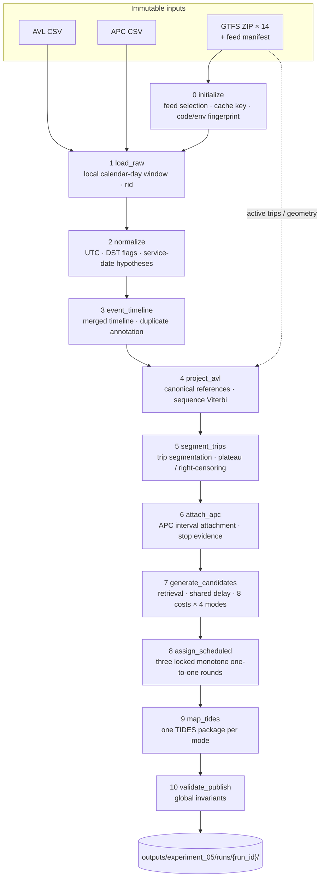

# TTC: From GTFS + AVL + APC to TIDES — Pipeline, Algorithms, and Cross-Agency Comparison

> 中文版 / Chinese version: [ttc-tides-pipeline-and-comparison.md](ttc-tides-pipeline-and-comparison.md)

> **Document status (2026-09-10)**
>
> Based on the current Experiment 05 code in `agencies/ttc/`, the
> authoritative configuration [`config/experiment05-v1.toml`](../config/experiment05-v1.toml),
> and local run manifests. Section 8 distinguishes the original two-day acceptance from the
> later versioned export policy. Each run manifest pins its own code, config and outputs;
> a new policy does not retroactively change an older package.
>
> The output is an **inferred research** TIDES v1.0 package. It passes the TIDES schemas and
> cross-table key checks, but `trip_id_scheduled` and trip boundaries are model inferences.
> **No independent human labels exist to calibrate them yet**, and this is not an official
> TTC data release.
>
> Only aggregate statistics are used here: no vehicle IDs, source record IDs, precise
> timestamps, or coordinates (per the repository redaction rule in
> [ADR 0003](decisions/0003-isolated-r1-diagnostic-experiments.md)).

## Contents

1. [One-page summary](#1-one-page-summary)
2. [Data reality: why a join is not enough](#2-data-reality-why-a-join-is-not-enough)
3. [Architecture](#3-architecture)
4. [Stage by stage](#4-stage-by-stage)
5. [Core algorithms](#5-core-algorithms)
6. [TIDES output contract](#6-tides-output-contract)
7. [Reproducibility, lineage, and fail-closed execution](#7-reproducibility-lineage-and-fail-closed-execution)
8. [Measured runs](#8-measured-runs)
9. [How we got here](#9-how-we-got-here)
10. [Comparison with other agencies' TIDES implementations](#10-comparison-with-other-agencies-tides-implementations)
11. [Known limitations and open questions](#11-known-limitations-and-open-questions)
12. [Running it and code map](#12-running-it-and-code-map)
13. [Glossary](#13-glossary)

---

## 1. One-page summary

**What it does.** Inputs are TTC's offline November 2023 AVL (GPS) CSV, APC (stop-level
passenger counter) CSV, and 14 versions of GTFS archives. Outputs are TIDES v1.0 packages per
service date × route × match mode: `trips_performed`, `vehicle_locations`, `stop_visits`,
`passenger_events`, `vehicles`, and `datapackage.json`. Only route 29 is enabled.

**What makes it hard.** In other agencies' implementations, vendor AVL or GTFS-Realtime
records usually carry a scheduled trip ID, so `trip_id_scheduled` is essentially a join.
TTC's data is different: **none** of the 3,133 AVL `tatripId` values matches a GTFS `trip_id`
valid that month, APC `StopID` is really a `stop_code`, and GTFS `route_id` changes with every
feed version. The scheduled association can only be **inferred from spatiotemporal evidence**.
This is the most fundamental difference between this implementation and the others.

**How it works.**

1. Project every GPS ping onto a validated canonical GTFS reference line, giving
   one-dimensional progress `s(t)`;
2. Split each vehicle's track into performed trips and identify a trustworthy observed end;
3. Attach APC records to trips as "stop × time interval" evidence;
4. For each trip, retrieve the scheduled trips active that day, fit one shared delay process per
   candidate, compute 8 cost components, and freeze a ranking;
5. Within each (service date, route, direction, GTFS version) group, run a three-round, locked,
   order-preserving one-to-one assignment;
6. Write one independent, validated TIDES package for each of the four match modes:
   `global`, `early`, `middle`, and `late`.

**Principles.** Every source record is kept and traceable; no guessed foreign keys; no
fabricated GPS pings or individual passenger measurements. Aggregate APC events use an explicit,
versioned departure-time proxy, distinguished from recorded source times. Times use UTC; daylight-saving
ambiguity is never guessed; any change to code, configuration, dependencies, or inputs makes
the run fail closed; only fully validated results are cached by fingerprint.

**Acceptance results.** Two service dates, 2023-11-06 and 2023-11-20, run end to end from raw
data, yielding 352 and 313 performed trips; across the four modes, 64.5%–72.5% of trips
receive a scheduled association. All 8 TIDES packages (2 days × 4 modes) pass schema and
cross-table key validation, and all 1,459 and 1,303 pipeline invariant checks pass in the original
two-day acceptance. The later November 6 policy run exports 38,211 passenger events per mode. These are
descriptive results, not accuracy (see [Section 8](#8-measured-runs)).

---

## 2. Data reality: why a join is not enough

| Source | Size (whole month) | Key fields | Role in the pipeline |
|---|---|---|---|
| AVL | 6,202,996 rows, ~840 MB; route values `29`/`929`/`PI`/`PO`; 156 vehicle IDs | `Message_DateTime`, `Vehicle`, `Latitude`/`Longitude`, `Heading`, `KPH`, `Route`, `Destination`, `tatripId` | Primary trajectory evidence |
| APC | 573,596 rows, ~97 MB; routes `29`/`929`; 148 vehicle IDs; 103 stop codes | `StopArrivalTime`/`StopDepartureTime`, `VehicleID`, `StopID`, `RouteDirection`, `Boarding`/`Alighting`, `Arrload`/`Depload`, `AvgSample`, `NoTrips` | Stop × time-interval matching evidence; explicit policy exports visit totals and vehicle arrival/departure events |
| GTFS | 14 ZIPs, ~441 MB; calendars span 2023-01-08 to 2024-01-06; versions overlap; no `feed_info.txt` | `trips`, `stop_times`, `stops`, `shapes`, `calendar`, `calendar_dates` | Scheduled trips, stops, geometry |

The [source data audit](source-data-audit.md) findings drive the design directly:

| Finding | Consequence if used directly | Treatment here |
|---|---|---|
| None of the 3,133 AVL `tatripId` values appears among GTFS `trip_id`s valid in November 2023; some numeric values collide with trips on other routes in older feeds | Wrong `trip_id_scheduled` | Audit-only field, **excluded from matching inputs in code**; the scheduled association is inferred from spatiotemporal evidence |
| APC `StopID` is a GTFS `stop_code`: 559,715 rows / 102 codes map via `stop_code`, only 403,336 rows / 72 via `stop_id`; code `1652` (13,881 rows) does not map | Wrong stops or heavy loss | `stop_code` → `stop_id` within the selected feed; ambiguous results stay as lists and are never forced |
| Route 29's `route_id` changes by version (e.g., `70071`, `70291`, `70507`) | Wrong cross-version joins | Resolved via `route_short_name` + the feed selected for that date; internal keys always carry the feed version |
| GTFS versions overlap and lack `feed_info.txt` | Wrong schedule version | Explicit feed manifest (SHA-256, calendar range, priority, status); a tie at top priority is an error |
| 1,150 APC timestamps fall on 2023-12-01; post-midnight service exists | Wrong service date | A "previous service day" hypothesis is kept as a diagnostic; GTFS times past 24:00 are never wrapped |
| The 2023-11-05 DST fall-back creates ambiguous local times (3,831 GPS and 428 APC rows in the month) | Broken time ordering | Ambiguous or nonexistent local times get a null `t` and a flag; no `fold` is guessed |
| `PI`/`PO` look like pull-in/pull-out but are unconfirmed | Wrong `trip_type` | Excluded from matching; not mapped to `Pullin`/`Pullout` |
| APC `AvgSample`, `NoTrips`, and `Avg*` fields suggest some rows are aggregates (45,226 rows with `AvgSample > 1`) | Averages treated as single stops | Preserve `grain_uncertain`; map visit totals under a user-authorized research assumption, not a vendor-confirmed grain |
| AVL contains byte-for-byte duplicate rows (e.g., 36,257 in the 2023-11-06 day window) | Double-counted trajectory weight | Annotated with `duplicate_of`; no extra trajectory or scoring weight |
| The sources have no device IDs, per-door counts, operator, or block fields | — | Unsupported fields stay empty; an assigned trip's `block_id` may come from GTFS, not the vehicle records |

---

## 3. Architecture

### 3.1 Design principles

1. **Offline and reproducible.** No network, database, or cloud service; the same inputs,
   configuration, and code produce the same IDs and business outputs
   ([ADR 0001](decisions/0001-offline-python-prototype.md)).
2. **Python owns every transformation.** Polars + Parquet; SQL is not a transformation layer.
3. **Immutable inputs, row-level lineage.** Every row carries
   `rid = <source>:<file SHA-256>:<original CSV row number>`, plus its raw payload and payload hash.
4. **No guessed foreign keys.** A source value becomes a GTFS or TIDES identifier only through an
   explicit, tested mapping.
5. **Uncertainty is data.** Ambiguity, rejection, and censoring are kept as reason codes instead of
   being hidden behind an arbitrary choice.
6. **TIDES core columns hold only supported values.** Diagnostics go to side-car Parquet / JSON,
   never into TIDES tables.
7. **Schedule-derived fields are quarantined.** `AvgOTP`, `tatripId`, `Date_Key`, `OffRoute`,
   `Delayed`, `Run`, and similar source fields are audit-only; matching code reads its inputs
   through an explicit allowlist and cannot see them.

### 3.2 The ten-stage pipeline



The CLI and the local web page call the same `run_pipeline()`. Every stage declares the outputs
it owns (`pipeline.STAGE_OUTPUTS`) and records row counts, duration, and output SHA-256, so it
can run on its own or resume from any validated boundary.

| # | Stage | Implementation (`tools/experiment05/`) | Main outputs | Row grain |
|---|---|---|---|---|
| 0 | Initialize | `pipeline.initialize_run` | `run_manifest.json`, `config.toml` | One run |
| 1 | `load_raw` | `sources.read_raw_day` | `stages/raw_observations.parquet` | Source row |
| 2 | `normalize` | `sources.normalize_sources` | `stages/normalized_observations.parquet` | Source row |
| 3 | `event_timeline` | `sources.event_timeline` | `stages/event_timeline.parquet` | Source row |
| 4 | `project_avl` | `projection.py` (calls `gtfs_matching.projection`) | `stages/projected_observations.parquet`, `gtfs/{bundle,canonical}.json` | Source row |
| 5 | `segment_trips` | `segmentation.py` + `plateau.py` | `performed_trip_segments.parquet`, `platform_diagnostics.parquet` | Trip |
| 6 | `attach_apc` | `apc.py` | `fused_projected_observations.parquet`, `stop_visits_evidence.parquet`, `apc_attachment_audit.parquet` | Source row / stop visit |
| 7 | `generate_candidates` | `candidates.py` (calls the 04c scorer) | `candidate_rankings.parquet`, `local_window_evidence.parquet`, `mode_results.parquet`, `scheduled_lookup.parquet` | Trip × mode × candidate |
| 8 | `assign_scheduled` | `assignment.py` | `assignments.parquet`, `assignment_audit.parquet` | Trip × mode |
| 9 | `map_tides` | `tides.py` | `tides/<mode>/…` | TIDES row |
| 10 | `validate_publish` | `validation.py` | `validation_report.json` | Invariant check |

The 04c scorer lives in `tools/merge_review/gtfs_matching/`, with continuous scoring in its
`continuous/` subdirectory.

---

## 4. Stage by stage

### 4.0 GTFS version selection and the schedule clock

- **Manifest-driven.** `artifacts/feed_manifest.draft.csv` records `feed_id`, SHA-256, calendar
  range, `priority`, and `status` for each archive. Selection rule: acceptable status (only
  `approved` by default), calendar covers the target date, archive present with a matching hash;
  take the highest `priority`. A tie at the top is an error that requires an explicit pin.
- **The manifest is still a draft.** Every row is `candidate`, and the Experiment 05 config
  explicitly sets `feed_allow_candidate = true`. For example, 2023-11-06 selects
  `ttc-d092742e6a5b` (priority 120, covering 2023-10-30 to 2023-11-18, route 29 `route_id = 70291`), which
  outranks an older version with priority 110 that also covers that date; 2023-11-20 selects
  `ttc-de8294439596` (priority 130, route 29 `route_id = 70507`). Human approval of the manifest
  remains an open governance item (decision D-15).
- **Active service.** Expand `calendar.txt` weekday rules, then apply `calendar_dates.txt` exceptions.
- **Schedule clock.** GTFS `HH:MM:SS` becomes seconds into the service day, and **values past 24
  hours are kept as is** (`25:00:00` = 90000, not `01:00`). Absolute times use the anchor defined
  by the GTFS specification: **local noon minus 12 hours** on the service date, converted to UTC
  epoch seconds, which stays correct on daylight-saving transition days.
- **Canonical references.** Within the selected feed and route, shapes form direction-specific
  families; reference identity includes feed/route/direction/family, not a universal metre axis.
  Each (direction, shape) combination is validated for geometric
  coverage, stop order, and a low-ambiguity monotone embedding (projection error at most
  `canonical_error_m = 30`, ambiguity fraction at most 2%). The longest shape is preferred as the
  family reference only after it passes; otherwise several references are kept, and `s` values
  from different references are never subtracted. Direction labels come from the geometry
  endpoints (north–south or east–west). Both measured dates produced 3 references.

### 4.1 `load_raw`: read one local calendar day

- The observation window is a **local calendar day** `[00:00, 24:00)`: AVL by
  `Message_DateTime`, APC by `StopArrivalTime` (falling back to `StopDepartureTime`). AVL rows
  with a missing timestamp but a `Date_Key` equal to that day are also read.
- File SHA-256 is checked before and after reading; a file modified during the read fails the stage.
- Every row gets an immutable `rid` and keeps its full raw payload.

### 4.2 `normalize`: per-source normalization, no cross-source joins

| Concept | AVL source field | APC source field | Normalized result |
|---|---|---|---|
| Vehicle | `Vehicle` | `VehicleID` | `vehicle_id`: trimmed, leading zeros kept, always a string |
| Time | `Message_DateTime` | `StopArrivalTime`, `StopDepartureTime` | UTC epoch seconds `t`, `arrival`, `departure`, plus a time status |
| Position | `Latitude`, `Longitude` | `Lat`, `Lon` (stop coordinates) | Raw WGS84; APC coordinates are **not treated as vehicle GPS** |
| Speed / heading | `KPH`, `Heading` | — | `speed_kph`, `heading`, unchanged |
| Route | `Route` | `Route` | `route_eligible = (Route == "29")` |
| Direction | First word of `Destination` | `RouteDirection` | `direction_label`, accepting only NORTH/SOUTH/EAST/WEST/INBOUND/OUTBOUND |
| Stop | — | `StopID` | Kept as a stop code and mapped later via `stop_code` |
| Passengers | — | `Boarding`, `Alighting`, `Arrload`, `Depload` | Kept; `grain_uncertain` when `AvgSample`/`NoTrips ≠ 1` or counts are non-integer |
| Audit only | `tatripId`, `Date_Key`, `Run`, `OffRoute`, `Delayed` | `AvgOTP` (renamed `audit_avg_otp`) | Never enters matching |

**Time zones and DST (`utc_clock`).** Each naive local time is tried with both `fold = 0` and
`fold = 1`. Exactly one UTC result is accepted (`UNIQUE_LOCAL_TIME`); two results mean
`AMBIGUOUS` and none means `NONEXISTENT`. In both cases `t` is null and the raw string and flag
are kept; no trajectory time is invented.

**Service-date hypotheses.** Every row's hypothesis set contains the selected date; rows with a
local time before 06:00 also get the previous day, as a diagnostic only. Rows are never silently
moved to another service date.

### 4.3 `event_timeline`: merged timeline and duplicate annotation

- The two sources are combined with `UNION ALL` and sorted by (vehicle, time, source, `rid`); a
  duplicate `rid` fails the stage.
- AVL duplicates are identified by raw-payload SHA-256: later rows get `duplicate_of` pointing to
  the first. They stay in diagnostics but take no part in projection or scoring.
- Each row gets a role: `ROUTE_EVIDENCE`, `OUT_OF_ROUTE_SCOPE`, or `DUPLICATE_DIAGNOSTIC`. Rows for
  route 929, `PI`, and `PO` stay in shared diagnostics but never enter route-29 matching or TIDES
  packages.

### 4.4 `project_avl`: GPS to one-dimensional progress on a canonical reference

- Parallelized per vehicle (8 spawned processes). A **numerical separator** is inserted when
  adjacent pings are more than 1800 s apart, the source direction word changes, or the vehicle has
  just left an out-of-route interval. Separators only reset the numerical projection; **they do not
  create trip IDs**.
- A **beam Viterbi with skip states** runs separately on each allowed reference (algorithm in
  [§5.2](#52-sequence-projection-beam-viterbi-with-skip-states)); direction is a prior, not a
  filter. An ungated sequence search runs first. If its best path uses any point with a lateral
  distance above 100 m (`max_projection_distance_m`), the search is rerun on in-gate candidates
  only, and that rerun path is **adopted whole**. Paths are never spliced point by point, which
  could reintroduce impossible jumps around loops.
- A point accepted on at least one reference is `ON_REFERENCE`. Among those references, the one
  minimizing `mean path cost − ln(projection quality) / 4` wins (ties broken by `reference_id`),
  and every reference's result is kept in `projection_alternatives`. Points accepted nowhere are
  `OFF_REFERENCE` (reason `distance_gate_failed` or `no_sequence_consistent_in_gate_path`); points
  with invalid source data are `UNPROJECTABLE`. Isolated anomalies (≤ 2 points and ≤ 30 s) can be
  skipped; sustained departures (≥ 60 s) or GPS gaps become separate fragments.
- **`OFF_REFERENCE` points are never silently dropped.** Unless later confirmed as a censored
  tail, they remain in the coverage denominator.

### 4.5 `segment_trips`: performed-trip segmentation

Each vehicle's time-ordered AVL rows (route 29, not duplicates, valid time, including
`OFF_REFERENCE`) are split whenever any of the following holds. Valid time here does not
mean a valid spatial projection:

| Cut reason | Rule |
|---|---|
| `JOINT_AVL_APC_GAP` | The adjacent AVL gap is > 1800 s **and** the largest gap in the union of AVL instants and APC service intervals is also > 1800 s (APC can "bridge" a GPS outage) |
| `CONFIRMED_PROJECTED_DIRECTION_CHANGE` | The projected direction changes and persists for at least 3 points and 20 s; the cut falls on the first point of the new direction |
| `SEQUENCE_RESTART_PROGRESS_RESET` | Progress on the same reference drops by more than 500 m and the projector recorded a sequence restart |

- A mid-route stop followed by recovery **does not** split a trip.
- **Stable ID:**
  `trip_id_performed = stable_id("performed", service date, feed version, route_id, vehicle, first rid, last rid)`.
  It depends only on input lineage and raw boundaries — not on scheduled trips or match modes — so
  reruns reproduce it.
- The trip direction is the majority of projected directions, or `UNKNOWN` when nothing projects
  (exported as null in TIDES).
- `plateau.py` then assesses each trip's **trustworthy evidence extent**
  (see [§5.5](#55-plateaus-and-right-censoring)) and records raw boundaries, effective boundaries,
  plateau onset, censor decision time, and reason.

### 4.6 `attach_apc`: APC as stop-time interval evidence

1. **Stop projection.** APC `StopID` is looked up as a `stop_code` in the **selected feed** to get
   `stop_id`, then mapped to canonical stop progress intervals on each reference; ambiguous stop
   codes or loop positions stay as lists.
2. **Interval validity.** Records with a missing arrival or departure, an inverted interval, or an
   interval longer than 1800 s are marked `INVALID_SERVICE_INTERVAL`.
3. **Candidate trips (same vehicle).** All of the following must hold:
   - the time gap between the APC interval and the trip's effective extent is ≤ 120 s, and a
     censored trip does not accept APC arriving after its effective end;
   - the trip's references contain a matching stop that is unambiguous and has an acceptable
     projection status;
   - when comparable valid AVL exists on the same reference within 120 s before/after the APC
     interval, the **minimum** point-to-stop progress error is ≤ 200 m. With no nearby AVL,
     attachment is still possible using a 200 m ranking fallback, not observed spatial agreement.
4. **Ranking and decision.** Sort by (direction conflict, time gap, −overlap, progress error). A
   unique best is `ATTACHED`; an exact tie for first is `AMBIGUOUS_TRIP_MEMBERSHIP`; no candidate
   is `NO_COMPATIBLE_PERFORMED_TRIP`. Every decision is written to `apc_attachment_audit`.
5. **Stop visits.** The selected trip's stop mapping must also resolve to a unique `stop_id`.
   One attached APC source row yields one hypothesis; neighboring rows are not merged and APC
   undergoes no irreversible deduplication. Within a trip, visits are ordered by (arrival, departure, `rid`),
   giving a consecutive `trip_stop_sequence` starting at 1. For a censored trip, the interval is
   clipped to the effective boundary **for scoring only**; raw values are unchanged and passenger
   counts are never prorated. `stop_visit_id` derives from the stable performed-trip ID and source
   `rid`; the observed sequence is not GTFS `stop_sequence`.
6. **Implementation limits.** There is no AVL-only reconstruction or automatic completion of
   GTFS stops missing APC. `visit_merge_gap_s = 30` is currently unused, not an active merging rule.
   APC without genuine vehicle coordinates remains stop-interval evidence; only genuine spatial
   observations receive the 100 m projection gate. See the [APC policy](experiment05-apc-events.md).

### 4.7 `generate_candidates`: retrieval and scoring; rankings are frozen once produced

- **Four match modes.** `global` uses the whole segment; `early`, `middle`, and `late` split the
  valid projected travel distance into chronological thirds, not equal-duration thirds. Distance
  accumulates only positive progress beyond the prior high-water mark between continuous valid
  points on the same reference and fragment. Rejections, reference/fragment changes, separators
  and long gaps contribute no connecting distance; jitter is not counted twice. The 1/3 and 2/3
  boundaries snap forward to real AVL times; ties belong to the later third and sparse data can
  leave a third empty. Zero valid distance gives `NO_EVIDENCE` for partial modes, not a time-based
  fallback. APC scoring intervals are clipped without prorating counts; shared segmentation and
  exported source visit times do not change. Each mode retrieves and fits **independently**,
  sharing no shortlist or delay result.
- **Input firewall.** Scoring inputs have the raw payload, `AvgOTP`, `tatripId`, source date,
  `OffRoute`, `Delayed`, and `Run` removed.
- **Retrieval (high recall).** Build a shared confusability class from local geometry, valid
  progress range and reliable observed APC stop order, not exact `pattern_id` equality. The hard
  stop-order filter uses only in-window APC with confidence ≥ 0.5. Keep top 12 or "best + 1.0"
  per window/class; protect the nearest occurrence and immediate predecessor/successor, including
  simultaneous ties, from top-K truncation, plus 3 configured rescue-neighbor levels. Core buffer
  is 2 × shared local headway; rescue is max(core, 4 × headway, 3600 s) plus clock/boundary
  uncertainty and 600 s only when a gap exists. Validated historical tails or vehicle-sequence
  evidence can add provenance-bound rescue; no calibrated history is currently configured.
  Union candidates across windows without truncating to 3. Sparse patterns receive no private
  3600-second headway privilege.
- **Scoring.** Fit a shared delay process per candidate and compute 8 cost components
  (see [§5.3](#53-continuous-passage-scoring-and-the-shared-delay-process)).
- **Ranking.** Ascending `(score, candidate_id)` (lower is better), with rank 1 the best. Every
  candidate is checked against the authoritative `scheduled_lookup` for hard constraints (service
  date, route, direction, feed, valid stop order). All components, weights, coverage, delay
  summaries, and every rank are persisted before assignment; rank 4 and below are audit-only.
- **Bounded memory.** Submissions are capped at the worker count; each trip's result is written as
  a hash-named shard and released immediately, then the shards are stream-concatenated. An earlier
  full-day run was killed by the system with exit code 137 because results accumulated in memory
  without bound; this is the corrected implementation.

### 4.8 `assign_scheduled`: three locked rounds of monotone one-to-one assignment

- **Groups:** `(service_date, route_id, direction_id, gtfs_feed_version)` × match mode. Modes
  never share occupancy.
- **Order:** actual order by `(actual_start_t, trip_id_performed)`; scheduled order by
  `(scheduled start in service seconds, trip_id_scheduled)`, with values past 24 hours never wrapped.
- **Three rounds:** in round r (r = 1, 2, 3), only still-unlocked trips propose their rank-r
  candidate. Among feasible proposals, the **strictly monotone, maximum-cardinality** chain is
  chosen and locked for good. Details in [§5.4](#54-three-locked-rounds-of-monotone-assignment).
- **Output:** one row per trip × mode, `ASSIGNED` or `UNMATCHED` (with a genuinely null
  `trip_id_scheduled`), plus a non-exclusive reason list: `NO_CANDIDATES`, `TOP3_EXHAUSTED`,
  `LOST_SAME_SCHEDULE_CONFLICT`, `CANDIDATE_ALREADY_USED`, `VIOLATED_LOWER_ORDER_BOUND`,
  `VIOLATED_UPPER_ORDER_BOUND`, `CROSSED_CURRENT_ROUND_ASSIGNMENT`, `INVALID_GTFS_REFERENCE`.
- **No score threshold.** As requested for Experiment 05, 04c's confidence gates are not applied:
  any feasible top-3 candidate can be assigned. Assignment never recomputes scores or ranks; the
  hash of `candidate_rankings.parquet` is checked before and after to prove it was not modified.

This is an Experiment 05 operating assumption, **not a TIDES requirement**. TIDES v1.0 allows
multiple performed trips per scheduled trip. One-to-one assignment can reject real vehicle
substitutions or split observations. `ASSIGNED` is not a calibrated scorer `MATCHED` verdict;
unassigned performed trips remain valid exports with null scheduled fields.

### 4.9 `map_tides`: one TIDES package per mode

See [Section 6](#6-tides-output-contract). Only route-29 observations are read. Each mode's
package is bound to this run, its configuration, the mode, and all upstream stage hashes
(`run_binding`).

### 4.10 `validate_publish`: global invariants

The checks are independent of scores and individual outcomes:

- source-row identity is conserved (raw row count = final row count, identical `rid` sets), raw
  payloads are unmodified, and each `rid` agrees with its file hash and row number;
- the raw AVL/APC files, GTFS archive, and feed manifest still hash to their initialization values;
- `trip_id_performed` is unique and every trip foreign key resolves; effective extents lie inside
  raw extents and censoring audit fields are complete; censored tails are not matching evidence;
  every trajectory point satisfies the 100 m projection gate; APC never appears as a trajectory point;
- candidate ranks run consecutively from 1 and agree with `(score, candidate_id)` order, and every
  score is finite;
- there is exactly one assignment row per trip × mode; every assignment comes from a legal top-3
  candidate; within a group, scheduled trips are unique and **globally** strictly monotone
  (including within a round);
- every mode's TIDES package validates, and the scheduled associations in `trips_performed.csv`
  equal the assignment table exactly;
- the outputs of every completed stage still match their recorded hashes before publication.

---

## 5. Core algorithms

### 5.1 Linear referencing: turning 2-D tracks into `s(t)`

Each canonical reference is a polyline measured in metres. A projected GPS point gets progress
`s`, lateral distance `ℓ`, and a tangent direction; GTFS stops are embedded on the same reference
by a monotone stop-order dynamic program. Every later comparison happens in the `(s, t)` plane:
the observed track is an `s(t)` curve, and a scheduled trip is a monotone step polyline built from
`stop_times`.

### 5.2 Sequence projection: beam Viterbi with skip states

```text
Candidates: for each GPS point i, on each reference, up to 6 projection candidates c within 500 m
            (progress s_c, lateral distance ℓ_c, tangent direction θ_c)

Emission cost
  E(i, c) = (ℓ_c / 25 m)²
          + 2 · (heading error / 90°)²   only when speed ≥ 5 km/h and heading is valid
          + 4                            if the Destination direction word contradicts the reference

Transition feasibility (relative to the last accepted point)
  Δt ≥ 0,  Δs ≥ −35 m,  Δs ≤ 36.1 m/s · Δt + 20 m
Transition cost
  ((−Δs) / 35 m)²                        only when Δs < 0 (tolerated slight backtracking)

Skip states
  +50 per skipped point, keeping the real time of the last accepted point, so removing an
  isolated spike never shortens the interval used by the next speed constraint
Restart
  an infeasible transition may restart only when Δt ≥ 60 s (another +50), recorded as sequence_restart

Beam width 12; deduplicated by (time, progress); projection quality = exp(−min(E, 100) / 8),
multiplied by 0.8 when heading is missing

Gating and selection
  first find the best ungated path; if it uses any point with lateral distance > 100 m,
  rerun on in-gate candidates only and adopt that path whole
  when a point is accepted on several references, pick the minimum of  mean path cost − ln(quality) / 4
```

### 5.3 Continuous passage scoring and the shared delay process

**The schedule is never resampled.** For candidate trip k, each inter-stop movement segment is a
straight line from one stop's departure to the next stop's arrival; each dwell is a time interval
`[arrival, departure]` at fixed `s`. At any progress `s`, the scheduled passage is an interval
`[a_k(s), b_k(s)]` (with `a = b` on movement segments), queried in O(log n).

**Residuals are intervals, not points.** For an observation `(t_i, s_i)` the residual is

```text
r_i = [ t_i − b_k(s_i),  t_i − a_k(s_i) ]
```

A delay state inside the interval costs nothing, so there is no need to pick arrival or departure
arbitrarily.

**Each (trip, candidate) pair fits exactly one delay process `d(t)`**; local windows cannot shift
it independently. It is solved by IRLS (iteratively reweighted least squares) with tridiagonal
normal equations, in O(n). The objective has this structure (schematic):

```text
  Σ_i  w_i · Huber( dist(d(t_i), r_i) / σ_i )             conditioned fit
+ λ_prior  · Prior(d)                                     operational delay prior
+ λ_smooth · Σ_j Huber( (d_{j+1} − d_j) / scale )         smoothness
subject to |Δd| ≤ 0.95 · Δt + 0.5 · |Δs|; delay recovery (decrease) rate at most 3 s/s
```

- `w_i` is temporal support (trapezoidal integration; points at the same instant share support)
  times projection quality — **GPS points are not counted as votes**;
- `σ_i` combines schedule uncertainty (timepoint 30 s, non-timepoint 90 s, interpolation 30 s),
  projection error, stop or terminal state, and observation gaps; gaps longer than 90 s break the
  state chain;
- states live on non-overlapping 60 s physical-time atoms, so the dynamics term does not grow with
  sampling density.

**Eight cost components** (raw component × weight = contribution; score = sum of contributions;
lower is better; **not a probability**):

| Component | Weight | Meaning |
|---|---:|---|
| `absolute_delay_level_cost` | 1.0 | Whether the delay level is operationally plausible (see the operational prior below) |
| `conditioned_fit_cost` | 1.0 | Robust residual after removing the shared delay, normalized by time uncertainty |
| `delay_dynamics_cost` | 0.5 | Physical plausibility of how delay changes over time and progress |
| `APC_stop_time_cost` | 0.5 | Whether APC service intervals are compatible with scheduled stop intervals corrected by the same delay |
| `projection_and_coverage_cost` | 2.0 | Lateral residual + share of projected time lost + share of schedule alignment lost |
| `pattern_progress_cost` | 1.0 | Heading, direction prior, backtracking, unserved stops, contradicted key stops |
| `occurrence_displacement_cost` | 1.0 | How many confusable neighboring trips must be "crossed" to explain the observations (new in 04c) |
| `vehicle_sequence_cost` | 0.0 | Reserved; the whole-day vehicle sequence is a shadow annotation only and does not affect decisions |

**Three-level coverage identity.** Computed both by point count and by real duration:

```text
projection  = valid projected / all spatial observations
schedule    = schedule-supported valid projected / valid projected
end_to_end  = schedule-supported valid projected / all spatial observations
with  projection × schedule = end_to_end
```

Every level records its numerator and denominator explicitly, and denominators never shrink when
scoring fails.

**Operational delay prior (04c).** An asymmetric two-piece Student-t mixture (3 degrees of
freedom): the routine component has early/late scales of 120 s / 300 s, the disruption component
600 s / 1800 s, with disruption weight 0.05. The cost is the negative log-density relative to the
mode. All competing candidates share one prior determined by the observed context, and **a
candidate's own headway is not an input**, so sparser patterns cannot absorb large delays more
cheaply. These parameters are explicitly labeled engineering assumptions, not calibrated
probabilities.

**Occurrence displacement (04c).** Within the observed `s` range, a common class of confusable
trips is built from geometry and the observed ordered stops:

```text
occurrence_displacement_cost
  = competing passages crossed × 1
  + seconds outside the time cell bounded by midpoints to neighboring passages
    / local common headway × 1
```

It separates "the previous trip running a full headway late" from "this trip on time", which
interval evidence alone could not do in the R1 experiments.

**Decision guard.** The scorer also emits statuses such as `MATCHED`, `AMBIGUOUS`,
`PATTERN_ONLY`, and `UNMATCHED`. Without independent labels, the guard never promotes a result
to `MATCHED`, and probabilities stay uncalibrated. Experiment 05 stores these statuses in
`mode_results.parquet`, but assignment uses only the frozen ranking.

### 5.4 Three locked rounds of monotone assignment

```text
for group in stable_group_order:            # (service date, route, direction, feed) × mode
    locked = {}
    for r in [1, 2, 3]:
        proposals = rank-r candidate of every unlocked trip
        reject: missing GTFS reference or group mismatch / hard constraint failed
                / UNKNOWN direction / scheduled trip already taken
                / outside the scheduled-order bounds set by the nearest locked predecessor or successor
        among feasible proposals, find a strictly increasing chain
        (weighted longest increasing subsequence, O(n²)), comparing in turn:
            1) maximum chain length
            2) minimum score sum (exact Fraction arithmetic, so no float or input-order effects)
            3) (score, candidate_id, trip_id_performed) tuples in actual order
        lock the chosen proposals; earlier rounds never change
    emit one row per trip; unassigned trips get a genuine null and every reason
```

**What this constraint implies.** Within a group, trips ordered by actual start time must receive
scheduled trips in strictly increasing scheduled start order: no two vehicles may "cross" in the
result, and each scheduled trip is used at most once per mode. This matches first-in-first-out
operations and removes adjacent trips stealing each other's matches. The cost: with bunching or
overtaking, or when a trip starts mid-route because of a data gap (its actual start is later than
its scheduled departure), the correct candidate can be rejected as
`CROSSED_CURRENT_ROUND_ASSIGNMENT` or as out of bounds. Such cases need review through
`assignment_audit`.

### 5.5 Plateaus and right-censoring

The problem: when a vehicle sits still for a long time at a terminal or mid-route, GPS keeps
reporting. If this "flat `s(t)`" is scored in full, an arbitrarily large delay can "explain" it and
distort the match. `plateau.py` runs after projection and before APC attachment and schedule
matching. It can only **shorten the evidence extent**; it never picks a scheduled trip and never
creates a new trip ID.

**States (on non-overlapping 60 s atomic windows):**

| State | Meaning |
|---|---|
| `NORMAL` | Normal progress, or stillness not yet long enough |
| `STATIONARY_PLATEAU` | Raw coordinates still (radius ≤ 25 m) and canonical progress flat (range ≤ 30 m) |
| `TERMINAL_LAYOVER` | Sustained stillness near a valid terminal or short-turn point (150 m) |
| `LONG_MIDROUTE_STOP` | A sustained mid-route stop; not censored automatically |
| `FROZEN_TELEMETRY` | ≥ 8 identical coordinates contradicted by the reported speed; judged a telemetry fault only |
| `OFF_REFERENCE_MOVING` | Raw coordinates move but no valid reference supports them |
| `REFERENCE_MISMATCH` | Progress on the current reference is flat while the raw position or another reference shows movement |
| `RECOVERED_AFTER_PLATEAU` | Continuous valid progress resumes afterwards; the segment is kept |
| `RIGHT_CENSORED_TAIL` | The tail is censored only when **all** conditions below hold |

**Necessary conditions for censoring:** (1) evidence of stillness or frozen telemetry; (2) all
references were checked, not only the current direction; (3) both the raw position and canonical
progress are near a valid terminal (including the first and last stops of every scheduled trip,
which covers short turns); (4) no time gap, ambiguous time, or later recovery; (5) no unexplained
APC service (valid boardings/alightings at the same location push the idle start to the last APC
departure); (6) the stillness lasts at least

```text
min(1800 s, max(600 s, local headway × 1.5 + 300 s))
```

with enough continuous observation to cover a 900 s recovery look-ahead; (7) **counterfactual
veto**: for every high-recall GTFS hypothesis still fit to test, delay is fitted using only real,
monotone observations **before** the plateau, and the most conservative clock

```text
t_schedule = t_observed − (delay_before_plateau + uncertainty + 0.1 · time_since_plateau)
```

gives the `s` the vehicle "should have reached by now". Censoring is allowed only if every
hypothesis advances by at least 250 m. A single long scheduled dwell that still explains the stop
is enough to veto, and a hypothesis without reliable prior data makes the decision abstain.

After censoring, only one real AVL endpoint and the relevant APC intervals are kept; the other
plateau points are marked `censored_tail = true` and `exclude_from_matching = true` but remain in
diagnostics. `physical_trip_end_confirmed` is always `false`: what is confirmed is the **extent of
usable evidence**, not that the vehicle actually ended service.

---

## 6. TIDES output contract

**Specification version.** TIDES v1.0, pinned to upstream commit
`b2cb23178e00cb58dbdb1b9a5a8626818278ecbb`. The original schemas, package profile, Table Schema
reference, CC-BY-4.0 attribution, and their checksums are vendored in
`schemas/experiment05/tides-v1/`, verified file by file at runtime, and never downloaded during a run.

### 6.1 Package contents

```text
tides/<match_mode>/
  datapackage.json          # profile pinned to the commit above; sha256 per resource; title/description declare "inferred research data"
  trips_performed.csv
  vehicle_locations.csv
  stop_visits.csv
  passenger_events.csv     # current explicit departure-proxy policy; absent if no valid events
  vehicles.csv
  schemas/                  # the package's own copy of the TIDES schemas and vendor.json
  diagnostics.json          # lineage, omission reasons, trip observation envelopes (not a TIDES resource)
  validation_report.json
  summary.json
  completion.json           # completion marker, run_binding, every file hash
```

`devices.csv` is not written under the current configuration. Passenger-event policy and
assumptions are recorded in package metadata and diagnostics.

### 6.2 Field mapping

**`trips_performed`** (primary key `service_date` + `trip_id_performed`)

| Field | Value | Notes |
|---|---|---|
| `service_date` | The selected date | `YYYY-MM-DD` |
| `trip_id_performed` | Stable hash | See [§4.5](#45-segment_trips-performed-trip-segmentation) |
| `vehicle_id` | Source vehicle ID | String, leading zeros kept |
| `trip_id_scheduled` | Three-round assignment result | Genuine null when unassigned |
| `route_id` | GTFS `route_id` of the assigned trip; otherwise route 29's `route_id` in the selected feed | Version-specific |
| `direction_id` | Direction of the assigned trip; otherwise the projected direction | `UNKNOWN` exported as null |
| `shape_id`, `block_id` | GTFS fields of the assigned trip | `block_id` comes from GTFS, not from the source data |
| `schedule_trip_start` / `schedule_trip_end` | First-stop departure / last-stop arrival of the assigned trip | UTC |
| `schedule_relationship` | `Scheduled` when assigned, otherwise null | Unassigned **does not mean** `Added`, `Canceled`, or `Missing` |
| `actual_trip_start` / `actual_trip_end` | Null | The observation envelope is not an origin departure or destination arrival event |
| `route_type`, `ntd_mode`, `pattern_id`, `operator_id`, `trip_start_stop_id`, `trip_end_stop_id`, `trip_type` | Null | Unsupported by the sources or not yet derived |

**`vehicle_locations`** (primary key `location_ping_id`)

| Field | Value |
|---|---|
| `location_ping_id` | Source-row `rid` |
| `event_timestamp` | UTC ISO-8601 (`Z` suffix) |
| `vehicle_id` | Source vehicle ID |
| `latitude`, `longitude` | Raw GPS (projected coordinates are not used) |
| `heading` | Raw value, not recomputed |
| `speed` | `KPH ÷ 3.6`, in m/s |
| `service_date`, `trip_id_performed`, `trip_id_scheduled` | From trip membership |
| Other fields (`device_id`, `stop_id`, `current_status`, `trip_stop_sequence`, `gps_quality`, `odometer`, `schedule_deviation`, …) | Null |

Route-29 AVL with valid time and coordinates is written, including `OFF_REFERENCE` and duplicate
rows. Unmatched status does not delete GPS. Invalid time/coordinates remain upstream and in
diagnostics, not this resource. Current APC has no genuine vehicle GPS and is not manufactured
into `vehicle_locations`.

**`stop_visits`** (primary key `service_date` + `trip_id_performed` + `trip_stop_sequence`)

| Field | Value |
|---|---|
| `trip_stop_sequence` | Within the trip, ordered by (arrival, departure, `rid`), consecutive from 1 |
| `vehicle_id` | Trip vehicle |
| `stop_id` | APC `StopID` (stop code) → `stop_id` in the selected feed |
| `actual_arrival_time`, `actual_departure_time` | APC arrival / departure times (UTC) |
| `dwell` | Departure − arrival; written only for whole seconds, otherwise null with a reason (never rounded) |
| `scheduled_stop_sequence`, `schedule_arrival_time`, `schedule_departure_time`, `timepoint` | Currently null: upstream does not map visits to an occurrence of a stop in the final candidate. The exporter only accepts an explicit, validated mapping, never a nearest-stop guess |
| `boarding_1`, `alighting_1`, `departure_load`, and other passenger fields | Null: APC counts are whole-vehicle, with unconfirmed door allocation and grain, so they cannot go into `boarding_1` |

**`passenger_events`: explicit departure-proxy policy.** The current configuration selects
`apc_stop_interval_departure_proxy_v1`: an attached APC row is treated as one stop visit and
counts as visit totals. This is a user-authorized **research mapping assumption**, not a
vendor certification or a TIDES-prescribed timestamp rule.

| `event_type` | `event_timestamp` | `event_count` |
|---|---|---|
| `Vehicle arrived at stop` | Source APC arrival | 1 |
| `Vehicle departed stop` | Source APC departure | 1 |
| `Passenger boarded` | APC departure-time proxy | Positive integer boarding total |
| `Passenger alighted` | APC departure-time proxy | Positive integer alighting total |

No individual passenger events are manufactured. Zero counts emit no event of that type;
missing values are not zero-filled, and negative/fractional counts are not rounded. Missing APC
lineage or an incomplete/invalid interval causes rejection with a reason. Events use their
own mode's scheduled association, or null when unassigned. Without explicit scheduled-stop or
real ping linkage, `scheduled_stop_sequence` and `location_ping_id` remain null; no nearest AVL
ping or door is guessed. Per-event diagnostics retain source rows, original intervals,
`timestamp_is_proxy`, `semantics_assumed` and `measured_individual_passenger_time = false`.
Matching still uses the APC interval, **not the exported proxy timestamp**. The explicit
`omit_without_event_semantics` option remains available, and standalone export calls without a
policy retain the older conservative behavior. See the [APC policy](experiment05-apc-events.md).

**`vehicles`**: distinct `vehicle_id` values. **`devices`**: omitted (`include_devices = false`,
and the sources have no device IDs).

**Null encoding.** An empty CSV cell is null and JSON uses real `null`; the strings `None`, `null`,
or `NA` are never emitted; zero stays zero. Identifiers are always strings, and numeric identifiers
are rejected rather than coerced.

### 6.3 Validation layers

1. The vendored schemas and `vendor.json` match the expected commit, tag, and per-file SHA-256;
2. every row's column set equals the schema fields **exactly** (nothing extra, nothing missing);
3. each resource passes in-memory Frictionless schema validation;
4. **composite business foreign keys** (TIDES v1.0 schemas declare no `foreignKeys`, so a generic
   validator cannot cover them): vehicles, devices, the `(service_date, trip_id_performed)` trip key,
   trip–vehicle consistency, scheduled-association consistency, the stop-visit composite key,
   `location_ping_id`, GTFS `stop_id`, GTFS scheduled trips (plus route, direction, shape, and block
   consistency), stop-visit interval and dwell consistency, and consecutive actual stop sequences
   starting at 1;
5. `datapackage.json` is validated against the package profile with Draft-07;
6. Frictionless runs again on the CSVs **as written to disk**;
7. everything is written to a private staging directory and atomically renamed only after all checks
   pass; existing outputs are never overwritten.

The upstream shell validator's exit code is not used as a verdict, because its cleanup and error
handling can mask failures. **Passing structural validation does not independently establish**
trip boundaries, APC grain, proxy-time precision, or scheduled-association accuracy. Local
requirements such as consecutive actual stop sequences and one-to-one assignment are stricter
project contracts, not TIDES requirements. Report formal conformance separately from observed,
inferred and proxy semantics.

The independent current four-mode structural/reference/lineage audit passed 50/50 checks;
proxy-policy replay passed 24/24. See the [TIDES evidence-boundary audit](experiment05-tides-compliance.md).
This is neither official certification nor proof of data permissions: source-code and schema
licenses do not automatically authorize redistribution of raw AVL/APC or GTFS archives.

---

## 7. Reproducibility, lineage, and fail-closed execution

| Mechanism | How |
|---|---|
| Cache key | SHA-256 of (service date, public route number, selected modes, `pipeline_version`, config hash, raw AVL/APC hashes, GTFS archive hash, manifest hash, dependency-environment hash) |
| Code identity | `pipeline_version = experiment-05-v1+<16-hex hash>`, computed from the hashes of `tools/experiment05`, `tools/merge_review/gtfs_matching`, `src/ttc_tides`, the vendored schemas, `pyproject.toml`, `uv.lock`, and related files |
| Environment identity | Python version plus every installed package and version |
| Stage pinning | Each stage records its output SHA-256; all prerequisite stages are re-verified before the next stage runs; a code, config, or environment change during a run fails it |
| Cache reuse | Only runs with `status = complete` and `validation_ok` are reused, after verifying every file hash; `--force-rerun` creates a new run |
| Atomic writes | Unique temporary files, then rename; a failed run keeps its partial files but never becomes a cache entry |
| TIDES package binding | `run_binding` in `completion.json` binds the run ID, cache key, code, config, mode, and upstream stage hashes, preventing reuse of a package across runs |
| Safety | Symlinks and path traversal are rejected; run directories are 0700 and files 0600; the web page listens on localhost only and accepts no arbitrary paths |
| Baseline snapshot | Git tag `pre-experiment-05-20260910` (commit `3809a76`) plus the hash-inventoried minimal reproduction set in `releases/pre-experiment-05-20260910/` |

**Scope of determinism:** with fixed inputs, business outputs and IDs must agree; a rerun changes
only run metadata (timestamps, run ID).

---

**Historical availability.** Authorized exact-list cleanup retired 1,252 regenerable 03d–04c
case, overview and episode files (14,127,707,246 logical bytes). Raw AVL/APC, GTFS, code, config,
tests, reviews and the minimal reproduction snapshot remain. The old full-result UI requires
regeneration; retained output pins are historical audit records, not a currently passing full
inventory. Experiment 05 does not ingest those old cases; port 8767 serves 05. See
[frozen execution and retention](frozen-workbench.md).

## 8. Measured runs

Both service dates ran all four modes for route 29 through `validate_publish`, with
`status = complete` and `validation_ok = true` (run directories
`run-2023-11-06-2cf05504dfcdf899` and `run-2023-11-20-debe65bd31e3044b`). The numbers below come
from each run's `run_manifest.json`, `summary.json`, and stage outputs. They are **descriptive
statistics**, not accuracy.

### 8.1 Stages 1–6: from raw rows to stop evidence

| Stage | Metric | 2023-11-06 | 2023-11-20 |
|---|---|---:|---:|
| Initialize | Selected GTFS version (route 29 `route_id`) | `ttc-d092742e6a5b` (70291) | `ttc-de8294439596` (70507) |
| `load_raw` | AVL / APC rows that day (all routes) | 213,895 / 19,090 | 198,490 / 18,048 |
| `normalize` | Invalid time (ambiguous / nonexistent / missing) | 0 | 0 |
| `event_timeline` | Exact-duplicate AVL rows (all routes) | 36,257 | 34,661 |
| | Route-29 AVL rows (exact duplicates among them) | 112,002 (19,859) | 100,771 (19,019) |
| | Route-29 APC rows | 13,862 | 13,064 |
| `project_avl` | `ON_REFERENCE` / `OFF_REFERENCE` points | 90,848 / 1,295 | 80,375 / 1,377 |
| | Canonical references | 3 | 3 |
| `segment_trips` | Performed trips (right-censored) | 352 (0) | 313 (1) |
| `attach_apc` | `ATTACHED` / `NO_COMPATIBLE_PERFORMED_TRIP` | 13,599 / 263 | 12,764 / 300 |

On 2023-11-06, the non-duplicate route-29 AVL rows number 92,143 (= 90,848 + 1,295) and the APC
rows 13,862. These counts verify current raw-to-TIDES source conservation, not a comparison
against historical matching results (see 8.4).
APC attachment reaches 98.1% (13,599 / 13,862) and 97.7% (12,764 / 13,064), with no
`AMBIGUOUS_TRIP_MEMBERSHIP`.

### 8.2 Stages 7–8: candidates and assignment

| Metric | 2023-11-06 | 2023-11-20 |
|---|---:|---:|
| Candidate ranking rows (all four modes) | 35,157 | 32,108 |
| Local window evidence rows | 4,593,488 | 4,161,683 |
| Assignment proposals and audit events | 33,846 | 30,833 |

| Mode | 2023-11-06 assigned / 352 | Rounds 1 / 2 / 3 | 2023-11-20 assigned / 313 | Rounds 1 / 2 / 3 |
|---|---:|---:|---:|---:|
| `global` | 244 (69.3%) | 211 / 32 / 1 | 225 (71.9%) | 193 / 23 / 9 |
| `early` | 246 (69.9%) | 223 / 22 / 1 | 227 (72.5%) | 203 / 23 / 1 |
| `middle` | 244 (69.3%) | 209 / 28 / 7 | 223 (71.2%) | 193 / 25 / 5 |
| `late` | 227 (64.5%) | 203 / 20 / 4 | 215 (68.7%) | 190 / 18 / 7 |

Reasons for unassigned trips in `global` mode (non-exclusive; one trip can have several):

| Reason | 2023-11-06 (108 unassigned) | 2023-11-20 (88 unassigned) |
|---|---:|---:|
| `TOP3_EXHAUSTED` | 88 | 74 |
| `CANDIDATE_ALREADY_USED` | 74 | 66 |
| `LOST_SAME_SCHEDULE_CONFLICT` | 73 | 58 |
| `VIOLATED_UPPER_ORDER_BOUND` | 63 | 43 |
| `VIOLATED_LOWER_ORDER_BOUND` | 41 | 43 |
| `NO_CANDIDATES` | 20 | 14 |
| `CROSSED_CURRENT_ROUND_ASSIGNMENT` | 16 | 20 |
| `INVALID_GTFS_REFERENCE` | 12 | 11 |

What this shows:

- **About 30% of trips stay unassigned in each mode, mostly because of conflicts rather than a lack
  of candidates.** Only 20 / 14 trips have no candidate at all; more trips lose because the
  scheduled trip they want is already taken, they lose a contest for the same scheduled trip, or
  they violate the order bounds. The one-to-one plus monotone constraint dominates. Possible
  sources include one operating run split into several fragments, non-revenue movement, bunching or
  overtaking, and fragments that start mid-route; which applies needs review through the audit
  tables, and this document makes no claim either way.
- **Assignments are sensitive to the evidence scope.** Only 101 / 352 (28.7%) and 81 / 313 (25.9%)
  trips are assigned in all four modes with the same scheduled trip. Among trips assigned in
  `global`, `early` picks the same scheduled trip for 161 / 244 (66.0%) and 137 / 225 (60.9%). This
  is exactly why all four modes are published.
- **The consequence of having no score threshold.** Assigned `global` costs have a median of
  1.06 / 1.03 (P10 about 0.44, P90 about 2.2), but a median cannot certify every assignment.
  Without an absolute-quality gate, consumers must inspect components, coverage and ambiguity;
  `ASSIGNED` is not high-confidence certification.

### 8.3 Stages 9–10: TIDES packages

The table records the **original two-day acceptance under the old conservative export policy**,
not current passenger-policy counts. All four modes have the same row counts; only scheduled
associations differ. Historical packages have not been overwritten.

| Resource | 2023-11-06 | 2023-11-20 |
|---|---:|---:|
| `trips_performed` (rows with `trip_id_scheduled` in `global`) | 352 (244) | 313 (225) |
| `vehicle_locations` (rows with a scheduled association in `global`) | 112,002 (91,184) | 100,771 (85,752) |
| `stop_visits` | 13,599 | 12,764 |
| `vehicles` | 31 | 29 |
| `passenger_events`, `devices` (old policy) | Not written | Not written |
| Omitted passenger events (semantics or time unconfirmed) | 11,013 | 10,378 |
| Pipeline invariant checks | 1,459, 0 failed | 1,303, 0 failed |

Checked in the `global` packages: `actual_trip_start` is null for every trip;
`schedule_relationship` is `Scheduled` when assigned and null otherwise; every stop visit has an
integer `dwell`; `boarding_1` is always null. All of this matches the contract in Section 6.

**Later versioned event export.** November 6 run `run-2023-11-06-a39c5491eae9f48b` uses
`apc_stop_interval_departure_proxy_v1` and exports **38,211** events per mode: 27,198 vehicle
arrival/departure events and 11,013 aggregate boarding/alighting events. The latter use a
departure proxy, not individually measured passenger times; all trace back to APC visits.
38,211 is an event-row count, not a passenger total. Boarding/alighting `event_count` sums are
21,122 / 19,347. This run passed 1,483 invariants; its first eight stages and four pre-existing
CSV resources are unchanged from the earlier run.
The older table's omissions do not apply to these new packages. That run's manifest pins its
code, configuration and outputs; the November 20 packages still use the older policy until
explicitly rebuilt. See the local [policy acceptance report](../outputs/experiment_05/acceptance/apc-events-policy/acceptance-summary.md)
and [export invariance check](../outputs/experiment_05/acceptance/apc-events-policy/export-invariance.json).

**Runtime and resources.** A full day takes about 11.8 and 10.6 minutes. Candidate generation
accounts for 479 s and 419 s — about two thirds; TIDES mapping takes about 50 s, invariant
validation about 30 s, and the first six stages about 2 minutes combined. Resident memory is about
4 GB (8 workers). Two earlier runs with the same configuration are marked `ACCEPTANCE_SUPERSEDED`:
one was stopped deliberately to fix APC interval overlap and memory bounds, and the other was
killed by the system with exit code 137 during candidate generation; the results in this section
come from the corrected implementation.

### 8.4 No comparison with 04c

Experiment 05 re-segments from raw data, so segments do not correspond one to one with historical
experiments. This document makes no 04c–05 performance, assignment-rate or accuracy comparison;
descriptive statistics do not replace independent labels.

---

## 9. How we got here

| Phase | When | What | Lesson |
|---|---|---|---|
| Earlier project's notebook workflow | Before 2026-08 (documented 2026-08-07) | A hard-coded 2020 route-29 northbound shape; KD-tree nearest-vertex search in degree space that overwrote raw coordinates; tolerance-free `merge_asof` on a precomputed `TripID` of unknown origin; `25:10` rewritten as `01:10` ([methodology record](previous_proj_data_integration_methodology.md)) | Identity, time, and geometry contracts must be explicit and reproducible; never depend on cleaned artifacts of unknown provenance |
| GTFS preprocessing | 2026-08-05 | [ADR 0001](decisions/0001-offline-python-prototype.md); the `ttc-tides` CLI; manifest, streamed ZIP reads, quarantine, `p2` patterns; 92 synthetic tests; 2023-11-05 acceptance: 28,291 scheduled trips, 939,706 scheduled stop events, 0 rows quarantined ([review](gtfs-implementation-review.md)) | Versioned GTFS with quarantine can be delivered reliably |
| Merge plan and review | 2026-08-06 | [Implementation plan](merge-implementation-plan.md) and [review](merge-plan-review.md); [ADR 0002](decisions/0002-merge-plan-review-disposition.md) approved the architecture, froze S3 onward, and required R1–R6 to be resolved | Do not write publication code before joint resolution and the time contract are settled |
| R1 design spikes 01 / 02 / 02R | 2026-08-07 to 08-08 | Candidate / null model / margin framework; APC-assisted boundary refinement; kernel repair ([01](r1-design-spike-findings.md), [02](r1-boundary-refinement-spike-findings.md), [02R](r1-spike02r-kernel-repair-findings.md)) | Interval evidence alone cannot separate adjacent trips at 5–10 minute headways; evidence reuse inflates confidence; continuous spatiotemporal evidence and a shared delay are needed |
| Human labeling v1 / v2 | 2026-08-09 to 08-14 | First-pass labels on 18 pilot cases; the audit found 0/18 directly usable for calibration; the v2 blind-review protocol is frozen ([protocol](human-labeling-protocol-v2.md), [status](human-labeling-v2-run01-status.md)) | Without independent labels there is no accuracy or calibrated probability; this limitation carries through to Experiment 05 |
| APC–AVL coverage study | 2026-09-08 | 21 segmentation × fusion × threshold combinations over the full month (no GTFS): direct spatiotemporal association under default AVL-context segmentation covers 98.00% of APC ([method comparison](apc-avl-method-comparison-20260908.md)) | APC–AVL spatiotemporal association is feasible at the evidence level; a ±60 s APC clock shift sharply reduces associations, so the clock contract must come before wider tolerances |
| Direct-evidence optimization | 2026-09-08 | Endpoint support, partial support, and counter-evidence separated: under `avl_context`, direct 95.53%, direct + partial 96.39%, and 8,165 APC rows with endpoint counter-evidence ([report](apc-avl-direct-evidence-optimization-20260908.md)) | "Associated" needs grades; counter-evidence and abstention need their own counts |
| Experiments 03b–03d | 2026-09-09 | Discrete alignment matcher, four modes, whole-day overview, review workbench (`tools/merge_review/gtfs_matching/RESULTS.md`) | Four modes expose boundary uncertainty; with a weak standalone time-shift penalty, rankings drift |
| Experiments 04 / 04b / 04c | 2026-09-10 | Continuous passage scoring, shared IRLS delay, three-level coverage; 04b weight sensitivity; 04c operational prior, occurrence displacement, high-recall retrieval ([04](experiment04-continuous-matching.md), [04b](experiment04b-delay-weights.md), [04c](experiment04c-occurrence-plausibility.md)) | Diagnostic ranking is not calibrated certification; 05 adds a separate assignment layer. TIDES itself permits null scheduled fields and does not require a forced answer |
| **Experiment 05** | 2026-09-10 | Reuses the 04c scorer and adds a ten-stage pipeline from raw data, plateau / right-censoring, three-round monotone one-to-one assignment, and a pinned, validated TIDES export | Current version |

---

## 10. Comparison with other agencies' TIDES implementations

### 10.1 Implementations compared

- **WMATA SMART Data Hub** ([`agencies/wmata/`](../../wmata/)): a production-grade prototype funded
  by a USDOT SMART grant. Dagster orchestration, dbt transformation (Trino in production, DuckDB
  locally), Iceberg + Lakekeeper storage, OpenMetadata catalog, deployed on Azure Container Apps
  with infrastructure in OpenTofu. Sources include vendor CAD/AVL (the "Bus info" daily export and
  a near-real-time Oracle log), fare systems, rail faregates, and GTFS. See
  [bus_info.md](../../wmata/sdh-open-source/docs/warehouse/bus_info.md) and the
  [case study](../../wmata/sdh-writeup/wmata-sdh-writeup.md).
- **Mountain Line (Missoula)** ([`agencies/mountain-line/`](../../mountain-line/README.md)): the
  Level 0 "analyst on a laptop" pattern. In this repository it is a pointer entry only; the code lives
  in external repositories: [`polar-tides`](https://github.com/WindfallLabs/polartides) (TIDES schema
  validation for Polars, built on dataframely) and
  [`little_pipelines`](https://github.com/WindfallLabs/little_pipelines) (lightweight orchestration).
  Sources are ETA Transit CAD/AVL, APC processed by Swiftly, Via demand response, and self-published
  GTFS; the main use case is NTD reporting.
- **UT iROAM** (local workspace `agencies/ut/iROAM/`, **not yet merged into this repository**): also
  uses TTC data, but from continuously collected **GTFS-Realtime VehiclePositions** (2026),
  append-only PostgreSQL/PostGIS, FastAPI, and Streamlit, with an analytics layer for operations
  monitoring and bunching prediction. `apps/analytics/tides_export.py` exports three TIDES tables
  (described in `docs/station_events_and_tides.md`).

### 10.2 Side-by-side comparison

| Dimension | **TTC (this implementation)** | **WMATA SDH** | **Mountain Line** | **UT iROAM** |
|---|---|---|---|---|
| Positioning | Offline research prototype; one route, daily batches | Production-grade prototype; many sources and modes; cloud platform | Level 0 pattern for small agencies; NTD reporting | Academic / operations monitoring platform |
| Data | Historical 2023-11 AVL + APC CSVs; 14 GTFS versions | Vendor CAD/AVL (with per-door APC counts and operator-entered trip information), fares, faregates, GTFS | Vendor CAD/AVL, APC, demand response, GTFS | GTFS-RT vehicle positions (~20–30 s) + static GTFS |
| **Source of `trip_id_scheduled`** | **Source field unusable → spatiotemporal inference + one-to-one monotone assignment** | Vendor records carry `trip_id` and `pattern_id` | Joined through `trip_id_scheduled` and `stop_id` in vendor data (per its README) | GTFS-RT carries `trip_id` |
| `trip_id_performed` | Stable hash of service date, feed, route, vehicle, first/last `rid`; split on confirmed direction change, 30-minute joint AVL+APC gap, or progress reset | `trip_id_scheduled`-vehicle-pattern-start time; split at the day's first record or a gap ≥ 1 hour | Not published here | `{trip_id}:{start_date}:{vehicle_id}` |
| `stop_id` | APC code mapped via feed `stop_code`; minimum progress error ≤ 200 m when nearby comparable AVL exists, otherwise a weaker-evidence fallback | Joined from source `ta_geo_id`; scheduled / skipped records imputed to the nearest scheduled stop (haversine × stop-sequence difference, 300 m box) | Not published | Stop detection within ±50 m of the stop after shape projection |
| Service date | Local calendar-day observation window; UTC time axis; GTFS "noon − 12 h" anchor; DST ambiguity never guessed | Date of `event_time − 4 h` | Not published | `start_date` from the feed |
| Stop-visit source | APC intervals (one APC record = one stop visit) | Aggregated vendor events (several snapshots merged into one visit by rule) | APC (planned, per its README) | AVL only: a plateau classifier with hysteresis; boundaries corrected by half the sampling interval |
| APC → TIDES | Stop times, vehicle arrival/departure, and aggregate passenger events under the explicit departure-proxy policy; per-door counts and `departure_load` remain null | Front/back door counts → `boarding_1/2`, `alighting_1/2`; load → `departure_load`; `passenger_events` only from rail faregates | APC → `passenger_events`, `stop_visits` (planned) | No APC; these columns left empty as future join points |
| `actual_trip_start/end` | **Null**: the observation envelope is not an origin/destination event | `min/max(event_timestamp)` of valid pings, i.e., the observation envelope | Not published | Terminal-profile recommendation: `min(first sustained move, leaving the start buffer)` |
| `trip_type` | Null; the meaning of `PI`/`PO` is unconfirmed | Mapped from vendor route-code prefixes: `PI` → `Pullin`, `PO` → `Pullout`, `DH` → `Deadhead`, etc. | Not published | Null |
| Quality pattern | No source row is ever deleted; reason codes in diagnostic Parquet and side-car JSON; no private columns in TIDES core tables | `fct_*_quality` models: `is_valid`, `invalid_reason`, `has_*`; marts keep only valid rows | `polar-tides` schema validation | `_`-prefixed diagnostic columns and `_is_valid` inside TIDES CSVs |
| TIDES validation | Vendored v1.0 schemas (pinned commit) + Frictionless + Draft-07 profile + custom composite foreign keys | dbt tests + quality models | `polar-tides` (dataframely) | Writes `datapackage.json`; table builders covered by unit tests |
| Timestamps | UTC (`Z`) | Scheduled start/end converted to local ET (America/New_York) | Not published | Timezone-aware datetimes |
| Stack | Python 3.12, Polars, Parquet, uv, local CLI and web page | Dagster, dbt, Iceberg/Lakekeeper, Trino/DuckDB, OpenMetadata, Azure, OpenTofu | Python, Polars, dataframely, little_pipelines | PostgreSQL/PostGIS, FastAPI, Streamlit, Docker Compose |
| Incremental processing and scheduling | None; on-demand per day, successful results cached by fingerprint | dbt microbatch increments; Dagster sensors and automation | little_pipelines DAG | Collector polls every 20–30 s; analytics worker refreshes periodically |
| Reproducibility | Code, config, environment, and input hashes form the cache key; stage outputs pinned; fail-closed | Git, CI/CD, infrastructure as code; OpenMetadata lineage | Versioned code | Append-only raw storage that can be re-normalized |

### 10.3 What they have in common

1. **GTFS is the backbone for schedules and stops.** Every implementation links TIDES rows back to
   GTFS `trip_id` and `stop_id`, and each has to deal with GTFS versions changing by date.
2. **Layered transformation.** WMATA's staging → intermediate → quality → mart matches TTC's staged
   Python transformations in concept; TTC's [architecture document](architecture.md) lists the layers
   it borrowed from WMATA one by one.
3. **Annotate, don't silently drop.** WMATA's quality models, iROAM's `_is_valid`, and TTC's reason
   codes and side-car diagnostics all exist to make excluded data explainable.
4. **Deterministic `trip_id_performed`.** Each is built deterministically from service date,
   vehicle, and time elements.
5. **Explicit event-grain choices.** WMATA's bus APC is door-aggregated and its event table covers
   faregates; TTC now uses documented visit-total and departure-proxy assumptions, while its old
   policy omitted events; iROAM has no APC.
6. **One-dimensional linear referencing.** TTC and iROAM both project GPS onto shapes to get travel
   progress; WMATA relies on vendor-supplied stop sequences and stops.

### 10.4 Interpreting the key differences

**(1) Scheduled association: join vs. inference.** This is the core difference. WMATA, Mountain
Line, and iROAM receive a scheduled trip identifier at the vehicle (operator login, CAD, or
GTFS-RT), so the quality of `trip_id_scheduled` depends on the upstream system, and the main work
is field mapping, imputation, and cleaning. TTC's source identifier does not correspond to GTFS, so
it needs a full inference layer: candidate retrieval, delay modeling, component costs, and a
globally consistent assignment. That is why TTC's pipeline complexity is concentrated in stages 4–8.

**(2) Different grounds for splitting trips.** WMATA partitions by (scheduled trip, vehicle,
pattern) and splits at 1-hour gaps, which presumes the scheduled trip is known; iROAM uses the
feed's `trip_id` grain directly; TTC, without a known scheduled trip, can only split on physical
evidence (direction, gaps, progress resets) and uses the plateau mechanism to find a trustworthy end.

**(3) Different degrees of caution in mapping APC to TIDES.** WMATA's APC has explicit door
semantics (front / back door boardings and alightings), so mapping it into `boarding_1/2` is
supported. TTC's APC counts are whole-vehicle, and their aggregation grain is in question
(`AvgSample`, `NoTrips`); writing them into `boarding_1` would invent door semantics that do not
exist, so for now these fields stay empty rather than holding unsupported values.

**(4) Different meanings of `actual_trip_start`.** WMATA uses the minimum / maximum timestamps of
the observation envelope, iROAM estimates departure from a terminal profile, and TTC leaves it null.
All three write the same TIDES field with different meanings, so **cross-agency comparisons of trip
duration or on-time performance need particular care**.

**(5) Where diagnostics live.** iROAM puts `_`-prefixed diagnostic columns directly into TIDES CSVs
(following WMATA's convention), which is convenient for filtering. TTC keeps TIDES core tables to
schema fields only and puts diagnostics in side-car files, so generic TIDES validators and consumers
need no special handling.

**(6) Platform scale and goals.** WMATA solves the problem of a multi-source, continuous,
incremental, multi-user data platform; TTC solves "can the evidence support publication" on a single
machine. The two are complementary: TTC's inference layer could later run as a Python asset in a
WMATA-style platform.

### 10.5 Highlights of the TTC implementation

1. **When no usable source identifier exists, the scheduled association becomes an auditable
   inference.** Every candidate's components, weights, coverage, delay-process summary, and full rank
   list are persisted before assignment, so any `trip_id_scheduled` can be traced back to "why this
   one, and what it beat".
2. **A strict physical time axis.** UTC epoch seconds throughout; DST ambiguity never guessed; GTFS
   times past 24 hours kept as is and converted with the spec's noon-minus-12-hours anchor.
3. **Source-record conservation.** Every row has a `rid`, and invariant checks prove "input rows =
   output rows, raw payloads untouched"; duplicates and off-reference points are kept, only excluded
   from scoring.
4. **APC as interval evidence.** Matching invents no GPS pings; export distinguishes observed times
   from visit-total proxy times and invents neither door allocations nor individual measurements.
5. **Globally consistent one-to-one assignment.** Three locked rounds and a strictly monotone
   weighted longest increasing subsequence structurally rule out "one scheduled trip claimed by two
   vehicles" and "adjacent trips crossing", and every unassigned result carries audited reasons.
6. **Four-mode sensitivity analysis.** The same trip is matched independently on the whole segment
   and on its early, middle, and late thirds, producing four independent TIDES packages, so it is
   immediately visible whether a conclusion depends on the evidence scope.
7. **Right-censoring with a counterfactual veto.** Long terminal dwells cannot be "explained" by an
   ever-growing delay.
8. **Fail-closed reproducibility.** Code, config, dependency, and input fingerprints form the cache
   key; stage outputs are pinned; publication is atomic; TIDES packages are bound to their run.
9. **A pinned TIDES version, plus the composite foreign-key checks the schemas themselves cannot
   express.**
10. **Honest evidence boundaries.** The `datapackage.json` title and description, `summary.json`,
    and `validation_report.json` all declare research inference without calibration; status changes
    are never passed off as accuracy gains.

### 10.6 What each could borrow from the others

- **TTC from WMATA:** a strict `is_valid` / `invalid_reason` consumer view for downstream users; a
  ridership and on-time metrics layer on top of TIDES; incremental (microbatch) processing,
  orchestration, and a data catalog once continuous operation is needed; once `PI`/`PO` semantics are
  confirmed, WMATA's route-code prefix → `trip_type` mapping; and the "nth visit to the same stop"
  approach for scheduled stop sequence on loop routes.
- **TTC from iROAM:** AVL-based stop / dwell detection to fill `stop_visits` at stops without APC;
  a terminal profile to estimate `actual_trip_start` (currently null). If GTFS-RT **contemporaneous**
  with the AVL/APC ever becomes available, its `trip_id` could serve as an independent reference for
  evaluating the TTC matcher.
- **TTC from Mountain Line:** `polar-tides` as a second, independent TIDES validator for cross-checks;
  NTD reporting as a natural downstream use of TIDES output.
- **What TTC offers the others:** when upstream `trip_id` is unreliable (WMATA's documentation notes
  that one `trip_id_performed` can map to several vehicles, and iROAM's audit shows about 10% of
  realtime `trip_id`s resolve against the static schedule), TTC's evidence-based matching and
  monotone assignment can serve as a fallback or a check; its explicit treatment of unknown `actual_trip_start`
  and explicit `passenger_events` assumptions and event lineage can help document cross-agency
  definitions, without claiming independently established event semantics.

### 10.7 Observations on cross-agency interoperability

- TIDES v1.0 schemas declare no `foreignKeys`, so a generic validator cannot catch dangling trip or
  stop-visit references; every implementation needs its own composite-key checks.
- The same field can mean different things across implementations (`actual_trip_start` as envelope
  or event; timestamps in UTC or local time; `boarding_1` as a per-door or whole-vehicle count). These
  definitions should be stated explicitly in `datapackage.json` or accompanying documentation.
- "Unmatched" is not `Added`, `Canceled`, or `Missing`. None of the implementations writes "no
  scheduled association" directly as an operational status, and the community would benefit from
  agreeing on this explicitly.

---

## 11. Known limitations and open questions

**Inference quality**

1. **No independent labels.** Assignments are model outputs, not ground truth; accuracy, calibration
   error, and every precision metric are undefined. The v2 blind labeling protocol is frozen, but the
   second human review pass has not started.
2. **No score threshold in assignment.** Any feasible top-3 candidate is assigned, even with a high
   absolute cost. Downstream users should judge credibility from `candidate_rankings` scores, the
   scorer statuses in `mode_results`, and agreement across the four modes.
3. **The monotone assumption.** Bunching, overtaking, or fragments starting mid-route can cause the
   correct candidate to be rejected (see [§5.4](#54-three-locked-rounds-of-monotone-assignment)).
4. **Uncalibrated operational prior.** Its parameters are engineering assumptions.

**Scope and semantics**

5. **The observation window is a local calendar day.** The next-day portion of a post-midnight trip
   is not read; widening the window to a full operating day is an explicit future policy change.
6. **Only route 29 is enabled** (`allowed_routes = ["29"]`); route 929 and `PI`/`PO` remain in
   diagnostics only.
7. **The GTFS manifest is still a draft** (every row `candidate`); version priority needs human
   confirmation (D-15).
8. **Stop code `1652`** leaves 13,881 APC rows in the month unmapped; whether it is a particular
   terminal is still to be confirmed (D-10).
9. **APC semantics** (multi-door totals, aggregate rows, event times) lack vendor confirmation
   (D-06). Current packages expose totals under an explicit research assumption; departure proxies
   cannot support individual passenger-timing analysis, and overlapping/duplicate visits must not
   automatically be treated as disjoint passenger activity.
   On 2023-11-06, 1,026 visits remain `grain_uncertain`; 9 two-row groups share vehicle, stop and
   arrival/departure interval (5 within one segment, 4 across segments). They may represent terminal
   direction handovers, not necessarily two physical stops or safe-to-delete duplicate counts.
10. **Limited field coverage:** on 2023-11-06, 67/352 segments have no APC visit and all 13,599
    visits lack scheduled-stop occurrence mapping. `actual_trip_start/end`, `trip_type`, the scheduled fields of
    `stop_visits`, and the stop-related fields of `vehicle_locations` are all null.
11. **Duplicate AVL rows are written to `vehicle_locations`.** Byte-for-byte identical AVL rows are
    each written to TIDES with their own `rid` as `location_ping_id`: 19,859 of the 112,002 rows on
    2023-11-06 (about 18%), while the "duplicate" flag exists only in the diagnostic tables.
    Downstream users counting pings must deduplicate themselves; whether these rows should be omitted
    at export, or at least documented inside the package, deserves an explicit decision.

**Engineering**

12. **Performance and validation scope.** A full day takes about 11 minutes and 4 GB of memory,
    about two thirds of it in candidate generation; only two service dates have run end to end so far.
13. **The offline raw data is not distributed with the repository**, and whether it may be
    redistributed is still an open question.

---

## 12. Running it and code map

### 12.1 Running

From `agencies/ttc/`:

```sh
uv sync --frozen
./experiment05.sh availability                                   # list dates with both raw data and GTFS
./experiment05.sh run --service-date 2023-11-06 --route-id 29 --match-mode all
./experiment05.sh run --service-date 2023-11-20 --match-mode early
./experiment05.sh run --service-date 2023-11-06 --match-mode all --force-rerun
./experiment05.sh web --port 8767                                # local page: pick date and modes, see stages / reasons / validation, download
```

Stage by stage, with verification:

```sh
./experiment05.sh init --service-date 2023-11-06 --match-mode all
./experiment05.sh stage load_raw --run-dir outputs/experiment_05/runs/<run_id>
# run the remaining stages in order, or resume from any validated boundary
./experiment05.sh verify --run-dir outputs/experiment_05/runs/<run_id>
```

The raw AVL/APC files and GTFS archives must be supplied separately at the paths in
`config/experiment05-v1.toml`; they are not distributed through Git.

### 12.2 Visual inspection

**Read-only post-run inspection.** Open a successful run in the 05 page, filter by vehicle,
direction or text, and move between trips. The geographic view uses genuine AVL coordinates,
canonical references and stops, with zoom/pan but no external street basemap. APC symbols are
GTFS stop positions, not vehicle pings. The timeline preserves AVL timestamps and APC intervals
alongside GTFS passages/dwells; per-reference time–distance panels toggle up to three saved
candidates. Schedules retain their **original, unshifted clocks**, and the assigned candidate may
be rank 2 or 3.

Trip windows offer full extent or 5/15/30/60/120 minutes; horizontal pan synchronizes the map,
timeline and progress views. The day overview offers full extent or 30/60/120/240 minutes,
faceted by direction and reference, with one schedule per trip: its assignment or an explicitly
diagnostic rank-1 fallback. Reference metre axes are not interchangeable; multiple facet entries
are not extra trips. Trips without valid projection or a candidate remain in selectors/diagnostics.

Modes read saved distance-third scopes without rerunning matching or changing segmentation or
assignment; unpublished modes are not synthesized. Raw, duplicate, `OFF_REFERENCE` and censored
records remain inspectable, while valid lines break at reference/fragment changes, separators or
gaps beyond that run's pinned threshold. Day-view simplification reports original/display counts
and never enters metrics. Unattached APC currently has counts and audit downloads, not a dedicated
orphan-row explorer. Reads verify saved file hashes; a newer UI does not upgrade an older run's
code or export policy. See the [visualization contract](experiment05-visualization.md).

### 12.3 Code map

| Path | Role |
|---|---|
| `config/experiment05-v1.toml` | The single authoritative configuration: paths, time zone, segmentation, plateau, APC, execution, export, and every matcher parameter inherited from 04c |
| `tools/experiment05/pipeline.py` | Stage orchestration, cache key, code and environment fingerprints, stage pinning, resumption, summary |
| `tools/experiment05/sources.py` | Raw reads, normalization, UTC and DST, merged timeline, date-active GTFS |
| `tools/experiment05/projection.py` | Projection job partitioning and the input allowlist |
| `tools/experiment05/segmentation.py` | Trip segmentation and stable IDs |
| `tools/experiment05/plateau.py` | Plateau state machine, right-censoring, counterfactual veto |
| `tools/experiment05/apc.py` | APC interval attachment and stop evidence |
| `tools/experiment05/candidates.py` | Calls the 04c scorer; frozen per-mode rankings and hard constraints |
| `tools/experiment05/assignment.py` | Three-round locked monotone assignment |
| `tools/experiment05/tides.py` | TIDES mapping, validation, atomic publication |
| `tools/experiment05/validation.py` | Pipeline invariants |
| `tools/experiment05/web.py`, `static05/` | Local web page |
| `tools/merge_review/gtfs_matching/feed.py` | Manifest-based GTFS version selection and service expansion |
| `tools/merge_review/gtfs_matching/canonical.py` | Canonical reference construction and validation |
| `tools/merge_review/gtfs_matching/projection.py` | Sequence Viterbi projection and APC interval projection |
| `tools/merge_review/gtfs_matching/partial.py` | Scope partitioning for the four modes |
| `tools/merge_review/gtfs_matching/continuous/` | Continuous scoring: `schedule`, `retrieval`, `delay` (IRLS), `operational_prior`, `occurrence`, `evidence` (coverage), `integration` (8 costs) |
| `tools/merge_review/gtfs_matching/decision.py` | Conservative decision guard |
| `src/ttc_tides/` | The earlier GTFS preprocessing CLI (`ttc-tides gtfs …`) and shared helpers such as the service-day anchor |
| `schemas/experiment05/tides-v1/` | Vendored TIDES v1.0 schemas and checksums |
| `tests/test_experiment05_*.py` | Growing source, plateau, candidate, assignment, TIDES, APC-event, pipeline, web and cleanup coverage; use current test collection for the count |

Related documents: [design and stage contracts](experiment05-design.md),
[plateau state definitions](experiment05-platform.md), [TIDES export contract](tides05-contract.md),
[diagnostic table schema](experiment05-output-schema.md).

---

## 13. Glossary

| Term | Meaning |
|---|---|
| Performed trip | An observed operating-segment hypothesis identified by `trip_id_performed`, not an independently confirmed complete scheduled operation |
| Scheduled occurrence | One `trip_id` on one service date in one GTFS version |
| Canonical reference | A validated GTFS shape with distances, used as a one-dimensional axis |
| `s` (progress) | Distance along a reference, in metres |
| Passage | The scheduled time at which a trip passes a given `s` (an interval at a stop) |
| Residual interval | Observed time minus the scheduled passage interval |
| Delay process | The delay-over-time function fitted for one (trip, candidate) pair |
| Match mode | `global`, `early`, `middle`, or `late` — the observation scope used for matching |
| Plateau | A stretch where `s(t)` stays flat |
| Right-censoring | Excluding an untrustworthy stationary tail from the evidence, without asserting the trip ended |
| `rid` | A source row's immutable identity: source, file hash, original row number |
| Run binding | A digest binding a TIDES package to one specific run and its upstream hashes |
