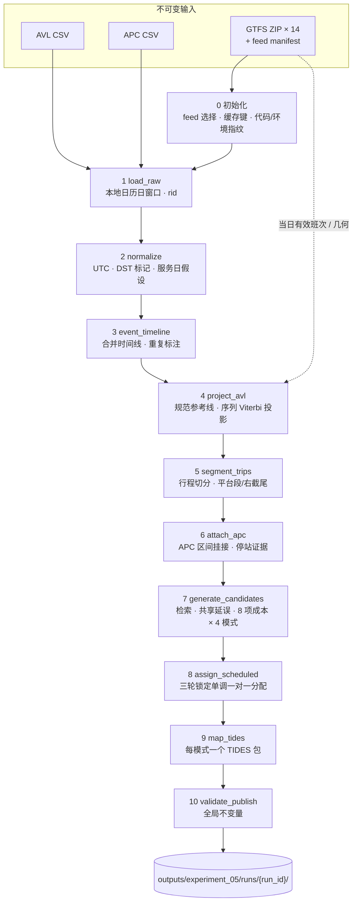

# TTC：从 GTFS + AVL + APC 到 TIDES —— 流水线、算法与跨机构对比

> English version: [ttc-tides-pipeline-and-comparison.en.md](ttc-tides-pipeline-and-comparison.en.md)

> **文档状态（2026-09-10）**
>
> 本文依据 `agencies/ttc/` 的现行 Experiment 05 代码、
> 权威配置 [`config/experiment05-v1.toml`](../config/experiment05-v1.toml)
> 以及本地运行清单编写。第 8 节区分原始两日验收与后续版本化导出策略；
> 具体代码、配置和输出身份以各 run manifest 的哈希为准，不把旧包当成已被新策略改写。
>
> 输出是**研究性推断**的 TIDES v1.0 数据包：结构上通过 TIDES schema 与跨表键校验，
> 但 `trip_id_scheduled`、行程边界等是模型推断，**目前没有独立人工标签校准**，
> 也不是 TTC 官方数据发布。
>
> 本文只使用聚合统计，不含车辆编号、源记录 ID、精确时间或坐标
> （遵循 [ADR 0003](decisions/0003-isolated-r1-diagnostic-experiments.md) 的仓库脱敏规则）。

## 目录

1. [一页摘要](#1-一页摘要)
2. [数据现实：为什么不能直接 join](#2-数据现实为什么不能直接-join)
3. [总体架构](#3-总体架构)
4. [分阶段说明](#4-分阶段说明)
5. [核心算法](#5-核心算法)
6. [TIDES 输出契约](#6-tides-输出契约)
7. [可复现性、溯源与失败即停](#7-可复现性溯源与失败即停)
8. [实测运行](#8-实测运行)
9. [演进历程与教训](#9-演进历程与教训)
10. [与其他机构 TIDES 实现的比较](#10-与其他机构-tides-实现的比较)
11. [已知局限与开放问题](#11-已知局限与开放问题)
12. [运行方式与代码地图](#12-运行方式与代码地图)
13. [术语表](#13-术语表)

---

## 1. 一页摘要

**做什么。** 输入是 TTC 2023 年 11 月的离线 AVL（GPS）CSV、APC（站点客流）CSV
和 14 个版本的 GTFS 压缩包；输出是按"服务日 × 线路 × 匹配模式"生成的 TIDES v1.0
数据包：`trips_performed`、`vehicle_locations`、`stop_visits`、`passenger_events`、`vehicles`
与 `datapackage.json`。当前只启用 29 路。

**难在哪里。** 在其他机构的实现中，供应商 AVL 或 GTFS-Realtime 记录通常自带计划班次 ID，
`trip_id_scheduled` 基本上是一次连接（join）。TTC 这份数据则不同：AVL 的 `tatripId`
与当月 GTFS `trip_id` **零匹配**（3,133 个取值中 0 个），APC 的 `StopID` 实际是
`stop_code`，GTFS 的 `route_id` 每个版本都会变化。计划关联因此只能**从时空证据推断**，
这是本实现与其他机构最根本的区别。

**怎么做。**

1. 把每个 GPS 点投影到经过校验的 GTFS 规范参考线上，得到一维里程 `s(t)`；
2. 按车辆把轨迹切分成"实际执行的行程"（performed trip），并识别可信的观测终点；
3. 把 APC 当作"站点 × 时间区间"证据挂接到行程上；
4. 对每个行程，在当天有效的 GTFS 班次中检索候选，为每个候选拟合一条共享延误过程并计算
   8 项成本，得到固定排名；
5. 在每个（服务日、线路、方向、GTFS 版本）组内，做"三轮锁定、保持时序单调"的一对一分配；
6. 为 `global`、`early`、`middle`、`late` 四种匹配模式各写出一个独立、经过校验的 TIDES 包。

**立场。** 每条源记录都保留并可追溯；不猜外键，不伪造 GPS 点或逐乘客测量；
APC 累计客流按显式版本策略使用离站代理时间，假设与真实源时间分开标注；
时间一律转为 UTC，夏令时歧义不做猜测；代码、配置、依赖或输入的任何变化都会让运行
直接失败（fail-closed）；只有完整验证通过的结果才会按指纹缓存。

**验收结果。** 2023-11-06 与 2023-11-20 两天已从原始数据完整跑通，分别得到 352 和 313 个
performed trips；四个模式下有 64.5%–72.5% 的行程获得计划关联。8 个 TIDES 包（2 天 × 4 模式）
全部通过 schema 与跨表键校验，全流程不变量检查 1,459 项与 1,303 项全部通过。
上述为原始两日验收；后续 2023-11-06 新策略包每模式含 38,211 条 `passenger_events`。
这些是描述性结果，不是准确率（见[第 8 节](#8-实测运行)）。

---

## 2. 数据现实：为什么不能直接 join

| 来源 | 规模（整月） | 关键字段 | 在流水线中的角色 |
|---|---|---|---|
| AVL | 6,202,996 行，约 840 MB；线路值 `29`/`929`/`PI`/`PO`；156 个车辆编号 | `Message_DateTime`、`Vehicle`、`Latitude`/`Longitude`、`Heading`、`KPH`、`Route`、`Destination`、`tatripId` | 轨迹主证据 |
| APC | 573,596 行，约 97 MB；线路 `29`/`929`；148 个车辆编号；103 个站码 | `StopArrivalTime`/`StopDepartureTime`、`VehicleID`、`StopID`、`RouteDirection`、`Boarding`/`Alighting`、`Arrload`/`Depload`、`AvgSample`、`NoTrips` | 匹配使用站点 × 时间区间；导出按显式策略记录累计客流与车辆到离站事件 |
| GTFS | 14 个 ZIP，约 441 MB；日历覆盖 2023-01-08 至 2024-01-06；版本互相重叠；没有 `feed_info.txt` | `trips`、`stop_times`、`stops`、`shapes`、`calendar`、`calendar_dates` | 计划班次、站点、几何 |

[源数据审计](source-data-audit.md)的发现直接决定了设计：

| 发现 | 直接使用的后果 | 本实现的处理 |
|---|---|---|
| AVL `tatripId` 的 3,133 个取值无一出现在 2023 年 11 月有效的 GTFS `trip_id` 中；部分数值与旧版本 feed 中其他线路的 trip 撞号 | 写出错误的 `trip_id_scheduled` | 仅作审计字段，**在代码层面排除在匹配输入之外**；计划关联由时空证据推断 |
| APC `StopID` 实为 GTFS `stop_code`：按 `stop_code` 可映射 559,715 行、102 个站码；按 `stop_id` 只有 403,336 行、72 个；站码 `1652` 的 13,881 行无法映射 | 站点错配或大量丢失 | 在所选 feed 内 `stop_code` → `stop_id`；歧义结果保留为列表，不强选 |
| 29 路 `route_id` 随版本变化（如 `70071`、`70291`、`70507`） | 跨版本错误连接 | 以 `route_short_name` + 当日所选 feed 解析；内部键始终带 feed 版本 |
| GTFS 版本重叠且无 `feed_info.txt` | 选错计划版本 | 显式 feed manifest（SHA-256、日历范围、优先级、状态），同优先级直接报错 |
| APC 有 1,150 行时间戳落在 2023-12-01；存在跨午夜服务 | 服务日判错 | 保留"前一服务日"假设作诊断；GTFS 中超过 24:00 的时刻保持原值，不折回 |
| 2023-11-05 夏令时回拨，存在歧义本地时间（整月 3,831 条 GPS、428 条 APC） | 时间顺序错乱 | 歧义或不存在的本地时间把 `t` 置空并打标，不猜 `fold` |
| `PI`/`PO` 疑似出入场，但含义未经确认 | 写出错误的 `trip_type` | 不进入匹配，也不映射为 `Pullin`/`Pullout` |
| APC 的 `AvgSample`、`NoTrips`、`Avg*` 字段显示部分行可能是聚合值（45,226 行 `AvgSample > 1`） | 把平均值当成单次停站 | 保留 `grain_uncertain`；当前按用户确认的研究假设映射 visit 总数，不声称厂商已确认粒度 |
| AVL 中存在逐字段完全相同的重复行（例如 2023-11-06 当日窗口内 36,257 行） | 轨迹权重被重复计算 | 标注 `duplicate_of`，不增加任何轨迹或评分权重 |
| 源数据没有设备 ID、分门计数、司机或 block 字段 | — | 无依据字段为空；已分配行程的 `block_id` 可以来自 GTFS，而非源车辆记录 |

---

## 3. 总体架构

### 3.1 设计原则

1. **离线、可复现。** 不需要网络、数据库或云服务；相同的输入、配置与代码产生相同的
   ID 与业务输出（[ADR 0001](decisions/0001-offline-python-prototype.md)）。
2. **Python 负责全部转换。** 使用 Polars + Parquet；SQL 不作为转换层。
3. **原始输入不可变，逐行溯源。** 每一行都携带 `rid = <source>:<文件 SHA-256>:<原始 CSV 行号>`，
   以及原始载荷与载荷哈希。
4. **不猜外键。** 源值只有经过显式、可测试的映射才会成为 GTFS 或 TIDES 标识。
5. **不确定性就是数据。** 歧义、拒绝、截尾都以原因码保留，而不是被任意选择掩盖。
6. **TIDES 核心列只放有依据的值。** 诊断信息写在旁路 Parquet / JSON 中，不混入 TIDES 表。
7. **计划派生字段隔离。** `AvgOTP`、`tatripId`、`Date_Key`、`OffRoute`、`Delayed`、`Run`
   等源字段只作审计，匹配代码通过显式白名单读取输入，拿不到这些字段。

### 3.2 十阶段流水线



命令行与本地网页调用同一个 `run_pipeline()`。每个阶段都声明了自己拥有的输出
（`pipeline.STAGE_OUTPUTS`），并记录行数、耗时和输出 SHA-256，可以单独执行或从任一已验证边界续跑。

| # | 阶段 | 实现（`tools/experiment05/`） | 主要输出 | 行粒度 |
|---|---|---|---|---|
| 0 | 初始化 | `pipeline.initialize_run` | `run_manifest.json`、`config.toml` | 一次运行 |
| 1 | `load_raw` | `sources.read_raw_day` | `stages/raw_observations.parquet` | 源行 |
| 2 | `normalize` | `sources.normalize_sources` | `stages/normalized_observations.parquet` | 源行 |
| 3 | `event_timeline` | `sources.event_timeline` | `stages/event_timeline.parquet` | 源行 |
| 4 | `project_avl` | `projection.py`（调用 `gtfs_matching.projection`） | `stages/projected_observations.parquet`、`gtfs/{bundle,canonical}.json` | 源行 |
| 5 | `segment_trips` | `segmentation.py` + `plateau.py` | `performed_trip_segments.parquet`、`platform_diagnostics.parquet` | 行程 |
| 6 | `attach_apc` | `apc.py` | `fused_projected_observations.parquet`、`stop_visits_evidence.parquet`、`apc_attachment_audit.parquet` | 源行 / 停站 |
| 7 | `generate_candidates` | `candidates.py`（调用 04c 评分器） | `candidate_rankings.parquet`、`local_window_evidence.parquet`、`mode_results.parquet`、`scheduled_lookup.parquet` | 行程 × 模式 × 候选 |
| 8 | `assign_scheduled` | `assignment.py` | `assignments.parquet`、`assignment_audit.parquet` | 行程 × 模式 |
| 9 | `map_tides` | `tides.py` | `tides/<mode>/…` | TIDES 行 |
| 10 | `validate_publish` | `validation.py` | `validation_report.json` | 不变量检查 |

评分器（04c）位于 `tools/merge_review/gtfs_matching/`，其中连续评分部分在 `continuous/` 子目录。

---

## 4. 分阶段说明

### 4.0 GTFS 版本选择与计划时钟

- **manifest 驱动。** `artifacts/feed_manifest.draft.csv` 为每个压缩包记录 `feed_id`、SHA-256、
  日历范围、`priority` 和 `status`。选择规则：状态合格（默认只接受 `approved`）、日历覆盖目标日期、
  压缩包存在且哈希一致，取 `priority` 最高者；最高优先级并列则报错，要求显式固定版本。
- **当前是草稿 manifest。** 所有行仍为 `candidate`，Experiment 05 配置显式设置
  `feed_allow_candidate = true`。例如 2023-11-06 选中 `ttc-d092742e6a5b`（优先级 120，
  覆盖 2023-10-30 至 2023-11-18，29 路 `route_id = 70291`），它覆盖了同样包含该日、优先级 110 的旧版本；
  2023-11-20 选中 `ttc-de8294439596`（优先级 130，29 路 `route_id = 70507`）。
  manifest 的人工审批仍是未关闭的治理事项（决策 D-15）。
- **有效服务。** 先按 `calendar.txt` 的星期规则展开，再应用 `calendar_dates.txt` 的例外。
- **计划时钟。** GTFS `HH:MM:SS` 转为服务日内秒数，**超过 24 小时的值原样保留**
  （`25:00:00` = 90000，而不是 `01:00`）。绝对时间使用 GTFS 规范定义的锚点：
  服务日**本地正午减 12 小时**，再转成 UTC 纪元秒，在夏令时切换日同样正确。
- **规范参考线（canonical references）。** 在选定 feed、route 内按方向组织 shape families，
  reference 身份包含 feed/route/direction/family，米轴不得跨 reference 混用。对每个（方向, shape）验证：几何覆盖、
  站点有序、低歧义单调嵌入（投影误差上限 `canonical_error_m = 30`，歧义比例上限 2%）。
  只有通过验证，才会优先采用最长 shape 作为家族参考；不合格时保留多条 reference，
  不同 reference 的 `s` 不相减。方向标签由几何端点判定（南北向或东西向）。
  两个实测日期都生成了 3 条 reference。

### 4.1 `load_raw`：按本地日历日读取

- 观测窗口是**本地日历日** `[00:00, 24:00)`：AVL 按 `Message_DateTime`，APC 按
  `StopArrivalTime`（缺失时用 `StopDepartureTime`）。AVL 时间戳缺失但 `Date_Key` 等于该日的行也会读入。
- 读入前后各校验一次文件 SHA-256，文件在读取过程中被改动即失败。
- 每行生成不可变的 `rid`，并保留完整原始载荷。

### 4.2 `normalize`：独立规范化，不跨源连接

| 概念 | AVL 源字段 | APC 源字段 | 规范化结果 |
|---|---|---|---|
| 车辆 | `Vehicle` | `VehicleID` | `vehicle_id`：去首尾空格，保留前导零，始终为字符串 |
| 时间 | `Message_DateTime` | `StopArrivalTime`、`StopDepartureTime` | UTC 纪元秒 `t`、`arrival`、`departure`，另附时间状态 |
| 位置 | `Latitude`、`Longitude` | `Lat`、`Lon`（站点坐标） | 原始 WGS84；APC 坐标**不当作车辆 GPS** |
| 速度 / 航向 | `KPH`、`Heading` | — | `speed_kph`、`heading`，保持原值 |
| 线路 | `Route` | `Route` | `route_eligible = (Route == "29")` |
| 方向 | `Destination` 首词 | `RouteDirection` | `direction_label`，仅接受 NORTH/SOUTH/EAST/WEST/INBOUND/OUTBOUND |
| 站点 | — | `StopID` | 保留为站码，后续按 `stop_code` 映射 |
| 客流 | — | `Boarding`、`Alighting`、`Arrload`、`Depload` | 保留；`AvgSample`/`NoTrips ≠ 1` 或计数非整数时标 `grain_uncertain` |
| 仅审计 | `tatripId`、`Date_Key`、`Run`、`OffRoute`、`Delayed` | `AvgOTP`（改名为 `audit_avg_otp`） | 不进入匹配 |

**时区与夏令时（`utc_clock`）。** 对朴素本地时间分别尝试 `fold = 0` 和 `fold = 1`：
恰好得到一个 UTC 结果则采用（`UNIQUE_LOCAL_TIME`）；得到两个则为 `AMBIGUOUS`，
一个都得不到则为 `NONEXISTENT`，这两种情况都把 `t` 置空、保留原始字符串和标记，
不虚构轨迹时间。

**服务日假设。** 每行的假设集合总是包含所选日期；本地时间早于 06:00 的行额外加入前一天，
仅作诊断，不会被悄悄改到另一个服务日。

### 4.3 `event_timeline`：合并时间线与重复标注

- 两个来源 `UNION ALL`，按（车辆, 时间, 来源, `rid`）排序；`rid` 重复即失败。
- AVL 以原始载荷 SHA-256 判定完全重复：后出现的行记录 `duplicate_of` 指向首行，
  保留在诊断中，但不参与投影与评分。
- 每行打上角色标签：`ROUTE_EVIDENCE`、`OUT_OF_ROUTE_SCOPE`、`DUPLICATE_DIAGNOSTIC`。
  929 路、`PI`、`PO` 等行保留在共享诊断里，但不进入 29 路匹配和 TIDES 包。

### 4.4 `project_avl`：GPS → 规范参考线上的一维进度

- 以车辆为单位并行（8 个 spawn 进程）。满足以下任一条件时，在序列中插入**数值分隔**：
  相邻点间隔超过 1800 s、源方向词变化、或刚经过一段非本线路区间。分隔只重置数值投影，
  **不生成行程 ID**。
- 对每条允许的 reference 分别运行**带跳过状态的 beam Viterbi**（算法见 [§5.2](#52-序列投影带跳过状态的-beam-viterbi)），
  方向只是先验，不是过滤条件。先做一次不设门控的序列搜索；如果最优路径用到了横向距离超过 100 m
  （`max_projection_distance_m`）的点，就只在门控内的候选上重新搜索，并**整条采用**重搜的路径，
  不在两条路径之间逐点拼接，否则在环线附近可能重新引入不可能的跳变。
- 一个点只要在至少一条 reference 上被接受，就是 `ON_REFERENCE`，并在这些 reference 中选
  `路径平均代价 − ln(投影质量) / 4` 最小者（并列时按 `reference_id`）；每条 reference 的结果都保留在
  `projection_alternatives` 中。没有被接受的点为 `OFF_REFERENCE`（原因为 `distance_gate_failed` 或
  `no_sequence_consistent_in_gate_path`），源数据无效的点为 `UNPROJECTABLE`。孤立异常（≤ 2 点且 ≤ 30 s）
  可以跳过；持续偏离（≥ 60 s）或 GPS 缺口会切成独立片段。
- **`OFF_REFERENCE` 点不会被悄悄删除**：除非后续被确认为截尾尾段，否则仍计入覆盖率分母。

### 4.5 `segment_trips`：切分实际执行的行程

对每辆车按时间排序的 AVL 行（29 路、非重复、时间有效，仍包括 `OFF_REFERENCE`），
满足以下任一条件时切分；这里的“时间有效”不等于通过空间投影：

| 切分原因 | 规则 |
|---|---|
| `JOINT_AVL_APC_GAP` | 相邻 AVL 间隔 > 1800 s，**并且** AVL 时刻与 APC 服务区间的并集中最大空档也 > 1800 s（APC 可以"桥接"GPS 断流） |
| `CONFIRMED_PROJECTED_DIRECTION_CHANGE` | 投影方向改变并持续至少 3 个点、20 s；切点落在新方向的第一个点 |
| `SEQUENCE_RESTART_PROGRESS_RESET` | 同一 reference 上进度回退超过 500 m，且投影器记录了序列重启 |

- 途中停车后恢复行驶**不会**切分行程。
- **稳定 ID：** `trip_id_performed = stable_id("performed", 服务日, feed 版本, route_id, 车辆, 首个 rid, 末个 rid)`。
  它只由输入溯源与原始边界决定，与计划班次和匹配模式无关，重跑结果一致。
- 行程方向取投影方向的多数票；无投影时为 `UNKNOWN`（导出 TIDES 时为空）。
- 随后由 `plateau.py` 评估每个行程的**可信证据范围**（见 [§5.5](#55-平台段与右截尾)），
  输出原始边界、有效边界、平台起点、截尾决策时刻与原因。

### 4.6 `attach_apc`：APC 作为站点时间区间证据

1. **站点投影。** APC `StopID` 按**所选 feed** 的 `stop_code` 查到 `stop_id`，再映射到各
   reference 上的规范站点进度区间；站码或环线位置有歧义时保留为列表。
2. **区间有效性。** 到站或离站时间缺失、区间倒置或超过 1800 s 的记录标为
   `INVALID_SERVICE_INTERVAL`。
3. **候选行程（同一车辆）。** 需要同时满足：
   - APC 区间与行程有效范围的时间间隔 ≤ 120 s；已截尾行程不接受有效终点之后到站的 APC；
   - 行程使用的 reference 上存在无歧义、投影状态合格的对应站点；
   - 若到离站区间前后 120 s 内存在同 reference 的有效 AVL 点，其与站点的**最小**进度差 ≤ 200 m。
     没有可比较的附近 AVL 时不因此拒绝，而在排序中使用 200 m 的回退值；这不等于已观测到空间一致。
4. **排序与决策。** 按（方向冲突, 时间间隔, −重叠时长, 进度误差）排序：唯一最优为 `ATTACHED`；
   前两名完全并列为 `AMBIGUOUS_TRIP_MEMBERSHIP`；没有候选为 `NO_COMPATIBLE_PERFORMED_TRIP`。
   所有决定写入 `apc_attachment_audit`。
5. **停站记录。** 唯一最优 trip 的站点映射还必须收敛到唯一 `stop_id`，才生成 visit。
   一条成功关联的 APC 源记录对应一次停站假设，不与相邻记录合并，也不对 APC 做不可逆去重；
   行程内按（到站, 离站, `rid`）排序，得到从 1 开始连续的 `trip_stop_sequence`。
   `stop_visit_id` 由稳定 performed-trip ID 与源 `rid` 构造；这个观察站序不是 GTFS `stop_sequence`。
   若行程已截尾，区间只在**评分时**裁剪到有效边界，原始值保持不变，客流计数也不按比例分摊。
6. **实现边界。** 当前不从 AVL 独立重建停站、不补齐缺 APC 的 GTFS 站点；
   `visit_merge_gap_s = 30` 尚未用于任何合并逻辑。没有真实车辆坐标的 APC 仍是站点区间证据；
   有真实坐标时才适用 100 m 投影门控。完整约定见 [APC 映射策略](experiment05-apc-events.md)。

### 4.7 `generate_candidates`：检索与评分，排名一经生成即冻结

- **四种匹配模式。** `global` 使用整段；`early`/`middle`/`late` 把有效投影行驶距离按时间顺序
  等分为三份。距离只累计同 reference、同 fragment、连续有效点超过此前进度高水位的正向增量；
  拒绝点、reference/fragment 改变、显式分隔与过长时间缺口不连线累计，GPS 来回抖动不重复计程。
  1/3 与 2/3 边界向前对齐到真实 AVL 时刻；边界点归后段，稀疏数据可产生空段。
  有效距离为零时三个局部模式均为 `NO_EVIDENCE`，不退化为等时长切分。
  APC 只裁剪用于评分的区间、不分摊人数；四模式不改变共享分段或导出的原始停站时间。
  每种模式**独立**检索、独立拟合，不共享候选短名单或延误结果。
- **输入防火墙。** 评分输入会剔除原始载荷、`AvgOTP`、`tatripId`、源日期、`OffRoute`、`Delayed`、`Run`。
- **检索（高召回）。** 按局部几何、有效进度范围及可靠 APC 观察站序建立共同可混淆集合，
  不要求精确 `pattern_id` 相同。站序硬筛选只用当前窗口内 confidence ≥ 0.5 的 APC。
  在观测位置处按计划通过时刻检索，每窗口每个共同集合保留 top-12 或"最佳 + 1.0"；
  最近班次及紧邻前/后班次（含同刻并列）不被 top-K 截断，另保留配置的 3 层邻班救援。
  核心 buffer = 2 × 共同局部发车间隔；救援 = max(核心, 4 × 间隔, 3600 s) + 时钟/边界不确定性，
  有缺口才额外加 600 s。已校准历史尾部和车辆序列可提供带来源的额外救援；当前没有校准历史。
  最后取所有窗口候选并集，不截断为 3 个；稀疏 pattern 不能获得私有的 3600 s headway 优惠。
- **评分。** 对每个候选拟合共享延误过程，计算 8 项成本（见 [§5.3](#53-连续通过时刻评分与共享延误过程)）。
- **排名。** 按 `(score, candidate_id)` 升序（越低越好），rank 1 为最佳。
  每个候选都会对照权威的 `scheduled_lookup` 检查硬约束（服务日、route、direction、feed、
  站序有效性）。所有分项、权重、覆盖率、延误摘要与全部名次都在分配前落盘；第 4 名及以后只用于审计。
- **内存受控。** 按 worker 数限制并发提交；每个行程的结果写成按哈希命名的分片后立即释放，
  最后流式合并。之前一次全日运行曾因结果在内存中无限累积被系统以退出码 137 终止，这是修正后的实现。

### 4.8 `assign_scheduled`：三轮锁定的单调一对一分配

- **分组：** `(service_date, route_id, direction_id, gtfs_feed_version)` × 匹配模式，模式之间互不占用。
- **顺序：** 实际顺序按 `(actual_start_t, trip_id_performed)`；计划顺序按
  `(计划开始服务秒, trip_id_scheduled)`，超过 24 小时的值不折回。
- **三轮：** 第 r 轮（r = 1, 2, 3）只让尚未锁定的行程提出其第 r 名候选；在可行提案中选出
  **严格单调、基数最大**的链，锁定后不再更改。算法细节见 [§5.4](#54-三轮锁定单调分配)。
- **输出：** 每个"行程 × 模式"一行：`ASSIGNED` 或 `UNMATCHED`（`trip_id_scheduled` 为真正的空值），
  并附非互斥的原因列表：`NO_CANDIDATES`、`TOP3_EXHAUSTED`、`LOST_SAME_SCHEDULE_CONFLICT`、
  `CANDIDATE_ALREADY_USED`、`VIOLATED_LOWER_ORDER_BOUND`、`VIOLATED_UPPER_ORDER_BOUND`、
  `CROSSED_CURRENT_ROUND_ASSIGNMENT`、`INVALID_GTFS_REFERENCE`。
- **不设分数阈值。** 按需求，Experiment 05 不沿用 04c 的置信门槛：任何可行的前三名候选都可以被分配。
  分配阶段不会重算分数或名次，运行前后会校验 `candidate_rankings.parquet` 的哈希未被改动。

这是 Experiment 05 的运营假设，不是 TIDES 的约束：TIDES v1.0 允许一个 scheduled trip
对应多个 performed trips。当前一对一策略可能拒绝换车或拆成多段的真实运行；`ASSIGNED`
也不等于评分器经过校准的 `MATCHED`。未分配的实际行程仍可合法导出，计划字段留空。

### 4.9 `map_tides`：每种模式一个 TIDES 包

见 [§6](#6-tides-输出契约)。只读取 29 路的观测；每个模式的包与本次运行、配置、模式和全部上游阶段哈希
绑定（`run_binding`）。

### 4.10 `validate_publish`：全局不变量

检查项独立于分数和个案结果，包括：

- 源行身份守恒（原始行数 = 最终行数，`rid` 集合一致），原始载荷未被修改，`rid` 与文件哈希、行号一致；
- 原始 AVL/APC 文件、GTFS 压缩包、feed manifest 的哈希与初始化时一致；
- `trip_id_performed` 唯一，所有行程外键可解析；有效范围落在原始范围之内，截尾审计字段齐全；
  截尾尾段不作为匹配证据；轨迹点都满足 100 m 投影门控；APC 没有被当作轨迹点；
- 候选名次从 1 连续且与 `(score, candidate_id)` 顺序一致，所有分数有限；
- 每个"行程 × 模式"恰好一条分配记录；已分配的必须来自合法的前三名候选；
  组内计划班次唯一，并且**全局**严格单调（包括同一轮内部）；
- 每个模式的 TIDES 包校验通过，`trips_performed.csv` 中的计划关联与分配表完全一致；
- 所有已完成阶段的输出哈希在发布前仍未变化。

---

## 5. 核心算法

### 5.1 线性参考：把二维轨迹变成 `s(t)`

每条规范 reference 是一条带里程（米）的折线。GPS 点投影后得到进度 `s`、横向距离 `ℓ`
和切线方向；GTFS 站点通过单调站序动态规划嵌入同一条 reference。此后所有比较都在
`(s, t)` 平面上进行：观测轨迹是 `s(t)` 曲线，计划班次是由 `stop_times` 构成的单调阶梯折线。

### 5.2 序列投影：带跳过状态的 beam Viterbi

```text
候选：对每个 GPS 点 i，在每条 reference 上取 500 m 内最多 6 个投影候选 c
      （进度 s_c、横向距离 ℓ_c、切线方向 θ_c）

发射代价
  E(i, c) = (ℓ_c / 25 m)²
          + 2 · (航向误差 / 90°)²     仅当速度 ≥ 5 km/h 且 heading 有效
          + 4                        若 Destination 方向词与 reference 方向矛盾

转移可行性（相对上一个被接受的点）
  Δt ≥ 0,  Δs ≥ −35 m,  Δs ≤ 36.1 m/s · Δt + 20 m
转移代价
  ((−Δs) / 35 m)²                   仅当 Δs < 0（允许的轻微倒退）

跳过状态
  每跳过一个点 +50，且保留"最后被接受点"的真实时间，
  这样剔除孤立跳点不会缩短后续速度约束所用的时间间隔
重新起始
  转移不可行时，只有 Δt ≥ 60 s 才允许重启（再 +50），并记录 sequence_restart

beam 宽度 12；按（时间, 进度）去重；投影质量 = exp(−min(E, 100) / 8)，
缺少航向时再乘 0.8

门控与选择
  先不设门控求最优路径；若路径用到横向距离 > 100 m 的点，只在门控内候选上重搜并整条采用
  点在多条 reference 上都被接受时，取  路径平均代价 − ln(质量) / 4  最小者
```

### 5.3 连续通过时刻评分与共享延误过程

**计划轨迹不重采样。** 对候选班次 k，站间运动段是"上一站 departure → 下一站 arrival"的线性段；
停站是固定 `s` 上的时间区间 `[arrival, departure]`。在任意进度 `s` 处，计划通过时刻是一个区间
`[a_k(s), b_k(s)]`（运动段上 `a = b`），查询复杂度 O(log n)。

**残差是区间而不是点。** 观测 `(t_i, s_i)` 的残差为

```text
r_i = [ t_i − b_k(s_i),  t_i − a_k(s_i) ]
```

延误状态落在区间内时代价为 0，不需要在到站和离站之间任意取一个。

**每个（行程, 候选）只拟合一条延误过程 `d(t)`**，局部窗口不能各自平移。求解方法是 IRLS
（迭代重加权最小二乘），法方程为三对角矩阵，复杂度 O(n)。目标函数的结构如下（示意）：

```text
  Σ_i  w_i · Huber( dist(d(t_i), r_i) / σ_i )             条件拟合
+ λ_prior  · Prior(d)                                     运营延误先验
+ λ_smooth · Σ_j Huber( (d_{j+1} − d_j) / 尺度 )          平滑
约束：|Δd| ≤ 0.95 · Δt + 0.5 · |Δs|；延误恢复（下降）速率上限 3 s/s
```

- `w_i` 是时间支持（梯形积分，同一时刻的点共享支持）乘以投影质量，**不按 GPS 点数计票**；
- `σ_i` 合并计划不确定性（timepoint 30 s、非 timepoint 90 s、插值 30 s）、投影误差、
  停站或终点状态以及观测缺口；超过 90 s 的缺口会断开状态连接；
- 状态定义在互不重叠的 60 s 物理时间原子上，动态项不会随采样密度增加。

**8 项成本**（原始分项 × 权重 = 贡献，总分 = 贡献之和，越低越好，**不是概率**）：

| 分项 | 权重 | 含义 |
|---|---:|---|
| `absolute_delay_level_cost` | 1.0 | 延误水平在运营上是否合理（见下方运营先验） |
| `conditioned_fit_cost` | 1.0 | 扣除共享延误后，按时间不确定性归一化的稳健残差 |
| `delay_dynamics_cost` | 0.5 | 延误随时间和进度变化的物理合理性 |
| `APC_stop_time_cost` | 0.5 | APC 服务区间与同一延误修正后的计划停站区间是否相容 |
| `projection_and_coverage_cost` | 2.0 | 横向残差 + 丢失的投影时长比例 + 丢失的计划对齐比例 |
| `pattern_progress_cost` | 1.0 | 航向、方向先验、进度倒退、未服务站点、关键站点矛盾 |
| `occurrence_displacement_cost` | 1.0 | 为解释观测需要"跨过"多少个可混淆的相邻班次（04c 新增） |
| `vehicle_sequence_cost` | 0.0 | 预留；车辆全天序列只作影子注释，不参与本次决策 |

**三层覆盖率恒等式。** 分别按点数和按真实时长计算：

```text
projection  = 有效投影 / 全部空间观测
schedule    = 获得计划支持的有效投影 / 有效投影
end_to_end  = 获得计划支持的有效投影 / 全部空间观测
满足  projection × schedule = end_to_end
```

每层都显式记录分子与分母，分母不会因为评分失败而缩小。

**运营延误先验（04c）。** 使用非对称双侧 Student-t（3 自由度）混合分布：
常态成分的提前/晚点尺度为 120 s / 300 s，扰动成分为 600 s / 1800 s，扰动权重 0.05。
成本为相对众数的负对数密度差。所有竞争候选共用同一个由观测上下文决定的先验，
**不使用候选自身的发车间隔**，避免"更稀疏的 pattern 更容易容纳大延误"。
这些参数是明确标注的工程假设，不是校准后的概率。

**班次位移（04c）。** 在当前观测的 `s` 范围内，按几何与观测到的有序站点构建共同的可混淆班次集合：

```text
occurrence_displacement_cost
  = 跨过的竞争通过次数 × 1
  + 超出相邻通过时刻中点所围时间单元的秒数 / 局部共同发车间隔 × 1
```

它把"晚点整整一个发车间隔的前一班"与"准点的本班"区分开，这正是 R1 实验中仅靠区间证据无法做到的。

**决策守卫。** 评分器还会输出 `MATCHED`、`AMBIGUOUS`、`PATTERN_ONLY`、`UNMATCHED` 等状态。
由于没有独立标签，守卫从不把结果提升为 `MATCHED`，概率保持未校准。Experiment 05 把这些状态
保存在 `mode_results.parquet` 中，但分配阶段只使用固定排名。

### 5.4 三轮锁定单调分配

```text
for group in stable_group_order:            # (服务日, route, direction, feed) × 模式
    locked = {}
    for r in [1, 2, 3]:
        proposals = 每个未锁定行程的第 r 名候选
        拒绝：GTFS 引用不存在或组不一致 / 硬约束失败 / 方向为 UNKNOWN
              / 计划班次已被占用 / 违反最近已锁定前驱或后继给出的计划顺序上下界
        在可行提案中求严格递增链（加权最长递增子序列，O(n²)），依次比较：
            1) 链长最大
            2) 分数之和最小（用 Fraction 精确求和，避免浮点与输入顺序相关）
            3) 按实际顺序比较 (score, candidate_id, trip_id_performed) 元组
        锁定选中者；之前各轮的结果永不改变
    每个行程输出一行；未分配为真正的空值，并附全部原因
```

**这个约束意味着什么。** 在同一组内，按实际开始时间排序的行程，分配到的计划班次必须按计划开始时间
严格递增：分配结果中不允许两辆车"交叉"，每个计划班次在一个模式中至多使用一次。这符合先到先发的
运营直觉，并能消除相邻班次互相抢占的问题。代价是：遇到串车或超车，或者行程因数据缺口从中途开始
（实际开始时间晚于其计划发车）时，正确候选可能被判为 `CROSSED_CURRENT_ROUND_ASSIGNMENT` 或越界而被拒，
这类情形需要借助 `assignment_audit` 复核。

### 5.5 平台段与右截尾

问题：车辆在终点或中途长时间静止时，GPS 仍在上报，这段"平的 `s(t)`"如果全部参与评分，
可以被任意大的延误"解释"掉，从而扭曲匹配。`plateau.py` 在投影之后、APC 挂接与计划匹配之前运行，
它只会**缩短证据范围**，不会选择计划班次，也不会生成新的行程 ID。

**状态（基于不重叠的 60 s 原子窗口）：**

| 状态 | 含义 |
|---|---|
| `NORMAL` | 正常行进，或静止尚未达到持续时长 |
| `STATIONARY_PLATEAU` | 原始坐标静止（半径 ≤ 25 m）且规范进度停滞（范围 ≤ 30 m） |
| `TERMINAL_LAYOVER` | 持续静止并接近有效终点或短线折返点（150 m） |
| `LONG_MIDROUTE_STOP` | 持续的途中停车，不自动截尾 |
| `FROZEN_TELEMETRY` | ≥ 8 个完全相同的坐标与上报速度矛盾，只判定为遥测故障 |
| `OFF_REFERENCE_MOVING` | 原始坐标在移动，但没有有效 reference 支持 |
| `REFERENCE_MISMATCH` | 当前 reference 的进度不动，而原始位置或另一条 reference 显示在前进 |
| `RECOVERED_AFTER_PLATEAU` | 之后恢复了连续的有效行进，保留原段 |
| `RIGHT_CENSORED_TAIL` | 下列条件**全部**满足后，截去尾段 |

**截尾的必要条件：** (1) 静止或遥测冻结的证据成立；(2) 已检查全部 reference，而不只是当前方向；
(3) 原始位置与规范进度都接近有效终点（包括所有计划班次的首末站，因此能覆盖短线折返）；
(4) 没有时间缺口、模糊时间或之后的恢复；(5) 没有未解释的 APC 服务
（同地点的有效上下客会把静止起点后移到最后一次 APC 离站）；(6) 静止持续时长达到

```text
min(1800 s, max(600 s, 局部发车间隔 × 1.5 + 300 s))
```

并有足够的连续观测覆盖 900 s 的恢复前瞻；(7) **反事实否决**：对每个仍适合检验的高召回 GTFS 假设，
只用平台**之前**的真实、单调观测拟合延误，然后按最保守的时钟

```text
t_schedule = t_observed − (delay_before_plateau + uncertainty + 0.1 · time_since_plateau)
```

推算"按计划此时应到达的 `s`"。只有所有假设的推进量都 ≥ 250 m 时才允许截尾；
一个仍能解释停站的长计划 dwell 就足以否决；没有可靠前序数据的假设会让结果弃判。

截尾后只保留一个真实 AVL 端点和相关的 APC 区间，其余平台点标记为 `censored_tail = true`、
`exclude_from_matching = true`，但仍保留在诊断中。`physical_trip_end_confirmed` 始终为 `false`：
这里确认的是**证据适用范围**，而不是车辆实际结束了服务。

---

## 6. TIDES 输出契约

**规范版本。** TIDES v1.0，固定到上游 commit `b2cb23178e00cb58dbdb1b9a5a8626818278ecbb`。
原始 schema、package profile、Table Schema 引用、CC-BY-4.0 署名及其校验和都 vendored 在
`schemas/experiment05/tides-v1/`，运行时逐文件核对哈希，运行期间不下载 schema。

### 6.1 包内文件

```text
tides/<match_mode>/
  datapackage.json          # profile 固定到上述 commit；每个资源带 sha256；标题与描述声明"推断的研究数据"
  trips_performed.csv
  vehicle_locations.csv
  stop_visits.csv
  passenger_events.csv     # 当前显式 departure-proxy 策略；无合法事件时不写
  vehicles.csv
  schemas/                  # 包内自带的 TIDES schema 副本与 vendor.json
  diagnostics.json          # 溯源、省略原因、行程观测包络（不是 TIDES 资源）
  validation_report.json
  summary.json
  completion.json           # 完成标记、run_binding、全部文件哈希
```

`devices.csv` 在当前配置下不写出。`passenger_events.csv` 的策略与假设写入包内元数据及诊断。

### 6.2 字段映射

**`trips_performed`**（主键 `service_date` + `trip_id_performed`）

| 字段 | 取值 | 说明 |
|---|---|---|
| `service_date` | 所选日期 | `YYYY-MM-DD` |
| `trip_id_performed` | 稳定哈希 | 见 [§4.5](#45-segment_trips切分实际执行的行程) |
| `vehicle_id` | 源车辆编号 | 字符串，保留前导零 |
| `trip_id_scheduled` | 三轮分配结果 | 未分配时为真正的空值 |
| `route_id` | 分配班次的 GTFS `route_id`；未分配时为所选 feed 的 29 路 `route_id` | 与 GTFS 版本相关 |
| `direction_id` | 分配班次的方向；未分配时为投影方向 | `UNKNOWN` 导出为空 |
| `shape_id`、`block_id` | 分配班次的 GTFS 字段 | `block_id` 来自 GTFS，而不是源数据 |
| `schedule_trip_start` / `schedule_trip_end` | 分配班次首站 departure / 末站 arrival | UTC |
| `schedule_relationship` | 已分配为 `Scheduled`，否则为空 | 未分配**不等于** `Added`、`Canceled` 或 `Missing` |
| `actual_trip_start` / `actual_trip_end` | 空 | 观测包络不等于起点发车或终点到达事件 |
| `route_type`、`ntd_mode`、`pattern_id`、`operator_id`、`trip_start_stop_id`、`trip_end_stop_id`、`trip_type` | 空 | 源数据没有依据，或尚未推导 |

**`vehicle_locations`**（主键 `location_ping_id`）

| 字段 | 取值 |
|---|---|
| `location_ping_id` | 源行 `rid` |
| `event_timestamp` | UTC ISO-8601（`Z` 后缀） |
| `vehicle_id` | 源车辆编号 |
| `latitude`、`longitude` | 原始 GPS（不使用投影后的坐标） |
| `heading` | 原始值，不重算 |
| `speed` | `KPH ÷ 3.6`，单位 m/s |
| `service_date`、`trip_id_performed`、`trip_id_scheduled` | 由行程归属得到 |
| 其余字段（`device_id`、`stop_id`、`current_status`、`trip_stop_sequence`、`gps_quality`、`odometer`、`schedule_deviation` 等） | 空 |

写出范围是具有合法时间和坐标的 29 路 AVL 行，包括 `OFF_REFERENCE` 与重复行；
不因未匹配而删除 GPS。无有效时间或坐标的行保留于上游和诊断，不写入此资源。
当前 APC 没有真实车辆 GPS，不被制造成 `vehicle_locations`。

**`stop_visits`**（主键 `service_date` + `trip_id_performed` + `trip_stop_sequence`）

| 字段 | 取值 |
|---|---|
| `trip_stop_sequence` | 行程内按（到站, 离站, `rid`）排序，从 1 开始连续 |
| `vehicle_id` | 行程车辆 |
| `stop_id` | APC `StopID`（站码）→ 所选 feed 的 `stop_id` |
| `actual_arrival_time`、`actual_departure_time` | APC 到站 / 离站时间（UTC） |
| `dwell` | 离站 − 到站；只有整数秒才写出，否则置空并记录原因（不四舍五入） |
| `scheduled_stop_sequence`、`schedule_arrival_time`、`schedule_departure_time`、`timepoint` | 当前为空：上游没有建立对最终候选的某次 scheduled stop occurrence 映射；导出器只接受显式且验证过的映射，不用最近站点补造 |
| `boarding_1`、`alighting_1`、`departure_load` 等客流字段 | 空：APC 是整车计数，门别与粒度都未确认，不能放进 `boarding_1` |

**`passenger_events`：显式离站代理策略。** 当前配置为
`apc_stop_interval_departure_proxy_v1`：把一条通过关联的 APC 行解释为一次停站、人数解释为
停站累计值。这是用户确认的**研究映射假设**，不是厂商认证，也不是 TIDES 指定的时间规则。

| `event_type` | `event_timestamp` | `event_count` |
|---|---|---|
| `Vehicle arrived at stop` | APC 到站时间 | 1 |
| `Vehicle departed stop` | APC 离站时间 | 1 |
| `Passenger boarded` | APC 离站代理时间 | 正整数累计上车人数 |
| `Passenger alighted` | APC 离站代理时间 | 正整数累计下车人数 |

不会生成逐乘客事件；0 人不生成该类事件，缺失不填零，负数或非整数不取整。
缺原始 APC 溯源或完整合法到离站区间时拒绝并记录原因。事件使用所属 mode 的计划关联，
未分配则为 null；没有显式计划站次或真实 ping 关联时，`scheduled_stop_sequence`、
`location_ping_id` 为 null。不猜最近 AVL 点，也不把整车人数放进分门字段。
`diagnostics.json` 逐事件保留源行、原始区间、`timestamp_is_proxy`、`semantics_assumed`
与 `measured_individual_passenger_time = false`。GTFS 匹配仍使用 APC 区间，**不使用导出代理时间**。
旧的 `omit_without_event_semantics` 仍可显式选择；独立导出 API 未传策略时保持旧保守行为。
详见 [APC 停站与事件策略](experiment05-apc-events.md)。

**`vehicles`**：去重后的 `vehicle_id`。**`devices`**：省略（`include_devices = false`，源数据也没有设备 ID）。

**空值编码。** CSV 中空单元格即 null，JSON 中使用真正的 `null`；不会输出字符串 `None`、`null` 或 `NA`；
0 保留为 0。标识符始终是字符串，数值型标识符会被拒绝而不是强制转换。

### 6.3 校验层次

1. vendored schema 与 `vendor.json` 的 commit、tag 与逐文件 SHA-256 一致；
2. 每行的列集合与 schema 字段**完全一致**（不能多也不能少）；
3. 在内存中对每个资源运行 Frictionless schema 校验；
4. **复合业务外键**（TIDES v1.0 schema 本身不声明 `foreignKeys`，通用校验器无法覆盖）：
   车辆、设备、`(service_date, trip_id_performed)` 行程键、行程与车辆一致、计划关联一致、
   停站复合键、`location_ping_id`、GTFS `stop_id`、GTFS 计划班次（以及 route、direction、shape、block 一致性）、
   停站区间与 dwell 一致、实际站序从 1 开始连续；
5. 用 Draft-07 校验 `datapackage.json` 是否符合 package profile；
6. 对**写到磁盘的** CSV 再跑一次 Frictionless 校验；
7. 先写入私有暂存目录，全部通过后再原子重命名；已存在的输出一律不覆盖。

上游 shell 校验器的退出码不作为结论，因为它的清理与错误处理可能掩盖失败。
**结构校验通过并不等于**行程边界、APC 粒度、代理时间精度或计划关联已获独立验证。
本地的实际站序连续、同一计划班次只分配一次等检查，比 TIDES schema 更严格，属于项目契约，
不能反过来称为标准要求。正式结构符合性与观测/推断/代理语义必须分别报告。
当前四模式的独立结构、引用和来源审查 50/50 通过，代理策略重放 24/24 通过；
结论与限制见 [TIDES 合规性与证据边界审计](experiment05-tides-compliance.md)。
这不是官方认证或数据授权证明；源码与规范许可证不自动授予原始 AVL/APC/GTFS 的再分发权。

---

## 7. 可复现性、溯源与失败即停

| 机制 | 做法 |
|---|---|
| 缓存键 | SHA-256（服务日、公共线路号、所选模式、`pipeline_version`、配置哈希、原始 AVL/APC 哈希、GTFS 压缩包哈希、manifest 哈希、依赖环境哈希） |
| 代码身份 | `pipeline_version = experiment-05-v1+<16 位哈希>`，由 `tools/experiment05`、`tools/merge_review/gtfs_matching`、`src/ttc_tides`、vendored schema、`pyproject.toml`、`uv.lock` 等文件的哈希计算 |
| 环境身份 | Python 版本与全部已安装包及其版本 |
| 阶段固定 | 每个阶段记录输出 SHA-256；运行下一阶段前重新校验全部前置阶段；阶段运行期间代码、配置或环境变化即失败 |
| 缓存复用 | 只有 `status = complete` 且 `validation_ok` 的运行才会被复用，并且复用前逐文件核对哈希；`--force-rerun` 会新建运行 |
| 原子写入 | 使用唯一临时文件后重命名；失败的运行保留部分文件，但永远不会成为缓存 |
| TIDES 包绑定 | `completion.json` 中的 `run_binding` 绑定运行 ID、缓存键、代码、配置、模式与上游阶段哈希，防止跨运行复用包 |
| 安全 | 拒绝符号链接与路径穿越；运行目录权限 0700、文件 0600；网页只监听本机，不接受任意路径 |
| 基线快照 | Git tag `pre-experiment-05-20260910`（commit `3809a76`）加 `releases/pre-experiment-05-20260910/` 中带哈希清单的最小复现集 |

**确定性范围：** 输入固定时，业务输出与 ID 必须一致；重新运行只会让运行元数据（时间戳、运行 ID）不同。

---

**历史产物可用性。** 已授权的精确清单清理删除了 03d–04c 的 1,252 个可再生 case、overview
与 episode 文件，共 14,127,707,246 逻辑字节；原始 AVL/APC、GTFS、源码、配置、测试、reviews
及最小复现快照保留。旧完整 UI 无法直接检查已退役结果，须先重建；保留的旧输出 pins 是历史
审计记录，不能声称当前全量文件仍通过校验。Experiment 05 不读取这些旧 case，8767 服务当前 05。
详见 [冻结执行与保留说明](frozen-workbench.md)。

## 8. 实测运行

两个服务日均以 29 路、全部四种模式完整运行到 `validate_publish`，状态为 `complete`、
`validation_ok = true`（运行目录 `run-2023-11-06-2cf05504dfcdf899` 与
`run-2023-11-20-debe65bd31e3044b`）。以下数字取自各运行的 `run_manifest.json`、`summary.json`
与阶段输出。它们是**描述性统计**，不是准确率。

### 8.1 阶段 1–6：从原始行到停站证据

| 阶段 | 指标 | 2023-11-06 | 2023-11-20 |
|---|---|---:|---:|
| 初始化 | 选中的 GTFS 版本（29 路 `route_id`） | `ttc-d092742e6a5b`（70291） | `ttc-de8294439596`（70507） |
| `load_raw` | 当日 AVL / APC 行（全部线路） | 213,895 / 19,090 | 198,490 / 18,048 |
| `normalize` | 时间无效（歧义 / 不存在 / 缺失） | 0 | 0 |
| `event_timeline` | 完全重复的 AVL 行（全部线路） | 36,257 | 34,661 |
| | 29 路 AVL 行（其中完全重复） | 112,002（19,859） | 100,771（19,019） |
| | 29 路 APC 行 | 13,862 | 13,064 |
| `project_avl` | `ON_REFERENCE` / `OFF_REFERENCE` 点 | 90,848 / 1,295 | 80,375 / 1,377 |
| | 规范 reference 数 | 3 | 3 |
| `segment_trips` | performed trips（其中右截尾） | 352（0） | 313（1） |
| `attach_apc` | `ATTACHED` / `NO_COMPATIBLE_PERFORMED_TRIP` | 13,599 / 263 | 12,764 / 300 |

2023-11-06 的 29 路非重复 AVL 为 92,143 行（= 90,848 + 1,295），APC 为 13,862 行，
这些计数用于核对当前 raw-to-TIDES 源记录守恒，不构成与历史匹配结果的比较（见 8.4）。
APC 挂接率为 98.1%（13,599 / 13,862）与 97.7%（12,764 / 13,064），没有出现 `AMBIGUOUS_TRIP_MEMBERSHIP`。

### 8.2 阶段 7–8：候选与分配

| 指标 | 2023-11-06 | 2023-11-20 |
|---|---:|---:|
| 候选排名行（四模式合计） | 35,157 | 32,108 |
| 局部窗口证据行 | 4,593,488 | 4,161,683 |
| 分配提案与审计事件 | 33,846 | 30,833 |

| 模式 | 2023-11-06 已分配 / 352 | 第 1 / 2 / 3 轮 | 2023-11-20 已分配 / 313 | 第 1 / 2 / 3 轮 |
|---|---:|---:|---:|---:|
| `global` | 244（69.3%） | 211 / 32 / 1 | 225（71.9%） | 193 / 23 / 9 |
| `early` | 246（69.9%） | 223 / 22 / 1 | 227（72.5%） | 203 / 23 / 1 |
| `middle` | 244（69.3%） | 209 / 28 / 7 | 223（71.2%） | 193 / 25 / 5 |
| `late` | 227（64.5%） | 203 / 20 / 4 | 215（68.7%） | 190 / 18 / 7 |

`global` 模式未分配行程的原因（非互斥，一个行程可以有多个原因）：

| 原因 | 2023-11-06（108 个未分配） | 2023-11-20（88 个未分配） |
|---|---:|---:|
| `TOP3_EXHAUSTED` | 88 | 74 |
| `CANDIDATE_ALREADY_USED` | 74 | 66 |
| `LOST_SAME_SCHEDULE_CONFLICT` | 73 | 58 |
| `VIOLATED_UPPER_ORDER_BOUND` | 63 | 43 |
| `VIOLATED_LOWER_ORDER_BOUND` | 41 | 43 |
| `NO_CANDIDATES` | 20 | 14 |
| `CROSSED_CURRENT_ROUND_ASSIGNMENT` | 16 | 20 |
| `INVALID_GTFS_REFERENCE` | 12 | 11 |

几点解读：

- **约 30% 的行程在每个模式下都未分配，主因是冲突而不是没有候选。** 完全没有候选的只有 20 / 14 个；
  更多行程是因为想要的计划班次已被占用、输掉了同一班次的竞争，或违反了顺序上下界。
  这说明一对一加单调约束在起主导作用。可能的来源包括：同一次运行被切成了多个片段、
  非营运移动、串车或超车，以及从中途开始的片段；具体是哪一种需要借助审计表复核，本文不做断言。
- **分配结果对证据范围敏感。** 四个模式全部分配且给出相同计划班次的行程只有
  101 / 352（28.7%）和 81 / 313（25.9%）；在 `global` 已分配的行程中，`early` 给出相同班次的比例为
  161 / 244（66.0%）和 137 / 225（60.9%）。同时发布四个模式的意义正在于此。
- **没有分数阈值的后果。** `global` 已分配结果的成本中位数为 1.06 / 1.03（P10 约 0.44，P90 约 2.2），
  但成本中位数不能证明每个结果可靠。当前分配没有绝对质量门槛，消费者必须同时检查分项、
  证据覆盖与歧义，而不能把 `ASSIGNED` 当成高置信认证。

### 8.3 阶段 9–10：TIDES 包

下表记录上述**原始两日验收的旧保守导出策略**，不是当前 passenger policy 的行数。
四个模式的行数相同，只有计划关联不同；历史包没有被覆盖。

| 资源 | 2023-11-06 | 2023-11-20 |
|---|---:|---:|
| `trips_performed`（`global` 中带 `trip_id_scheduled` 的行） | 352（244） | 313（225） |
| `vehicle_locations`（`global` 中带计划关联的行） | 112,002（91,184） | 100,771（85,752） |
| `stop_visits` | 13,599 | 12,764 |
| `vehicles` | 31 | 29 |
| `passenger_events`、`devices`（旧策略） | 未写出 | 未写出 |
| 被省略的乘客事件（语义或时间未确认） | 11,013 | 10,378 |
| 全流程不变量检查 | 1,459 项，0 失败 | 1,303 项，0 失败 |

在 `global` 包中核对：所有行程的 `actual_trip_start` 均为空；`schedule_relationship` 在已分配时为
`Scheduled`，其余为空；所有停站都有整数 `dwell`；`boarding_1` 全部为空。这些都与第 6 节的契约一致。

**后续版本化事件导出。** 2023-11-06 的 `run-2023-11-06-a39c5491eae9f48b` 采用
`apc_stop_interval_departure_proxy_v1`，每模式输出 **38,211** 条事件：27,198 条车辆到/离站，
以及 11,013 条累计上/下车事件。后者的时间是离站代理而非逐乘客测量；每条都可回溯到 APC visit。
38,211 是事件行数，不是人数；累计上/下车事件的 `event_count` 合计分别为 21,122 / 19,347。
旧表的“未写出”不适用于这些新包。该 run 的 1,483 项不变量通过，原前八阶段和四类既有 CSV
保持不变；见本地 [策略验收](../outputs/experiment_05/acceptance/apc-events-policy/acceptance-summary.md)
与 [导出不变量检查](../outputs/experiment_05/acceptance/apc-events-policy/export-invariance.json)。
具体身份以 run manifest 为准；2023-11-20 历史包仍保留旧策略，直到显式重跑。

**耗时与资源。** 单日全流程分别约 11.8 分钟和 10.6 分钟。其中候选生成为 479 s 和 419 s，约占三分之二；
TIDES 映射约 50 s，不变量校验约 30 s，前六个阶段合计约 2 分钟。进程常驻内存约 4 GB（8 个 worker）。
同配置的前两次运行已被标记为 `ACCEPTANCE_SUPERSEDED`：一次为修正 APC 区间重叠与内存有界问题而主动停止，
另一次在候选生成时被系统以退出码 137 终止；本节结果来自修正后的实现。

### 8.4 不与 04c 比较

Experiment 05 从原始数据重新切分，与历史实验的分段不一一对应。本文不做 04c–05 的
性能、分配率或准确率比较；描述性统计不能代替独立标签评估。

---

## 9. 演进历程与教训

| 阶段 | 时间 | 内容 | 教训 |
|---|---|---|---|
| 前一项目的 notebook 流程 | 2026-08 之前（2026-08-07 记录） | 硬编码 2020 年 29 路北行 shape；在经纬度度数空间用 KD-tree 找最近顶点，覆盖原始坐标；用预先生成、来源不明的 `TripID` 做无容差的 `merge_asof`；把 `25:10` 改写为 `01:10`（[方法记录](previous_proj_data_integration_methodology.md)） | 身份、时间和几何的契约必须显式、可复现；不能依赖来路不明的清洗产物 |
| GTFS 预处理 | 2026-08-05 | [ADR 0001](decisions/0001-offline-python-prototype.md)；`ttc-tides` CLI；manifest、流式 ZIP、隔离区、`p2` pattern；92 个合成测试；2023-11-05 验收：28,291 个计划班次、939,706 个计划停站事件，隔离 0 行（[评审](gtfs-implementation-review.md)） | 版本化 GTFS 与隔离模式可以稳定落地 |
| 合并方案与评审 | 2026-08-06 | [实施计划](merge-implementation-plan.md) 与[评审](merge-plan-review.md)；[ADR 0002](decisions/0002-merge-plan-review-disposition.md) 批准架构，冻结 S3 及以后的阶段，要求解决 R1–R6 | 在联合求解与时间契约定清楚之前，不应写发布代码 |
| R1 设计实验 01 / 02 / 02R | 2026-08-07 至 08-08 | 候选 / 空模型 / 边际框架；APC 辅助边界细化；内核修复（[01](r1-design-spike-findings.md)、[02](r1-boundary-refinement-spike-findings.md)、[02R](r1-spike02r-kernel-repair-findings.md)） | 仅靠区间证据无法区分 5–10 分钟发车间隔下的相邻班次；证据复用会虚高置信度；需要连续的时空证据与共享延误 |
| 人工标注 v1 / v2 | 2026-08-09 至 08-14 | 18 个试点案例的首轮标注；审计结论为 0/18 可直接用于校准；v2 盲审协议已冻结（[协议](human-labeling-protocol-v2.md)、[状态](human-labeling-v2-run01-status.md)） | 没有独立标签就不能谈准确率或校准概率；这一限制一直延续到 Experiment 05 |
| APC–AVL 覆盖研究 | 2026-09-08 | 全月数据上 21 种分割 × 融合 × 阈值组合（不使用 GTFS）：默认 AVL 上下文分割的时空直接关联覆盖 98.00% 的 APC（[方法比较](apc-avl-method-comparison-20260908.md)） | APC–AVL 时空关联在证据层面可行；APC 时钟偏移 ±60 s 会显著减少关联，时钟契约要先于放宽容差 |
| 直接证据优化 | 2026-09-08 | 区分端点支持、部分支持与反证：`avl_context` 下 direct 为 95.53%，direct + partial 为 96.39%，8,165 条 APC 存在端点反证（[报告](apc-avl-direct-evidence-optimization-20260908.md)） | "关联上"要分等级，反证与弃判需要单独计数 |
| 实验 03b–03d | 2026-09-09 | 离散对齐匹配器、四种模式、全天总览、审阅工作台（`tools/merge_review/gtfs_matching/RESULTS.md`） | 四模式有助于暴露边界不确定性；独立的时移惩罚过弱时，排序容易漂移 |
| 实验 04 / 04b / 04c | 2026-09-10 | 连续通过时刻评分、共享 IRLS 延误、三层覆盖率；04b 做权重敏感性；04c 引入运营先验、班次位移与高召回检索（[04](experiment04-continuous-matching.md)、[04b](experiment04b-delay-weights.md)、[04c](experiment04c-occurrence-plausibility.md)） | 诊断排名不等于校准认证；05 另加分配层。TIDES 本身允许未分配时计划字段为空，不要求强选答案 |
| **Experiment 05** | 2026-09-10 | 复用 04c 评分器，加上从原始数据开始的十阶段流水线、平台段 / 右截尾、三轮单调一对一分配，以及固定版本的 TIDES 导出与校验 | 当前版本 |

---

## 10. 与其他机构 TIDES 实现的比较

### 10.1 参与比较的实现

- **WMATA SMART Data Hub**（[`agencies/wmata/`](../../wmata/)）：USDOT SMART 资助的生产级原型。
  Dagster 编排，dbt 转换（Trino 生产 / DuckDB 本地），Iceberg + Lakekeeper 存储，
  OpenMetadata 编目，部署在 Azure Container Apps，基础设施用 OpenTofu 管理。数据源包括供应商 CAD/AVL
  （"Bus info"日导出与准实时 Oracle 日志）、票务、地铁闸机和 GTFS。
  参见 [bus_info.md](../../wmata/sdh-open-source/docs/warehouse/bus_info.md)
  与[案例文章](../../wmata/sdh-writeup/wmata-sdh-writeup.md)。
- **Mountain Line（Missoula）**（[`agencies/mountain-line/`](../../mountain-line/README.md)）：
  "分析师一台笔记本"的 Level 0 模式，本仓库中只是指针条目，代码在外部仓库：
  [`polar-tides`](https://github.com/WindfallLabs/polartides)（基于 dataframely 的 Polars TIDES schema 校验）
  和 [`little_pipelines`](https://github.com/WindfallLabs/little_pipelines)（轻量编排）。
  数据源为 ETA Transit 的 CAD/AVL、经 Swiftly 处理的 APC、Via 需求响应服务和自有 GTFS，重点用途是 NTD 报送。
- **UT iROAM**（本地工作区 `agencies/ut/iROAM/`，**尚未合入本仓库**）：同样使用 TTC 数据，
  但来源是持续采集的 **GTFS-Realtime VehiclePositions**（2026 年），PostgreSQL/PostGIS 追加写入，
  配有 FastAPI 与 Streamlit，另有面向运营监控与串车预测的分析层；`apps/analytics/tides_export.py`
  导出三张 TIDES 表（说明见 `docs/station_events_and_tides.md`）。

### 10.2 逐维度对比

| 维度 | **TTC（本实现）** | **WMATA SDH** | **Mountain Line** | **UT iROAM** |
|---|---|---|---|---|
| 定位 | 离线研究原型；单线路按日批处理 | 生产级原型；多源多模式；云平台 | 小型机构的 Level 0 模式；NTD 报送 | 学术 / 运营监控平台 |
| 数据 | 2023-11 历史 AVL + APC CSV；14 个 GTFS 版本 | 供应商 CAD/AVL（含 APC 门级计数、司机录入的班次信息）、票务、闸机、GTFS | 供应商 CAD/AVL、APC、需求响应、GTFS | GTFS-RT 车辆位置（约 20–30 s）+ 静态 GTFS |
| **`trip_id_scheduled` 来源** | **源字段不可用 → 时空推断 + 一对一单调分配** | 供应商记录自带 `trip_id` 与 `pattern_id` | 依靠供应商数据中的 `trip_id_scheduled` 和 `stop_id` 连接（按其 README） | GTFS-RT 自带 `trip_id` |
| `trip_id_performed` | 由服务日、feed、route、车辆、首末 `rid` 生成的稳定哈希；按确认的方向变化、AVL+APC 联合 30 分钟缺口、进度重置切分 | `trip_id_scheduled`-车辆-pattern-开始时间；遇当日首条记录或 ≥ 1 小时间隔时切分 | 未在本仓库公开 | `{trip_id}:{start_date}:{vehicle_id}` |
| `stop_id` | APC 站码按 feed 的 `stop_code` 映射；有可比较的附近 AVL 时使用最小进度差 200 m 门控，无附近 AVL 为弱证据回退 | 源 `ta_geo_id` 连接；再对计划 / 跳站记录插补最近计划站（haversine × 站序差，300 m 框） | 未公开 | shape 投影后在站点 ±50 m 缓冲内检测停站 |
| 服务日 | 本地日历日观测窗口；UTC 时间轴；GTFS"正午 − 12 h"锚点；DST 歧义不猜 | `event_time − 4 h` 取日期 | 未公开 | 使用 feed 提供的 `start_date` |
| 停站来源 | APC 区间（一条 APC 记录 = 一次停站） | 供应商事件聚合（多条快照按规则合并为一次停站） | APC（按其 README 计划） | 仅 AVL：带滞回的平台分类器，边界补偿半个采样间隔 |
| APC → TIDES | 停站时间、车辆到离站及累计客流事件；客流使用显式离站代理策略。分门计数与 `departure_load` 仍空 | 前后门计数 → `boarding_1/2`、`alighting_1/2`，载客 → `departure_load`；`passenger_events` 只由地铁闸机生成 | APC → `passenger_events`、`stop_visits`（计划中） | 没有 APC；这些列留空，作为日后连接的位置 |
| `actual_trip_start/end` | **置空**：观测包络不等于起终点事件 | 有效 ping 的 `min/max(event_timestamp)`，即观测包络 | 未公开 | 终点站画像推荐值：`min(首次持续移动, 离开起点缓冲区)` |
| `trip_type` | 置空；`PI`/`PO` 含义待确认 | 按供应商线路代码前缀映射：`PI` → `Pullin`、`PO` → `Pullout`、`DH` → `Deadhead` 等 | 未公开 | 置空 |
| 质量模式 | 源行一律不删；原因码写在诊断 Parquet 与旁路 JSON；TIDES 核心表不加私有列 | `fct_*_quality` 模型：`is_valid`、`invalid_reason`、`has_*`；mart 只保留有效行 | `polar-tides` schema 校验 | TIDES CSV 内加 `_` 前缀诊断列与 `_is_valid` |
| TIDES 校验 | vendored v1.0 schema（固定 commit）+ Frictionless + Draft-07 profile + 自定义复合外键 | dbt 测试 + 质量模型 | `polar-tides`（dataframely） | 写出 `datapackage.json`；以单元测试覆盖表构建 |
| 时间表示 | UTC（`Z`） | 计划起止时间转换为本地 ET（America/New_York） | 未公开 | 带时区的 datetime |
| 技术栈 | Python 3.12、Polars、Parquet、uv、本地 CLI 与网页 | Dagster、dbt、Iceberg/Lakekeeper、Trino/DuckDB、OpenMetadata、Azure、OpenTofu | Python、Polars、dataframely、little_pipelines | PostgreSQL/PostGIS、FastAPI、Streamlit、Docker Compose |
| 增量与调度 | 无；按日按需，成功结果按指纹缓存 | dbt microbatch 增量；Dagster 传感器与自动化 | little_pipelines DAG | 采集器每 20–30 s 轮询；分析 worker 周期刷新 |
| 可复现性 | 代码、配置、环境、输入的哈希都进入缓存键；阶段输出固定；失败即停 | Git、CI/CD、基础设施即代码；OpenMetadata 血缘 | 版本化代码库 | 原始数据追加写入、可重新规范化 |

### 10.3 共同点

1. **GTFS 是计划与站点的主干。** 各实现都把 TIDES 行回链到 GTFS 的 `trip_id` 和 `stop_id`，
   也都遇到了 GTFS 版本随日期变化的问题。
2. **分层转换。** WMATA 的 staging → intermediate → quality → mart，与 TTC 的阶段化 Python 转换
   概念一致；TTC 的[架构文档](architecture.md)逐项列出了从 WMATA 借鉴的层次。
3. **标注而非静默删除。** WMATA 的质量模型、iROAM 的 `_is_valid`、TTC 的原因码与旁路诊断，
   都是为了让被排除的数据可解释。
4. **确定性的 `trip_id_performed`。** 都由服务日、车辆和时间等要素确定性地构造。
5. **显式处理事件粒度。** WMATA 的 bus APC 按门聚合，其事件表仅实现闸机；TTC 当前采用
   已注明假设的停站累计客流与离站代理时间，旧策略才是省略；iROAM 没有 APC。
6. **一维线性参考。** TTC 与 iROAM 都把 GPS 投影到 shape 上得到行驶进度；WMATA 依赖供应商提供的站序与站点。

### 10.4 关键差异解读

**(1) 计划关联：连接 vs 推断。** 这是最核心的差异。WMATA、Mountain Line 与 iROAM 的数据源在车辆端
就带有计划班次标识（司机登录、CAD 或 GTFS-RT），`trip_id_scheduled` 的质量取决于上游系统；
主要工作是字段映射、插补与清洗。TTC 的源标识与 GTFS 不对应，所以必须建立一个完整的推断层：
候选检索、延误建模、分项成本和全局一致的分配。这也是 TTC 流水线的复杂度集中在第 4–8 阶段的原因。

**(2) 行程切分的依据不同。** WMATA 以（计划班次, 车辆, pattern）为分区、以 1 小时间隔切分，
前提是计划班次已知；iROAM 直接使用 feed 的 `trip_id` 粒度；TTC 在计划班次未知的条件下，
只能依靠物理证据（方向、缺口、进度重置）切分，并用平台段机制确定可信终点。

**(3) APC 的 TIDES 映射保守程度不同。** WMATA 的 APC 有明确的门别语义（前门 / 后门上下客），
映射到 `boarding_1/2` 有依据。TTC 的 APC 是整车计数，并且存在聚合粒度的疑问
（`AvgSample`、`NoTrips`），把它写入 `boarding_1` 会制造不存在的门别语义，
因此目前宁可让这些字段为空，也不写入无依据的值。

**(4) `actual_trip_start` 的语义不同。** WMATA 用观测包络的最小 / 最大时间戳，iROAM 用终点站画像估计发车，
TTC 则留空。三者写进同一个 TIDES 字段，含义并不相同，**跨机构对比行程时长或准点率时需要特别注意**。

**(5) 诊断信息放在哪里。** iROAM 把 `_` 前缀的诊断列直接放进 TIDES CSV（沿用 WMATA 的做法），
方便过滤使用；TTC 让 TIDES 核心表严格只有 schema 字段，诊断放在旁路文件，保证通用的 TIDES 校验器和
消费者无需特殊处理。

**(6) 平台规模与目标。** WMATA 解决的是多源、持续、增量、多用户的数据平台问题；TTC 解决的是
在一台机器上"证据能否支撑发布"的问题。二者可以互补：TTC 的推断层未来可以作为 WMATA 式平台中的一个
Python 资产运行。

### 10.5 TTC 实现的亮点

1. **在没有可用源标识时，把计划关联做成可审计的推断。** 候选的每个分项、权重、覆盖率、延误过程摘要与
   全部名次都在分配前固定落盘，任何一个 `trip_id_scheduled` 都能追溯到"为什么是它、它打败了谁"。
2. **严格的物理时间轴。** 全程使用 UTC 纪元秒；DST 歧义不猜；GTFS 超过 24 小时的时刻保留原值，
   并用规范的正午减 12 小时锚点换算。
3. **源记录守恒。** 每一行都有 `rid`，并由不变量检查"输入行数 = 输出行数、原始载荷未改动"；
   重复行与离线点都保留，只是不参与评分。
4. **把 APC 当作区间证据。** 匹配不伪造 GPS 点；导出把观测时间与累计客流代理时间明确区分，不伪造门别或逐乘客测量。
5. **全局一致的一对一分配。** 通过三轮锁定与严格单调的加权最长递增子序列，从结构上排除
   "一个计划班次被两辆车同时认领"和"相邻班次互相交叉"的结果，每个未分配结果都有原因审计。
6. **四模式敏感性分析。** 同一行程在整段与前、中、后三段上独立匹配，得到四个独立的 TIDES 包，
   结论是否依赖所用的观测范围一目了然。
7. **有反事实否决的右截尾。** 终点长时间停留不能被"无限增长的延误"解释掉。
8. **失败即停的可复现性。** 代码、配置、依赖与输入指纹共同构成缓存键，阶段输出固定，发布是原子的，
   TIDES 包与运行绑定。
9. **固定 TIDES 版本，并补上 schema 本身无法表达的复合外键校验。**
10. **如实标注证据边界。** `datapackage.json` 的标题与描述、`summary.json` 和
    `validation_report.json` 都声明这是研究推断、未经校准；不用"状态变化"去冒充准确率提升。

### 10.6 可以相互借鉴的地方

- **TTC 可以向 WMATA 学习：** 为下游提供严格的 `is_valid` / `invalid_reason` 消费视图；在 TIDES 之上建立
  客流与准点等指标层；在需要持续运行时引入增量（microbatch）处理、编排与数据目录；
  在 `PI`/`PO` 语义确认后，参考 WMATA 的代码前缀 → `trip_type` 映射；环线的计划站序可以采用
  "第 n 次访问同一站点"的做法。
- **TTC 可以向 iROAM 学习：** 用 AVL 的停站 / dwell 检测补充没有 APC 的站点，从而填充更多 `stop_visits`；
  借鉴终点站画像来估计 `actual_trip_start`（目前留空）。如果将来能拿到与 AVL/APC **同期**的
  GTFS-RT，它自带的 `trip_id` 可以作为评估 TTC 匹配器的独立参照。
- **TTC 可以向 Mountain Line 学习：** 用 `polar-tides` 作为第二个独立的 TIDES 校验器交叉检查；
  NTD 报送是 TIDES 输出很自然的下游用例。
- **TTC 能提供给其他实现的：** 当上游 `trip_id` 不可靠时（例如 WMATA 文档提到一个 `trip_id_performed`
  可能对应多个车辆，iROAM 审计显示实时 `trip_id` 与静态计划的解析率约为 10%），TTC 的证据式匹配与
  单调分配可以作为回退或校验手段；TTC 显式区分 `actual_trip_start` 的未知值、
  `passenger_events` 的研究假设与逐事件溯源，可供跨机构说明口径时参考，而非已确认的语义标准。

### 10.7 对跨机构互操作的观察

- TIDES v1.0 的 schema 没有声明 `foreignKeys`，只用通用校验器无法发现行程键、停站键的悬空引用，
  各实现都需要自己的复合键检查。
- 同一个字段在不同实现中含义可能不同（`actual_trip_start` 取包络还是事件；时间戳用 UTC 还是本地时间；
  `boarding_1` 是门别计数还是整车计数）。建议在 `datapackage.json` 或配套文档中显式说明这些口径。
- "未匹配"不等于 `Added`、`Canceled` 或 `Missing`；三家都没有把"缺少计划关联"直接写成运营状态，
  这一点值得在社区层面形成共识。

---

## 11. 已知局限与开放问题

**关于推断质量**

1. **没有独立标签。** 分配结果是模型输出，不是真值；准确率、校准误差和各种精度指标都未定义。
   v2 盲审标注协议已冻结，但第二轮人工审阅尚未开始。
2. **分配不设分数阈值。** 只要存在可行的前三名候选就会被分配，即使绝对成本很高。下游应结合
   `candidate_rankings` 的分数、`mode_results` 中评分器的状态，以及四种模式的一致性来判断可信度。
3. **单调假设。** 串车、超车或从中途开始的分段，可能导致正确候选被拒（见 [§5.4](#54-三轮锁定单调分配)）。
4. **运营先验未校准。** 先验参数是工程假设。

**关于范围与语义**

5. **观测窗口是本地日历日。** 跨午夜班次在次日的那部分不会被读入；把窗口扩展为完整的运营日
   属于显式的未来策略变更。
6. **只启用 29 路**（`allowed_routes = ["29"]`）；929 路以及 `PI`/`PO` 仅保留在诊断中。
7. **GTFS manifest 仍是草稿**（全部为 `candidate`），版本优先级需要人工确认（D-15）。
8. **站码 `1652`** 在当月有 13,881 行 APC 无法映射，是否为某个终点站仍待确认（D-10）。
9. **APC 语义**（是否为多门合计、是否为聚合行、事件时间）尚未获厂商确认（D-06）。当前包按
   显式研究假设提供累计客流；可审查这些总数，但不能把离站代理时间用于逐乘客事件时序分析，
   也不能把重叠/重复 APC visit 默认视为互不重复的乘客活动。
   2023-11-06 有 1,026 visits 标记 `grain_uncertain`，9 组双行同车同站同区间（5 组同分段、
   4 组跨分段），可能是终端方向交接；不能直接认定两次物理停车，也不能未经确认便合并删除客流。
10. **字段覆盖有限：** 2023-11-06 的 67/352 分段没有 APC visit，全部 13,599 visits 无计划站次映射。
    `actual_trip_start/end`、`trip_type`、`stop_visits` 中的计划字段、
    `vehicle_locations` 中与站点相关的字段都为空。
11. **重复 AVL 行会写入 `vehicle_locations`。** 逐字段完全相同的 AVL 行各自以自己的 `rid` 作为
    `location_ping_id` 写入 TIDES：2023-11-06 的 112,002 行中有 19,859 行属于这种情况（约 18%），
    而"重复"标记只存在于诊断表中。按 ping 计数的下游需要自行去重；是否应在导出时省略这些行，
    或在包内加以说明，值得明确决定。

**关于工程**

12. **性能与验证范围。** 单日全流程约 11 分钟、约 4 GB 内存，其中候选生成约占三分之二；
    目前只有两个服务日完整跑通。
13. **离线原始数据不随仓库分发**，能否再分发仍是开放问题。

---

## 12. 运行方式与代码地图

### 12.1 运行

在 `agencies/ttc/` 目录下：

```sh
uv sync --frozen
./experiment05.sh availability                                   # 列出可用日期（原始数据与 GTFS 均具备）
./experiment05.sh run --service-date 2023-11-06 --route-id 29 --match-mode all
./experiment05.sh run --service-date 2023-11-20 --match-mode early
./experiment05.sh run --service-date 2023-11-06 --match-mode all --force-rerun
./experiment05.sh web --port 8767                                # 本地网页：选择日期与模式、查看阶段 / 原因 / 校验、下载
```

分阶段执行与校验：

```sh
./experiment05.sh init --service-date 2023-11-06 --match-mode all
./experiment05.sh stage load_raw --run-dir outputs/experiment_05/runs/<run_id>
# 依次运行其余阶段，或从任意已验证的边界续跑
./experiment05.sh verify --run-dir outputs/experiment_05/runs/<run_id>
```

原始 AVL/APC 与 GTFS 压缩包需要按 `config/experiment05-v1.toml` 中的路径另行提供，不随 Git 分发。

### 12.2 可视化检查

**处理后的只读检查。** 在 05 页面打开成功运行，按车辆、方向或文字筛选，逐 trip 前后浏览。
地理图使用真实 AVL 经纬度、canonical reference 与站点位置，可缩放/平移，但没有外部街道底图；
APC 图标是 GTFS 站点位置，不是车辆 GPS。双源时间线保留 AVL 时刻和 APC 到离站区间，
并显示 GTFS 计划站点通过/停站；时空图按 reference 分面，最多切换三个已落盘候选。
计划曲线使用**未按推断延误平移的原始计划时间**，assignment 指示可指向第 2/3 名。

逐 trip 时间窗口可选全范围或 5/15/30/60/120 分钟，横向滑条同步地图、时间线与进度图。
全天概览可选全范围或 30/60/120/240 分钟，按方向和 reference 分面；每 trip 只显示一个计划：
已分配者用 assignment，未分配者用明确标为诊断的 rank-1。不同 reference 的米轴不能直接混用，
同一 trip 出现在多个分面不代表多个行程；无有效投影且无候选者仍在选择器/诊断中。

四模式读取已保存的距离三等分范围，不重算、不改变分段或 assignment；未发布模式不会伪造。
原始、重复、`OFF_REFERENCE` 和截尾记录保留查看；有效曲线不跨 fragment/reference/分隔或
超过该 run 配置阈值的缺口连接。全天图可能精简显示点，并标注原始/显示数量；精简不参与指标。
未关联 APC 目前提供数量和审计下载，没有逐条孤立记录浏览器。读取校验保存文件的 SHA，
不把新 UI 当成历史 run 的代码或策略升级。详见 [可视化契约](experiment05-visualization.md)。

### 12.3 代码地图

| 路径 | 作用 |
|---|---|
| `config/experiment05-v1.toml` | 唯一权威配置：路径、时区、切分、平台段、APC、执行、导出，以及全部继承自 04c 的匹配器参数 |
| `tools/experiment05/pipeline.py` | 阶段编排、缓存键、代码与环境指纹、阶段固定、续跑、摘要 |
| `tools/experiment05/sources.py` | 读取原始数据、规范化、UTC 与 DST、合并时间线、当日有效 GTFS |
| `tools/experiment05/projection.py` | 投影任务切分与输入白名单 |
| `tools/experiment05/segmentation.py` | 行程切分与稳定 ID |
| `tools/experiment05/plateau.py` | 平台段状态机、右截尾、反事实否决 |
| `tools/experiment05/apc.py` | APC 区间挂接与停站证据 |
| `tools/experiment05/candidates.py` | 调用 04c 评分器，按模式固定排名与硬约束 |
| `tools/experiment05/assignment.py` | 三轮锁定单调分配 |
| `tools/experiment05/tides.py` | TIDES 映射、校验与原子发布 |
| `tools/experiment05/validation.py` | 全流程不变量 |
| `tools/experiment05/web.py`、`static05/` | 本地网页 |
| `tools/merge_review/gtfs_matching/feed.py` | 按 manifest 选择 GTFS 版本并展开服务 |
| `tools/merge_review/gtfs_matching/canonical.py` | 规范参考线的构建与校验 |
| `tools/merge_review/gtfs_matching/projection.py` | 序列 Viterbi 投影与 APC 区间投影 |
| `tools/merge_review/gtfs_matching/partial.py` | 四种模式的范围划分 |
| `tools/merge_review/gtfs_matching/continuous/` | 连续评分：`schedule`、`retrieval`、`delay`（IRLS）、`operational_prior`、`occurrence`、`evidence`（覆盖率）、`integration`（8 项成本） |
| `tools/merge_review/gtfs_matching/decision.py` | 保守的决策守卫 |
| `src/ttc_tides/` | 早期 GTFS 预处理 CLI（`ttc-tides gtfs …`），以及服务日锚点等公用函数 |
| `schemas/experiment05/tides-v1/` | vendored TIDES v1.0 schema 与校验和 |
| `tests/test_experiment05_*.py` | 持续扩展的来源、平台段、候选、分配、TIDES、APC 事件、流水线、网页与清理测试；数量以当前测试收集结果为准 |

相关文档：[设计与阶段契约](experiment05-design.md)、[平台段定义](experiment05-platform.md)、
[TIDES 导出契约](tides05-contract.md)、[诊断表 schema](experiment05-output-schema.md)。

---

## 13. 术语表

| 术语 | 含义 |
|---|---|
| performed trip（实际执行的行程） | 从观测切分出的运行片段假设，对应 `trip_id_performed`；不等于已独立确认的一次完整运营班次 |
| scheduled occurrence（计划班次实例） | 某服务日、某 GTFS 版本中的一个 `trip_id` |
| canonical reference（规范参考线） | 经过校验、带里程的 GTFS shape，用作一维坐标轴 |
| `s`（进度） | 沿 reference 的里程，单位米 |
| passage（通过） | 计划轨迹在某个 `s` 处的通过时刻（停站时为区间） |
| residual interval（残差区间） | 观测时刻减去计划通过区间 |
| delay process（延误过程） | 为一个（行程, 候选）拟合的延误随时间变化的函数 |
| match mode（匹配模式） | `global`、`early`、`middle`、`late`，即用于匹配的观测范围 |
| plateau（平台段） | `s(t)` 持续不变的一段 |
| right-censoring（右截尾） | 把不可信的静止尾段排除在证据之外，而不是断言行程已结束 |
| `rid` | 源行的不可变身份：来源、文件哈希、原始行号 |
| run binding | 把 TIDES 包绑定到具体运行及其上游哈希的摘要值 |
